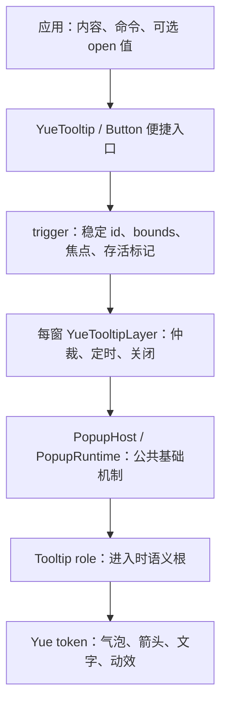

# 10 YueTooltip（Tooltips 文字提示）设计方案

状态：已在 Popup 基础层上实现，日期 2026-11-01。依赖为 `gpui-kit 0.8.0`、仓库维护补丁的 `gpui-base 0.8.0`、`gpui-pre 0.3.9`。公开 API、Button / Segmented 入口、分组平移、溢出提示和 Showcase 已接入。V1 仅对同尺寸、同 variant、安全路径执行平移；尺寸变化采用安全淡出/淡入，不声称完成尺寸 morph。实际验证与边界见第 12 节。

## 1. 目标与参考

为图标含义、作用范围、隐藏快捷键和被截断文本提供简短说明。提示贴近触发对象，不改变原布局、不接管焦点，也不阻止对象原本的命令。重要说明仍放在可见标签、帮助文字或校验信息中。

参考已保存到仓库，便于离线评审：

- [用户提供的 TDesign 页面截图](assets/tooltip-reference.png)：十二个位置、箭头开关、六种主题、四种触发、轻量提示、溢出、定时消失，以及与 Popup / Popconfirm 的组合。
- [用户提供的 HTML 原型](assets/tooltip-reference.html)：原文件为 `D:\000_Inbox\020_Browser\021_Edge\deepseek_html_20261101_7fea66.html`，原样保存，仅作为视觉与交互意图来源。
- [GPUI Kit 组件参考](../refer/GPUI%20Kit%20组件文档.html)：本地参考页 `.tt-b` 的 300ms 等待、200ms 进入、100ms 退出、4px 位移及无过冲缓动，作为 2026-11-01 动效优化依据。
- [Button](02-button.md)、[Dropdown](07-dropdown.md)、[接入与架构完善](08-integration-hardening.md)：沿用 Base-only、主题继承、稳定身份及测试约定。

本次实现遵循本文的交互契约；通用锚点、定位、箭头、呈现和关闭路由复用 [Popup 基础层](12-popup.md)，Tooltip 只持有提示特有的策略。

## 2. 范围及参考差异

| 参考内容 | Yue 契约 |
| --- | --- |
| 十二个位置 | 四个 side × 三个 align；默认 Top / Center；支持边缘翻转与窗口约束 |
| 带箭头 / 不带箭头 | 默认带箭头；跟随最终位置，指向实际触发对象 |
| default / primary / success / danger / warning / light | Default / Primary / Success / Danger / Warning / Light；读取 Yue 语义 token |
| hover / focus / click / contextmenu | 默认 HoverFocus；另有独立 Hover、Focus、Click、ContextMenu、Manual |
| destroyOnClose | 默认关闭后卸载；V1 不公开隐藏内容缓存开关 |
| 轻量提示 | 现有 Button `.tooltip(text)` 作为便捷入口，迁移后统一生命周期 |
| 超出省略 | 根据真实排版结果启用提示，不按字符数猜测 |
| 定时消失 | 可选 `auto_hide_after`；默认不启用，演示设为 2 秒 |
| Popup / Popconfirm 组合 | 支持操作浮层内的提示及共享 trigger；不在提示气泡里放交互控件 |
| 网页展示结构 | 采纳示例章节；不复制 coverage、贡献者和站点页脚 |

HTML 不能直接翻译为 GPUI 样式，原因如下：

1. `top-left` 使用 `right: 0`，实际右对齐；`top-right` 使用 `left: 0`，实际左对齐。Yue 按第 5 节明确映射，不复制反向命名。
2. HTML 只演示八个位置，`left-*` / `right-*` 的 CSS 始终垂直居中；截图中的十二位置需要完整实现。
3. `position: absolute` 和 `z-index: 1000` 没有窗口边缘避让、滚动锚点与卸载生命周期。
4. `white-space: nowrap` 会使长内容跑出窗口；Yue 先限宽、换行再定位。
5. `pointer-events: none` 不能维持移入气泡后的阅读；Yue 增加非交互 hover 保持，且不吞掉下层命令。
6. HTML 未实现焦点提示的 Escape 关闭，统一 `stopPropagation` 也会破坏组合；Yue 仅消费自己处理的关闭事件。

## 3. 实施前基线与 gpui-base 能力

以下表格保留实施前的能力核对，其中 Yue `tooltip.rs` 与原生 Tooltip 调用已被本轮迁移替换。上游路径相对各 crate 的 `src/`，版本由 `Cargo.lock` 确认；没有修改本机 Cargo registry 源码。

| 来源 | 已核实的源码能力 | 本方案用途或限制 |
| --- | --- | --- |
| Yue `tooltip.rs` | 私有 `view(text, theme, cx)` 创建文本 Entity，设置内边距、圆角、背景、文字色和字号 | 没有公共 Tooltip、role、箭头、限宽、主题 variant 或受控开合 |
| Yue `button.rs` / `segmented.rs` | 使用 GPUI 原生 `.tooltip(...)` 调用上述视图 | 不受 Base `TooltipDefaults` / `TooltipOverlay` 管理 |
| Base `tooltip.rs::Tooltip` | 无样式语义容器，提供 `Role::Tooltip`、`Styled`、`ParentElement` | 直接作为气泡语义根 |
| Base `TooltipDefaults` | 全局 show delay 默认 500ms，grace period 默认 300ms；每次请求读取 | 复用配置，不能每帧覆盖全局默认 |
| Base `TooltipRequest` | 内容 builder、trigger bounds、可选四方向 placement 和 show delay | 不含 align、offset、arrow、owner id、FocusHandle、open-change 回调 |
| Base `TooltipOverlay` | 每窗 Entity；延迟、宽限期内即时切换、任务取消、epoch、Enter / Switch renderer；移动端拒绝请求 | 不是完整 trigger、受控状态或模态层管理器 |
| Base `TooltipPositioner` | 包装 `Positioner::side`，默认 margin 4px；只公开 placement 和 children | 包装器无法设置十二方位及箭头所需的 resolved callback |
| Base `positioner.rs::Positioner` | `side`、`placement`、`align`、`offset`、`margin`、`on_position`，返回 `ResolvedPosition`；考虑装饰 inset；`occlude` 默认关 | 直接复用测量、翻转、clamp 和最终 side |
| Base `root.rs` | `RootPlugin`、`Root::register_plugin`、`Root::plugin`；插件每窗保留，建窗时捕获注册表 | 承载提示协调层，沿用 Kit 已有 Root；不能补装到已建 Root |
| Base `popover.rs` | `PopoverState` 管理开合、焦点转移/恢复和 deferred popover 登记 | 提示不接管焦点，不能直接套用它的开合生命周期 |
| Base motion / Presence | transition、Presence、reduced motion | 复用动效机制，视觉策略由 Yue 决定 |
| GPUI `elements/div.rs` / `app/context.rs` | 原生 tooltip、hoverable tooltip、show delay；`aria_label`、`aria_description`；焦点和窗口激活订阅 | 接入输入与描述；未发现 `aria-describedby` 关系接口 |
| Component `tooltip.rs` | `ManagedTooltipExt` 额外实现 bounds、弱存活标记、按下抑制、移除清理，依赖私有 `WindowState` | 这些不是 Base Overlay 自带能力；不启用 Component feature 或引用其私有状态 |

Base TooltipOverlay 内部 deferred priority 为 200，popup 使用 `POPUP_PRIORITY`。这是 GPUI 绘制顺序；已有 `--layer-tooltip: 40` 表示设计相对层级，不能原样当作 deferred priority，更不能照搬网页 `z-index`。

### 3.1 架构决定

实施前置依赖为 [Popup 基础浮层](12-popup.md)：先实现基础层并迁移 Dropdown，通过回归后再实现 Tooltip。V1 使用私有 `YueTooltipLayer` 统一所有 Yue 提示的时序、owner 仲裁及内容交接，通过 PopupHost 复用锚点、定位、箭头、Presence、保护区域与层级路由；不再直接组装第二套 Positioner / deferred / dismiss registry。气泡按 Base Tooltip 的同一 `Role::Tooltip` 契约构建，退出根省略 role；`TooltipDefaults` 提供时序配置。每窗一个当前提示请求，公共 PopupRuntime 负责浮层登记，二者不是两份业务 open。

不把 Base `TooltipOverlay` 嵌套在第二个 Positioner 里：Overlay 已在内部定位，renderer 也拿不到最终 `ResolvedPosition`，会造成双重偏移且无法可靠画箭头。现有请求接口不足，因此任务调度、owner 仲裁和开合通知由 Yue 私有层补齐；这是新增行为，不能声称 Base 已提供完整内核。

Base 接口缺口和依赖扩展统一在 Popup 基础层解决，尤其是同帧 side 锚点与候选求解；详见其第 3.1 / 7 节。V1 不修改 registry 源码、不读取私有字段，不复制 Base 定位算法；未经验证的基础能力不能在 Tooltip 中另行兜底实现。



`yue_component::init` 在开窗前幂等注册公共 PopupRuntime，并安装 Tooltip controller；共用同一个 Base Root，不为 Tooltip 再建独立层级或关闭路由。宿主继续使用 `gpui_kit::open_window` 或显式 Base Root。缺少 Root 时开发构建给出明确诊断，发布构建保留原控件、略去提示；不自动嵌套 Root 或创建新窗口。已经打开的窗口需要在注册后重建。

## 4. 公共 API

类型在 `yue_component` 根部重导出，字段私有。`YueTooltip` 是 `RenderOnce` builder，保留行为归窗口插件与稳定 id 对应的 keyed state；调用方无需为每个短提示创建 Entity。

```rust,ignore
use yue_component::{
    TooltipAlign, TooltipPlacement, TooltipTrigger, TooltipVariant,
    YueButton, YueTooltip,
};
use yue_component::gpui_kit::IntoElement as _;

// builder 接收稳定 FocusHandle，实际控件使用同一 handle。
YueTooltip::new("export-help", theme, "导出当前筛选的结果")
    .placement(TooltipPlacement::Top)
    .align(TooltipAlign::Center)
    .trigger_with(|focus, _, _| {
        YueButton::new("export", "导出…")
            .track_focus(focus)
            .into_any_element()
    });

// 共享宿主已有的焦点；path_control 本身也使用 self.path_focus。
YueTooltip::new("path-help", theme, self.full_path.clone())
    .track_focus(&self.path_focus)
    .trigger(path_control);

YueTooltip::new("permission-help", theme, "需要项目管理员授权")
    .trigger_mode(TooltipTrigger::Click)
    .variant(TooltipVariant::Warning)
    .show_arrow(false)
    .trigger_with(|focus, _, _| {
        YueButton::new("permission", "权限说明")
            .track_focus(focus)
            .into_any_element()
    });
```

上述示例省略了宿主字段；组件模块中的独立构造示例作为 doctest 编译验证。`trigger_with` 将同一个 FocusHandle 交给实际按钮，不新增 Tab stop。

| 方法 | 默认及契约 |
| --- | --- |
| `new(id, theme, text)` | id 为 `impl Into<ElementId>`，text 为 `impl Into<SharedString>` |
| `.use_default_theme()` / `.theme(theme)` | 沿用 Yue 应用默认主题 / 显式实例覆盖规则 |
| `.trigger(element)` | 恰好一个内容根；不改其语义、布局或 Tab 顺序，也可包静态文本 |
| `.trigger_with(builder)` | `FnOnce(&FocusHandle, &mut Window, &mut App) -> AnyElement`；handle 必须挂到实际控件 |
| `.track_focus(&FocusHandle)` | 借用控件已有 handle，不再创造焦点目标；与 builder 同用时传入该 handle |
| `.trigger_mode(TooltipTrigger)` | HoverFocus；枚举 HoverFocus / Hover / Focus / Click / ContextMenu / Manual |
| `.placement(TooltipPlacement)` | Top；枚举 Top / Bottom / Left / Right |
| `.align(TooltipAlign)` | Center；枚举 Start / Center / End |
| `.show_arrow(bool)` | true |
| `.variant(TooltipVariant)` | Default；枚举 Default / Primary / Success / Danger / Warning / Light |
| `.show_delay(Duration)` | 未设置时每次请求读取 Base defaults；只作用于 hover |
| `.auto_hide_after(Option<Duration>)` | None；从实际打开时计时 |
| `.dismiss_on_press(bool)` | true；Hover / Focus 提示默认按下关闭。数值操控反馈可设 false，拖动时保留提示 |
| `YueTooltip::gap(Rems)` | 可选实例间距；默认读取 `--tooltip-gap`，保留焦点环 clearance；负数和非有限值会 panic |
| `.disabled(bool)` | false；只禁用提示，不改变原控件可用性 |
| `.open(bool)` | 未设置时内部管理；设置后由调用方控制 |
| `.on_open_change(handler)` | `Fn(&bool, &mut Window, &mut App)`，报告请求状态，不是动画完成通知 |

连续工具栏提供 `YueTooltipGroup::new(id, axis)`，`axis` 为 GPUI `Axis::Horizontal` / `Axis::Vertical`。它是无可见样式的组合边界，不改变按钮原布局或 Tab 顺序；普通 `.child(...)` / `.children(...)` 负责组合，组内 Tooltip trigger 登记自己的实际几何。没有 Tooltip 的相邻按钮用`.protected_child(id, element)` 显式登记为避让区域。分组、受保护控件与动效契约见第 5.5 / 8.3 节；不能仅凭坐标接近把不同工具栏自动归为一组。

保留 Button `.tooltip(text)` 原签名，增加 `.tooltip_options(TooltipOptions)`。该配置仅含位置、对齐、主题、箭头、时序和 `dismiss_on_press` 策略，不含 trigger、open 或任意内容。`TooltipOptions` 和 `YueTooltip` 均提供 `.dismiss_on_press(bool)`；Slider 设为 false，让按压及拖动过程持续显示实时数值，Escape 仍可关闭，普通帮助提示的默认行为不变。便捷入口固定 HoverFocus，高级场景使用显式 `YueTooltip`。同一个对象只安装一个入口。

V1 不提供气泡任意 `Styled`、PopupProps 透传、HTML / 富交互内容、任意 z-index、隐藏内容缓存或自定义动画曲线。气泡限宽由 token 决定，trigger 的外部布局仍归调用方。

### 4.1 开合所有权

- 非受控：提交开合后回调一次。受控：输入只请求新值，宿主不写回则保持旧值；外部同步不反向回调。
- hover 延迟到期才请求 true；外部直接传入 true 则立即显示，不再等待 hover delay。
- 同一次请求去重；调用 handler 前释放内部借用，允许宿主同步关闭页面或移除 trigger。
- disabled、空白文本、失效锚点、窗口失活及模态遮挡是硬性呈现条件。即使 open=true 也不画悬空提示；只请求关闭一次，硬性关闭后不会每帧重开，须经历 false→true 或新的有效触发周期。
- 每窗只有一个显示槽，新请求取代旧 owner。旧定时任务、退出回调或 hover-leave 不得关闭新 owner。旧受控 owner 收到一次关闭请求，不能因持续渲染 true 抢回显示槽。

## 5. 十二方位与定位

### 5.1 固定映射

V1 定义 LTR 的物理方向，不声称自动 RTL 镜像；未来支持 RTL 时需整体定义 Start / End 并追加兼容测试。

下表表示调用方请求的方位。排版测量后，先应用第 5.4 节的特殊情况，得到有效方位，再执行定位与窗口避让；退化同时作用于气泡对齐和箭头位置。

| 参考名 | placement | align | 初始对齐 |
| --- | --- | --- | --- |
| top-left | Top | Start | 左边缘 |
| top | Top | Center | 水平中心 |
| top-right | Top | End | 右边缘 |
| bottom-left | Bottom | Start | 左边缘 |
| bottom | Bottom | Center | 水平中心 |
| bottom-right | Bottom | End | 右边缘 |
| left-top | Left | Start | 顶边 |
| left | Left | Center | 垂直中心 |
| left-bottom | Left | End | 底边 |
| right-top | Right | Start | 顶边 |
| right | Right | Center | 垂直中心 |
| right-bottom | Right | End | 底边 |

### 5.2 定位流程和边缘约束

1. trigger 在 prepaint 登记窗口坐标下的实际 bounds 及可见区域。零面积、已卸载、完全滚出裁剪区的锚点不显示。
2. 气泡先按最大宽度换行并测量，取得实际行数及外宽 / 外高；按第 5.4 节得到有效 placement / align，再交给 PopupHost，由基础层调用 Base Positioner。
3. Base 尝试首选侧，再尝试相反侧；均不足时选余量较大的一侧并 clamp。它不在四边中全局择优，也不会缩小过大内容。
4. 通过 `on_position` 读取最终 side / bounds；翻转保留有效方位的交叉轴 align，再由 clamp 修正。箭头按最终结果指向 trigger 中心。
5. 箭头纳入几何包络。`--tooltip-gap` 是受保护 trigger 外缘到箭尖的最小余量；保护边界还保守计入焦点环宽度及 offset。因此相对原 trigger bounds，有箭头的表面间距为 `gap + focus_clearance + arrow_depth`，无箭头为 `gap + focus_clearance`。本库维护的 Base 补丁已计入 offset-fit，Popup 仍验证完整包络和重叠；没有安全候选时省略提示，不能覆盖 trigger。未得到有效结果前不绘制错误位置，也不循环重试。
6. clamp 后箭头位置限制在圆角安全区，不能仍画在旧 side 或越过圆角。锚点已远到无法形成可信指向时隐藏提示。

滚动、resize、内容、字体、rem 及主题几何改变均更新同一请求，不重启 show delay、不重播进入动画。优先在 trigger prepaint 更新注册表，由 deferred surface 读取本帧数据；不能照搬 Dropdown 的前帧锚点路径后宣称同帧跟随。如果技术验证只能使用前帧，须记录实窗限制并修正实现计划，验收目标为无可见滞后。

### 5.3 八个非居中方位的箭头坐标

未触发第 5.4 节退化规则时，`top-left`、`top-right`、`bottom-left`、`bottom-right`、`left-top`、`left-bottom`、`right-top`、`right-bottom` 的小三角不能使用固定边缘偏移，也不能统一放在气泡边缘的 50% 处。位置由气泡实际宽高、trigger 尺寸和最终定位共同计算。以下为 Yue 的明确设计规则，不声称参考截图或 HTML 已提供同样公式。

坐标以**气泡矩形表面左上角**为原点，定义：

- `W` / `H`：气泡排版后的外宽 / 外高，包含内容、内边距和边框，不包含向外突出的三角形。不能直接使用文本宽高。
- `(Px, Py)`：翻转及窗口 clamp 后，气泡表面左上角的窗口坐标。
- `(Cx, Cy)`、`Tw` / `Th`：trigger 的中心窗口坐标及实际宽 / 高。
- `r`：气泡圆角半径，`b`：三角形底边半宽，`d`：三角形深度；安全内缩 `s = r + b`，确保整个三角形底边避开圆角。

先计算 trigger 中心在气泡局部坐标中的投影，再约束三角形底边中心：

```text
x = clamp(Cx - Px, s, W - s)   // Top / Bottom 使用
y = clamp(Cy - Py, s, H - s)   // Left / Right 使用
```

没有触发第 5.4 节、没有发生翻转或窗口 clamp、且按第 5.1 节边缘对齐时，八个方位可展开为下表。`clampW(v)` 表示 `clamp(v, s, W-s)`，`clampH(v)` 表示 `clamp(v, s, H-s)`；三角形底边中心和尖端均为气泡局部坐标。

| 方位 | 沿边坐标 | 三角形底边中心 | 三角形尖端 |
| --- | --- | --- | --- |
| top-left | `x = clampW(Tw / 2)` | `(x, H)` | `(x, H + d)` |
| top-right | `x = clampW(W - Tw / 2)` | `(x, H)` | `(x, H + d)` |
| bottom-left | `x = clampW(Tw / 2)` | `(x, 0)` | `(x, -d)` |
| bottom-right | `x = clampW(W - Tw / 2)` | `(x, 0)` | `(x, -d)` |
| left-top | `y = clampH(Th / 2)` | `(W, y)` | `(W + d, y)` |
| left-bottom | `y = clampH(H - Th / 2)` | `(W, y)` | `(W + d, y)` |
| right-top | `y = clampH(Th / 2)` | `(0, y)` | `(-d, y)` |
| right-bottom | `y = clampH(H - Th / 2)` | `(0, y)` | `(-d, y)` |

其余四个居中方位在没有窗口 clamp 时，Top / Bottom 的 `x = W/2`，Left / Right 的 `y = H/2`。发生窗口 clamp 后，所有十二方位都必须回到中心投影公式，不再使用这张表的简化式；三角形所在边由最终 side 决定。例如 top-right 翻转到 Bottom / End 后，应画在气泡顶边，不能仍按 top-right 的底边绘制。

当内容换行、文字变长、字体或 rem 改变时，先更新 `W/H` 和最终 bounds，再计算箭头；不能复用旧尺寸下的偏移。Top / Bottom 的沿边位置主要受 `W` 约束，Left / Right 主要受 `H` 约束；另外一个尺寸决定三角形所在边的坐标及气泡距 trigger 的位置。

例如未 clamp 的 top-right，trigger 宽 32、气泡宽 120 时，箭头中心横坐标为 `120 - 32/2 = 104`；气泡内容变长使宽度增至 200 时，坐标相应变成 184。多行内容的 left-bottom 在 trigger 高 32、气泡高从 48 变为 80 时，纵坐标由 32 变为 64。以上是假设未触及安全区的逻辑尺寸示例，不是实现中的固定像素常量。

如果相关边长小于 `2s`，没有合法的安全区，不得调用上下界倒置的 clamp。V1 省略整个本次提示，不暗中关闭调用方请求的箭头。Light 的安全区还计入半描边宽。安全区约束可能使尖端无法精确对准 trigger 中心，此时允许在 trigger 对应边范围内偏移；Popup 的显式 `arrow_within_anchor` 证明该范围，无法可信指向时同样省略提示。

### 5.4 特殊尺寸下的方位退化

以下两条规则优先于第 5.3 节非居中方位公式。退化表示**气泡定位和小三角位置都等价于对应的居中方位**，不能保留 Start / End 的气泡位置而只把箭头移到中间。即使 `.show_arrow(false)`，气泡定位仍执行同一规则。

| 条件 | 请求方位 | 有效方位 | 无窗口避让时的气泡及箭头 |
| --- | --- | --- | --- |
| 最终内容只有一行 | left-top / left-bottom | Left / Center，即 left | 气泡与 trigger 垂直中心对齐；小三角位于气泡右侧中间，底边中心 `(W, H/2)` |
| 最终内容只有一行 | right-top / right-bottom | Right / Center，即 right | 气泡与 trigger 垂直中心对齐；小三角位于气泡左侧中间，底边中心 `(0, H/2)` |
| 气泡外宽 `W <= Tw` | top-left / top-right | Top / Center，即 top | 气泡与 trigger 水平中心对齐；小三角位于气泡下方中间，底边中心 `(W/2, H)` |
| 气泡外宽 `W <= Tw` | bottom-left / bottom-right | Bottom / Center，即 bottom | 气泡与 trigger 水平中心对齐；小三角位于气泡上方中间，底边中心 `(W/2, 0)` |

“一行”以最大宽度约束下实际排版得到的行数为准，不能根据字符串没有换行符、字符数或某个固定高度判断。长文字自动换行后不再满足此条件；显式换行也计入行数。

`W` 使用最终尺寸约束下气泡的实际外宽，包含内边距、边框，不包含箭头；`Tw` 为 trigger 的实际外宽，二者使用同一坐标单位。等宽也退化，不使用严格小于判断。该宽度规则对单行和多行内容都有效；行数规则只作用于 Left / Right，宽度规则只作用于 Top / Bottom，两者不跨轴推广。

计算顺序为：保留请求方位 → 约束并测量内容 → 应用对应退化规则 → 使用有效方位定位 → 进行 Base 翻转及窗口 clamp → 计算最终箭头。两种条件同时满足时，按请求 side 对应的规则处理，结果仍是该 side 的 Center，不切换到另一个轴。翻转后继续保留有效 Center，例如退化后的 Top / Center 翻到下方仍是 Bottom / Center。

窗口避让依然执行第 5.2 / 5.3 节的统一规则；退化后的结果必须与直接请求 left / right / top / bottom 的结果一致。clamp 若使气泡不能继续与 trigger 中心对齐，箭头按最终 bounds 重新投影，不能为保持局部居中而错误指向；这是所有居中方位共有的边缘处理。

内容、字体、rem、气泡宽度约束或 trigger 尺寸改变时，从原请求方位重新判断，不将请求值永久写成 Center：单行变为多行时，Left / Right 恢复原 Start / End；`W` 从不大于 `Tw` 变为大于 `Tw` 时，Top / Bottom 恢复原 Start / End。重新判断不产生 open-change，也不重启显示延迟或进入动画。

### 5.5 按钮避让与连续显示位置

**Tooltip 在静止、进入、平移和退出的任何可见帧都不能遮住受保护按钮。** 验证范围包括气泡矩形、箭头和可见阴影，也包括按钮外侧的可见焦点环。仅设置鼠标穿透不满足此要求；能点击但看不清按钮仍是遮挡。

单个 Tooltip 至少保护自己的 trigger。`YueTooltipGroup` 保护组内所有 Tooltip trigger 和通过 `protected_child` 登记的按钮，包括当前未 hover、禁用及没有提示的按钮。其他邻近控件也必须显式登记，不能声称 Base Positioner 会自动发现整棵 UI 树中的按钮。受保护区域来自当前布局及有效裁剪范围，不按标签长度估算。

| 组合 | 默认显示位置 | 连续 hover 的移动方式 |
| --- | --- | --- |
| 同一行按钮 / Horizontal 组 | 优先整行上方，空间不足时整行下方 | 保持同一 side 和靠近按钮的一条水平边，沿 X 轴移动 |
| 同一列按钮 / Vertical 组 | 优先整列右侧，空间不足时整列左侧 | 保持同一 side 和靠近按钮的一条垂直边，沿 Y 轴移动 |
| 独立按钮 | 使用请求方位及第 5.4 节退化规则 | 跨组不做长距离飞行，按第 8.3 节重新呈现 |

组内未显式指定 placement 的 Tooltip 才采用轴向默认；显式 placement 仍是偏好，不能凌驾于避让要求。同列默认右侧只属于 Group；独立 Tooltip 的默认仍是 Top。

同一连续 hover 会话内保持当前安全 side，不能每换一个按钮就上下 / 左右翻转。每个新目标先按第 5.4 节确定有效 align；以整组受保护区域的上 / 下 / 左 / 右边界建立外侧显示轨道，而非分别围绕每个按钮另选高度。只要轨道安全，就保持它不变。内容尺寸变化时，以靠近按钮的表面边为基准：上方的气泡向上增高，下方向下增高，右侧向右增宽，左侧向左增宽；避免内容变化使表面朝按钮一侧侵入。

组级轨道通过调整 Base Positioner 的 offset 计算，窗口约束仍交由 Base；最终结果必须重新验算，不能对 clamp 后的坐标直接加未经验证的位移。轨道的共同边界由显式组的布局决定；独立 Tooltip 不受组级定位覆盖。

安全检查顺序为：当前侧轨道 → 相反侧轨道 → 与组轴垂直的安全侧。候选均通过 Base Positioner 求解并检查完整包络。Group 的外侧轨道规则在不遮挡与视觉连贯的前提下决定间距，允许比单个 trigger 的最小 gap 更远。所有候选均不安全时，本次省略提示，保留原按钮名称和持久帮助入口；不能将气泡 clamp 到按钮上方覆盖它。

平移不仅检查起点、终点，还要检查完整路径。V1 使用源 / 目标气泡完整包络的保守扫掠区域与受保护区域做相交测试；无法证明安全则不执行平移，不能依赖少量采样帧猜测。布局在运动中变化时逐帧复验，失效立即停止可见运动并重新选安全位置，不带着旧目标穿过按钮。

换侧、跨组、跳过非相邻按钮、距离超限或扫掠区域不安全时不平移，按第 5.6 / 8.3 节区分安全换位或重新等待，不从上方斜穿按钮飞到下方。Tooltip 的 hover 保持区域仅覆盖实际可见气泡，不扩展到整条移动通道，避免掠过的气泡抢走按钮 hover 或建立错误的延长显示循环。

### 5.6 平移资格：同组不等于可以任意远地移动

平移只服务短距离、连续的指向操作，以下条件必须**全部满足**。这些是 Tooltip 的策略，Popup 基础层不硬编码按钮距离或 hover 时序。V1 还要求自然尺寸及 variant 一致；否则按热会话安全换位。

| 条件 | 判定 |
| --- | --- |
| 同一组及输入范围 | group id、axis、有效 parent / scope 相同，不跨工具栏或模态层 |
| 同一行 / 列 | 实际布局处于同一轴向带；交叉轴区间的重叠长度至少为较小交叉轴尺寸的 50%，换行后的按钮不算同一行 |
| 视觉相邻 | 按当前可见布局在主轴排序，A / B 之间没有其他已登记按钮；非提示按钮也计入，不按“有 Tooltip 的列表”跳过它 |
| 按钮间隔足够小 | A / B 沿主轴的边缘净距 `g <= G`；重叠时按 0 计。默认 `G = 24px` 设计基准，随 rem 缩放 |
| 目标距离足够小 | A / B 中心距离 `d_anchor <= D`；默认 `D = 160px` 设计基准，随 rem 缩放 |
| 实际运动距离也足够小 | 从当前已显示气泡到新目标，四对同名矩形角的最大位移 `d_visual <= D`；不能只比较 A / B 的目标坐标 |
| 会话连续 | 已有可见表面或仍在 grace 内；只有 pending、尚未出现过的提示不能从隐藏位置“飞入” |
| 同一安全侧与轨道 | 当前与目标最终 side 相同，外侧轨道无需迁移；整条扫掠路径通过保护区域及窗口约束 |
| 允许动态效果 | reduced motion 关闭，窗口有效且 owner 存活 |

`24px` 和 `160px` 是本设计选定的初始参数，待 Showcase 实窗验证后统一调整，不是框架或平台标准。通过 `--tooltip-move-max-gap` / `--tooltip-move-max-distance` 解析，调用点不散布固定 px。距离统一取同一窗口的逻辑坐标，不再次乘 DPI。阈值用 `<=`，超过即禁止平移，不通过延长 150ms 时长让远处目标慢慢飞过去。

计算 `d_visual` 时必须从**当前动画采样位置和尺寸**出发。快速 A→B→C 时，虽然 A/B、B/C 分别相邻且间隔小，但气泡可能仍留在 A 附近；若当前位置到 C 已超过 D，应中止平移并安全换位，不允许连续改目标累积成长距离追赶。

短距离会话与平移资格分别判断：同组、同轴、相邻、`g <= G`、`d_anchor <= D`、grace 内则可继续热会话；若仅因换侧、轨道变化、`d_visual > D` 或路径不安全而禁止平移，保留零额外 show delay，在安全位置淡出/淡入。跨组、非相邻、按钮间隔或目标中心距离过大、grace 到期则结束旧会话，新目标按普通 show delay 重新等待，不能因鼠标在 300ms 内跃到远处就跳过等待。

旧提示退出与新目标的等待可以同时进行；show delay 从新目标首次有效进入时开始。等待期间离开即取消，仅保留最新目标。原表面仅允许自身 4px 回收位移，不能边淡出边跨越远处按钮。

## 6. 交互与生命周期

### 6.1 输入与关闭

| 模式 | 打开 | 关闭及事件约束 |
| --- | --- | --- |
| HoverFocus | hover 按 delay；获焦立即打开 | hover、focus 取并集，均离开才走 grace；Escape / 原命令按下立即关闭 |
| Hover | pointer 停留达到 delay | 离开 trigger 与气泡联合区域后走 grace |
| Focus | 实际控件 handle 获焦立即打开 | 失焦关闭；Escape 后持续聚焦也不重开，直到下一焦点周期 |
| Click | 控件语义激活切换，Enter/Space 等效 | 再次激活、外部按下、Escape；不能伪造 ClickEvent |
| ContextMenu | 区域内右键打开，锚定 trigger | 外部按下、Escape；仅此模式消费右键，重要说明另有可见 / 键盘入口 |
| Manual | 调用方 open=true | 调用方写回 false；Escape / 外部关闭仅发送请求 |

`trigger_with` 使用一个实际控件焦点目标。`.trigger(element)` 未共享 handle 时只能提供指针路径，不能宣称 Focus 支持，也不自动把 wrapper 变为第二个 Tab stop。静态文本若需键盘读取，由宿主显式提供有名称的焦点目标。

HoverFocus 不得因鼠标离开而关闭仍聚焦的提示。Click / ContextMenu 不与 hover 叠加，避免刚关闭即重开。Button 便捷入口在原命令按下时先关闭并抑制提示，直至 pointer / focus 原触发周期结束；原命令正常执行一次。

### 6.2 时序

Yue 初始化时仅在调用方未安装 `TooltipDefaults` 的情况下，安装 300ms show delay（引用 `--duration-300`）与 300ms grace period。后续仍逐次读取 Base 配置；已有全局值和实例 `.show_delay(...)` 保持优先。Focus、Click、ContextMenu、Manual 不等待 hover delay；输入延迟与动画时长分开。

| 阶段 | 输入 | 结果 |
| --- | --- | --- |
| Hidden | 有效 hover-enter | Waiting，记录 owner、generation、show task |
| Waiting | delay 到期且 owner 存活 | Open；过期任务无效 |
| Waiting | 离开 / 按下 / 卸载 | 取消，不能稍后冒出 |
| Open | 所有输入来源离开 | Grace；重入取消关闭 |
| Open / Grace | 进入另一有效 hover owner | 按第 5.6 节区分热会话或新会话；满足全部平移资格才移动，短距但不安全则换位，远距 / 跨组等重新等待 |
| Open | Escape / 原命令按下 / 硬性失效 | 立即退出，清任务并设置重开抑制 |
| Open | auto-hide 到期 | 请求关闭，同一触发周期不再重开 |
| Exiting | 同 owner 再次进入 | 从当前采样值续接 |
| Exiting | 动画完成 | 卸载气泡和 hover 区域 |

移入气泡仅维持阅读，不获得焦点、不提供文本选择或命令。通过 grace 跨越 gap；非阻挡 hover 探测不调用 Positioner `.occlude()`，不铺设吞事件的全窗透明遮罩。退出结束后不能保留透明命中节点。

`auto_hide_after(Some(2s))` 从实际进入 Open 开始；换 owner 重置，同 owner 重画或重测不重置。消失后需离开再进入、重新获焦或显式激活才重开，不在持续 hover 中循环闪现。此策略为可选演示，不作为阅读型说明默认行为。

### 6.3 存活及清理

请求持有稳定 owner id、弱存活标记、generation；相同 bounds 不能替代身份，缓存子树也不应因未逐帧 render 而失效。移除 trigger 会取消其 show / grace / auto-hide，并清除正在显示的请求；旧标记不得影响后来占据相同位置的控件。

任务使用弱 Entity / Window handle。页面切换、虚拟化、禁用、内容变空及窗口销毁都要清理。退出动画结束后卸载 content Entity。render 不得每帧创建 timer、订阅、FocusHandle 或无条件 notify。

## 7. 浮层组合、焦点与无障碍

提示没有 focus trap、Tab stop 或主动 focus。开关提示时焦点留在原控件。Escape 仅在提示实际可关闭时被消费，先关最上层提示，下一次 Escape 才交给父 Popover / Dialog；无提示时不干预宿主快捷键。

使用 PopupRuntime 的 Runtime dismiss route 接入窗口输入，Tooltip 不重复绑定全窗 Escape / outside-press handler。基础层通过每窗 RootPlugin 持有的 `intercept_keystrokes` 处理 Escape，按 window id 过滤，因此没有焦点的 hover 提示也能关闭；outside press 由非阻挡 canvas 的真实鼠标观察进入同一路由。Tooltip 仅观察原 trigger 的 Enter / Space 激活，不消费按钮命令。窗口失活立即清除 pending 和当前提示。

| 组合 | 契约 |
| --- | --- |
| Tooltip trigger 也打开 Popover / Dropdown | 按下或键盘激活先关提示，再由操作浮层接管焦点，原命令继续传播 |
| Popover / Dialog 内使用 Tooltip | 可显示在对应 surface 上方，仅接受当前有效输入层来源 |
| 打开更高模态层 | 旧层 pending 和当前请求失效，背景按钮提示不得漏到模态层上 |
| 气泡里放 Popover trigger | V1 不支持；改用独立 Popover / HoverCard |
| 截图“Popup 在 Tooltip 内部” | 视为共享 trigger 的包装组合，不把交互按钮放进提示气泡 |

层级资格过滤不能只靠增大 priority。公共 PopupRuntime 维护 parent / scope 与区域，Tooltip 提交自己的资格条件而不另建注册表。Base TooltipOverlay 不提供完整模态过滤，不能引用 Component 私有 WindowState。Yue 当前没有公共 Popup / Popconfirm facade；本实现依赖的是内部 Popup 基础层，不顺带承诺完整用户组件。

当前可达的模态判定入口是 Base `active_focus_trap(window, cx)`（公开但标记 `doc(hidden)`）及 GPUI `FocusHandle::contains(other, window)`。有活动 trap 时，只接受其包含的共享 trigger handle；没有可验证 handle 的静态区域采取保守策略，省略提示。该查询基于最近渲染的焦点树，模态切换帧须撤销旧请求并在有效布局后重验。它不能完整表达所有非模态浮层的所有权；普通 Popover 仍依靠激活关闭、真实 hit-test 和 owner 生命周期协调，并将该组合列为技术验证项。

- 气泡根使用 Base `Tooltip` / `Role::Tooltip`，可访问文本与可见说明一致。
- 图标控件始终有自己的 `aria_label`；提示不是名字的唯一来源。补充说明可由原控件 `aria_description` 提供，气泡隐藏时也能读取。
- 不覆盖调用方已有 description；由宿主合并或显式提供。通用 wrapper 不能凭空给任意 child 添加描述。
- 不伪造 DOM `aria-describedby` / `aria-controls`；当前未核实到对应关系 API。观察层树通过不代表 Windows UIA / 屏幕阅读器已经正确朗读，需实机验证。
- 禁用 Button 不增加 focus 入口；原因优先放邻近说明。hover 说明可由独立命中 wrapper 提供；只有显式“为何不可用”控件才加入 Tab 顺序。
- Success / Warning / Danger 必须由文字说明含义，不以颜色独占表达；Tooltip 不替代持续校验或重要状态。

## 8. 视觉及 Token

紧凑圆角矩形；单行随内容收缩，多行左对齐。默认不用胶囊，不改变 trigger 的背景、边框或焦点环。保留 Yue 现有 Tooltip 规格，不复制 HTML 的 6×12px 内边距。

| 项目 | 已有 / token | 规格 |
| --- | --- | --- |
| 背景 / 前景 | `--box-background-tooltip` / `--box-color-tooltip` | 跟随当前反色表面；暗色不强制黑底白字 |
| 内边距 | `--box-padding-inline-tooltip` / `--box-padding-block-tooltip` | 当前 8 / 4px；通过 rem adapter 解析 |
| 字号 / 行高 | `--box-font-size-tooltip` / `--line-height-sm` | 当前 12 / 16px；完整文字换行 |
| 圆角 | `--box-border-radius-tooltip` | 当前 4px；箭头避开圆角 |
| 最大宽度 | `--tooltip-max-width` | 320px 设计基准；按 rem 缩放，不超过可用窗口宽 |
| trigger 间距 | `--tooltip-gap` | 引用 `--space-4`，指箭尖到 trigger 受保护外缘的余量；另计焦点环 |
| 箭头 | `--tooltip-arrow-size` | 基准宽 8px、深 4px 的三角形；同气泡背景 |
| 窗口边距 | `--tooltip-viewport-margin` | 引用 `--space-8`；Base 另计平台装饰 inset |
| 阴影 | `--tooltip-shadow` | 默认无；Light 通过细边界区分，不沿用菜单大阴影 |
| 进入 / 退出 | `--tooltip-duration-enter` / `--tooltip-duration-exit` | 200 / 100ms，分别引用 `--duration-200` / `--duration-100` |
| 进入 / 退出位移 | 已有 `--space-4` | 4px 设计基准，按 rem 缩放；进入向外到达静止位置，退出向 trigger 方向回收 |
| 缓动 | `--tooltip-ease-enter` / `--tooltip-ease-exit` | 引用 `--ease-enter` / `--ease-exit` |
| 平移 | `--tooltip-duration-move` / `--tooltip-ease-move` | 150ms，引用 `--duration-150` / `--ease-enter`；快速起步、柔和停靠，无过冲 |
| 平移距离边界 | `--tooltip-move-max-gap` / `--tooltip-move-max-distance` | 24 / 160px 设计基准，按 rem 缩放；前者限制按钮边缘间隔，后者限制锚点距离及当前表面到目标的实际位移 |
| 相对层级 | 已有 `--layer-tooltip` | 设计顺序，GPUI priority 集中映射 |

上述 13 个 `--tooltip-*` token 已写入 Yue Design System 的 `packages/tokens/src/component-tokens/tooltip.css`、组件索引及词汇登记，并同步到本库 inventory / `theme/generated.rs`；没有动态缺名 fallback。阴影按完整层列表解析并提交 visual outsets，当前默认 `none`。

### 8.1 六种主题

| variant | 背景 / 文字来源 | 说明 |
| --- | --- | --- |
| Default | `--box-background-tooltip` / `--box-color-tooltip` | 无边框 |
| Primary | `--accent-solid` / `--on-accent` | 仅在确有强调意义时使用 |
| Success | `--success-solid` / `--on-success-solid` | 文字说明成功含义 |
| Danger | `--error-solid` / `--on-error-solid` | API 为 Danger，底层语义为 Error |
| Warning | `--warning-solid` / `--on-warning-solid` | 文字说明风险或前提 |
| Light | `--box-background-popover` / `--box-color-popover` | 使用 `--box-border-color-popover` / `--box-border-width-popover`；暗色时仍用主题表面色 |

箭头填充随 variant，Light 的边界连续且连接处无双线。variant 不改尺寸、字重和圆角。文字对比度目标至少 4.5:1，需测量所有已支持主题及 neutral tone，不能仅凭截图判断。

### 8.2 长文本与真实溢出

中文、英文、路径、无空格 URL 均在约束内换行，不再次省略、不提供气泡滚动。如果窄窗 / 高缩放下仍容不下完整短说明，由页面改用持久帮助区域，不能裁掉内容后宣称可读。

`YueOverflowTooltip::new(id, theme, full_text)`，由同一组件负责可见文本的单行省略、真实测量及按需提示。提供 `.width(...)` / `.max_width(...)` 和共享焦点接入；这些约束控制可见文本槽，不是气泡宽度。

只有完整 shaped text 的自然宽度超过文本槽可用宽度时启用。内容、字体、字重、容器宽、rem、DPI 变化均重测；恢复完整显示后取消 pending 并关闭提示。缓存键包括这些输入，不按字符数估宽。V1 不支持任意 child 溢出推断、多行 clamp 或富文本截断。

### 8.3 动效

选择“首次淡入并微移、连续平移、离开淡出并回收”。同组连续 hover 共用一个可见气泡表面；从 A 到 B 的感受是同一个提示移到下一个按钮，而非 A 消失后 B 再出现。不采用有过冲的弹簧、弹跳、整体缩放、逐字出现或运动模糊。

参考页的延迟、进入 / 退出时长及 4px 位移按四侧方向推广到十二方位，复用 Popup 的 Presence / 定位采样。保留 Yue 的键盘焦点无等待、气泡可移入阅读及 300ms grace；不照搬参考页的 `pointer-events:none`、离开即关闭和全页面 400ms warm 标记。只有显式同组、相邻且路径安全时才免等待续接，不能把任意远处按钮也变成热目标。

| 场景 | 时序与视觉 |
| --- | --- |
| 首次 hover | 默认停留 300ms 后，200ms 淡入并沿最终 side 向外移动 4px 到静止位置；全程保护 trigger、焦点环和完整箭头包络 |
| 同行短距相邻按钮 A→B | 满足第 5.6 节全部条件后，不重等 300ms；在共同外侧轨道上水平平移 150ms，表面维持可见，不重播进入 |
| 同列短距相邻按钮 A→B | 同上，在共同外侧轨道上垂直平移 150ms |
| 经过按钮间的空隙 | 300ms grace 内保留当前位置；只有仍满足短距离热会话条件才续接 |
| 快速 A→B→C 或折返 | 从当前采样位置改目标，并重新检查实际位移上限；取消旧目标，不排队，不积累成长距离追赶 |
| 离开整组和气泡 | grace 结束后 100ms 淡出并沿最终 side 向 trigger 方向回收 4px；不是向旧按钮进行长距离返回 |
| 短距热会话内尺寸或 variant 改变 / 换侧 / 路径不安全 / 运动距离超限 | 不平移；旧位置安全淡出 100ms，隐藏时换到安全目标，再 200ms 淡入；只执行各自 4px 微移，不重加 show delay |
| 间隔过大 / 目标过远 / 跨组 / 非相邻 / grace 到期 | 不平移，结束旧会话；旧位置安全退出，新目标默认停留 300ms 后在安全位置进入，期间仅保留最新目标 |
| 单纯滚动 / resize | 锚点以实际布局即时跟随，不给滚动叠加追赶动画；需要换侧时执行安全换位 |

#### 8.3.1 内容、尺寸和箭头如何一起移动

先测量新内容并求出目标位置、尺寸及箭头，再开始运动。V1 的 Popup Positioner 只移动已测量的内容，不能同时补间真实布局尺寸，因此**只有同尺寸且同 variant 才平移**。尺寸或配色变化时，旧位置 100ms 安全退出，隐藏后换到新尺寸与安全位置，再 200ms 进入；短距热会话不重等 300ms。没有整体 scale，也不将新文字裁在旧盒子里。

同尺寸内容交接使用两个绝对文本图层，旧文本淡出、新文本淡入，与平移使用相同的 150ms 时长及 move 缓动，互补采样，避免分别套用进入 / 退出时长导致文字交接时亮度下陷；表面维持可见。任一时刻只有新 owner 的语义文本参与可访问树，旧图层纯属退出绘制。不同尺寸按上一段换位；连续尺寸 morph 留待能同步布局、绘制和 hitbox 的基础能力支持后再设计，不能仅插值矩形而宣称实现。

常见的同一行、同高度内容，上方轨道固定气泡底边，只改变水平位置与宽度；内容多行变高时向上扩展。同列右侧轨道固定气泡左边，只改变垂直位置与高度，宽度向右扩展。其他方向遵循第 5.5 节的靠近按钮一侧固定规则，避免不必要的第二轴抖动。

箭头与表面同步移动，不能先跳到新按钮、留下气泡随后追赶。同尺寸的同侧运动时，箭头尖端的窗口目标随当前插值锚点从 A 过渡至 B，再用当前气泡几何和安全区求局部坐标；不能从第一个运动帧起一直硬指向 B。箭头始终连接表面，最终准确指向新 trigger。第 5.4 节退化 / 恢复参与目标计算，不额外重播进入动画；中间帧的几何由同一时间线协调，并持续满足安全区与按钮避让。

跨 variant 时不把文字色和背景色各自插值穿过低对比度状态；先退出旧配色快照，再进入新快照，仍保持目标跟随与路径安全。相同 variant 连续切换不降低整个表面的透明度。

#### 8.3.2 GPUI 实现约束与减少动态效果

位置、箭头目标与表面 Presence 使用每窗 layer 下稳定的 Base motion 通道，不随 owner 改变。文本交接使用代际独立的 Presence，避免旧文字复活。Base `transition` 从当前采样值重新设定目标，保证位置连续，不保证转向时速度连续；150ms、无过冲，不描述为保速弹簧。V1 不采样布局尺寸补间。

新请求即时成为当前 owner、关闭旧请求的定时任务；绘制快照可以短暂存在于新 owner 的交接动画中，但它不重新获得输入或语义资格。动画结束、关闭或窗口销毁后清理快照与通道任务。稳定后不持续请求下一帧。

reduced motion 时直接切换安全目标几何与文字，不执行平移、尺寸补间和交叉淡化；保留必要 show delay / grace 输入策略。Presence 退出结束后真正卸载，不留 progress=0 的透明命中区域。背景失效、模态切换等硬性安全关闭直接生效，不能为了完成退出动画继续显示失效内容。

## 9. 迁移与文件边界

| 位置 | 实现内容 |
| --- | --- |
| `src/tooltip/` | `mod.rs` 公开 seam；`controller.rs` 每窗仲裁与 trigger；`group.rs` 显式组；`surface.rs` 排版/视觉；`overflow.rs` 真实溢出；`tests.rs` 交互测试 |
| `src/application.rs` | 使用已注册 PopupRuntime，安装 Tooltip controller，不重复注册基础层或抢占全局 TooltipDefaults |
| `src/button.rs` | `.tooltip(text)` 迁入统一 layer，保留签名，复用现有焦点和名称 |
| `src/segmented.rs` | 图标选项提示迁移，保留 roving focus 和 Radio 语义 |
| `src/lib.rs` | 重导出新类型，按需加入 prelude |
| `src/tooltip/tests.rs` | 使用现有 opt-in headless-tests，接入真实输入及布局 |
| `examples/windows-showcase/src/pages/tooltip.rs` | 新增演示页，导航按现有字母序 |
| token 源和快照 | 真实源中新增 13 个 Tooltip token，已同步生成 |

同一个 Yue trigger 不得同时走原生 `.tooltip()` 和新 layer。迁移完成后所有 Yue 提示共享 delay、grace、仲裁和 Escape 规则；外部应用自己使用的原生 GPUI tooltip 仍独立。迁移改变了默认时序、focus 行为及 Root 条件，须在接入文档说明。

## 10. Showcase

采用截图章节顺序，压缩无意义空白，遵循桌面窗口布局；默认普通 Button，不把每个示例都做成主按钮。

1. **基础与配置**：placement、align、arrow、variant、trigger、disabled、open 回显；不提供无效的 destroyOnClose 开关。
2. **十二方位**：演示页按上、右、下、左环绕排列，每边三个方位，中央留空；按钮直接标注 `top-left` 等请求方位，hover / 键盘都能验证。
3. **箭头与主题**：带 / 不带箭头、六种主题，支持明暗切换。
4. **触发方式**：HoverFocus、Focus、Click、ContextMenu；说明关闭方式，并提供右键的替代入口。
5. **轻量与溢出**：Button 便捷入口，同一全文在宽 / 窄槽位下对照，宽度可调。
6. **定时消失**：2 秒示例，状态回显，持续 hover 不循环重开。
7. **浮层组合**：Base Popover 内提示；共享 trigger 的 Tooltip + YueDropdownMenu；连续 Escape 和命令只执行一次。
8. **边界与缩放**：四角、滚动容器、移除 trigger、空白、禁用、长路径、动态内容、rem、reduced motion。
9. **连续 hover**：一排按钮和一列按钮分别验证水平 / 垂直平移；包含无提示但需保护的按钮、长短文本、多行、快速扫过及折返、窗口边缘换侧。演示中按钮始终可见，不能只展示气泡的终点截图。

十二方位演示上方提供两个独立开关：**单行内容**将实际提示文字切换为单行，验证 Left/Right 的 Start/End 自动居中；**气泡宽度 ≤ 触发器**切换为短文字，使实际气泡不宽于按钮，验证 Top/Bottom 的 Start/End 自动居中。开关可同时开启，关闭后恢复对应的多行 / 长文字。四组文字预设保持按钮尺寸与环形布局不变，使用 Tooltip 的真实测量与第 5.4 节退化逻辑，不强制改写请求方位。当前演示不提供公开 resolved 几何读数，实际 bounds 在内部测试验证。

产品正文不暴露 Entity、priority 或 timer generation，实现说明放在 API / 开发文档。

## 11. 实施顺序与验收

先按 [Popup 实施顺序](12-popup.md) 通过基础机制关卡并迁移 Dropdown；之后确定 Tooltip token 源、新增名称，实现时序与 owner controller。共享定位、箭头和路由不重复开发；在其上加入特殊方位、连续平移策略，最后迁移 Button / Segmented、实现溢出组件、完成 Showcase 与 Windows 实窗检查。

| 验证层 | 必须证明 |
| --- | --- |
| 纯状态 | 多输入来源并集、受控去重、旧 generation 无效、auto-hide 后抑制、旧 owner 不抢回 |
| 虚拟时钟 | 默认 299ms 不开 / 300ms 开；保留全局 / 实例延迟覆盖；grace 内重入；即时切换；卸载 pending 不冒出；2 秒从 Open 计时，重画不重置 |
| 真实指针 | trigger→气泡→离开、跨 gap、按下关闭但原命令只执行一次、外部点击不被吞 |
| 真实键盘 | Tab 到原控件即提示，无额外 Tab stop；Escape 只关顶层且焦点不变；下次 Escape 关父层；Click 模式 Enter/Space |
| 身份与卸载 | 同坐标不同 id、重排、缓存子树、旧 owner 移除不误关新 owner、销窗无残留任务 |
| 几何 | 十二组合、四角 flip、align / clamp、最终箭头方向和中心、完整包络不越界、不与 trigger 错误重叠；八个非居中方位分别改变气泡宽 / 高和 trigger 尺寸，验证第 5.3 节投影及安全区公式，而非固定边缘偏移 |
| 特殊尺寸 | 单行时 left-top / left-bottom 与 left、right-top / right-bottom 与 right 的气泡 bounds 和箭头结果一致；分别覆盖 `W < Tw`、`W == Tw`，验证 top-left / top-right 与 top、bottom-left / bottom-right 与 bottom 完全等价；关闭箭头仍保持相同气泡定位 |
| 退化与恢复 | 实际换行、显式换行、字体 / rem 改变、trigger 宽度跨越等宽边界；验证恢复原 Start / End、两个条件同时满足时不跨轴变化、翻转后仍用 Center；无额外开合回调或进入动画 |
| 动态布局 | 长文本先限宽再测量、部分 / 完全滚出裁剪区、rem / resize / 字体变化、同帧锚点更新 |
| 按钮避让 | 自身 trigger、组内相邻 / 禁用 / 无提示按钮及焦点环，在静止、进入、平移、退出的所有可见帧均不与气泡完整包络相交；源 / 目标安全但扫掠路径相交时必须取消平移 |
| 连续 hover | 同行外侧水平轨道、同列外侧垂直轨道；首次延迟、有效短距热会话内零额外延迟、符合资格才 150ms 平移、快速 A→B→C / 折返时从当前采样值续接；无动画排队、跳回起点或每项重播 Enter |
| 平移资格边界 | 同组相邻但间隔过大、超宽按钮导致中心距离过大、换行 / 跨列、跳过已登记无提示按钮、grace 内跳到远处均不平移；G / D 等于阈值允许、超过阈值拒绝，rem / DPI 单位一致 |
| 连续追赶上限 | 连续相邻目标快速切换时，每次从当前采样 bounds 检查 d_visual；单步按钮很近但气泡已落后过远时也禁止平移；验证新会话重新延迟、短距安全降级不额外延迟 |
| 动画交接 | 长短 / 多行内容切换无字形缩放或裁切；箭头与表面同步，variant 切换不产生低对比度中间态；换侧不穿过按钮；布局中途失效立即重验，reduced motion 无平移或尺寸动画 |
| 主题 | 明暗、所有已支持 accent / neutral tone、对比度、箭头与边框连续 |
| 溢出 | 同一文本宽窄切换、CJK / 路径 / 字重变化；未溢出时无气泡且无 pending |
| 组合 | Popup 内提示、共享 trigger、上层模态使旧请求失效、透明退出区域不抢焦点 |
| 观察层 | Tooltip role、控件名称 / description、焦点不变；不把树结果冒充 UIA 朗读 |
| 动效 | 中途反向连续、切换不重复 Enter、reduced motion 直接就位、退出完成卸载 |

对齐与边缘关系必须读取最终 bounds，不能仅断言 style 设置了某值。箭头、实际字体、Windows DPI 像素及 UIA 朗读需实窗；建议覆盖 100% / 150% / 200% 显示缩放和至少两个 rem 值，记录实际环境，不预填通过结果。

实施后沿用工程检查：

```powershell
node tools/sync-yue-theme.mjs --check
cargo fmt --all -- --check
cargo test --workspace --locked
cargo test --workspace --locked --features headless-tests
cargo test -p yue-component --locked --no-default-features --features headless-tests
cargo clippy --workspace --locked --all-targets -- -D warnings
cargo clippy --workspace --locked --all-targets --features headless-tests -- -D warnings
```

本轮实现与实际验证见第 12 节；测试通过不等同于 Windows UIA、DPI 像素或真实 GPU 视觉通过。


## 12. 2026-11-01 实施记录

### 已交付

- `YueTooltip` / `TooltipOptions`：四方向 × 三种 align、六 variants、箭头开关、六种 trigger mode、受控同步、可选 auto-hide；通过 `trigger_with` 或 `track_focus` 共用原控件焦点。
- 每窗 controller：Yue 默认 300ms show / 300ms grace，仍读取 Base TooltipDefaults 并保留调用方覆盖；输入来源并集、气泡 hover 保持、弱任务及 epoch 取消、owner 仲裁、硬性失效与重开抑制；回调延迟到内部借用释放后执行。
- `YueTooltipGroup`：显式水平/垂直组、稳定组身份、`protected_child`、整组外轨道、相邻/交叉轴/24px 间隔/160px 距离限制，以及完整包络扫掠证明；不同 parent / scope 不续接。
- 平移：同尺寸同 variant 时 150ms；快速折返从实际采样位置续接，箭头目标同步。尺寸、variant、换侧或路径不安全时安全换位；尺寸淡出过程中继续到相邻目标仍保留热会话，不重新等待 300ms。
- 真实排版：限宽前先取得 Popup 的内容可用视口，计入箭头、阴影与平台装饰；使用 shaped text 行数应用单行退化，使用实际气泡/trigger 宽度应用不大于宽度退化。原请求值保留，内容改变可恢复 Start / End。
- `YueOverflowTooltip`：真实自然宽度与当前单行槽宽比较；prepaint 更新资格，宽度/内容改变时取消 pending 或关闭，持续 hover 中重新溢出也能重新判定。
- Button `.tooltip()` / `.tooltip_options()`、Segmented 图标提示已迁移。Button 未显式提供 description 时，以非空提示补充 description；不覆盖 accessible name 或已有 description。
- Showcase 新增 **组件 → Tooltip**：主题、十二方位、同行/同列平移、无提示保护按钮、远距重等、尺寸换位、退化恢复、受控/禁用、溢出与共享 Dropdown trigger。导航继续按字母序。

没有新增 Component feature、另一套定位算法或原生 Tooltip 双重入口；Popup 仍为私有基础层。十三个 Tooltip token 从真实设计系统源同步，不以缺失 token 的 fallback 代替。

### 自动验证

2026-11-01 在本工作区实际执行，以下结果取自本轮最终检查：

| 检查 | 结果 |
| --- | --- |
| Tooltip 定向测试 | 26 / 26 通过；真实键鼠、虚拟时钟、最终 bounds 与非居中退化恢复 |
| Popup / Dropdown / Segmented 回归 | 分别 27 / 27、23 / 23、12 / 12 通过，包含在最终 headless 检查中 |
| `cargo test --workspace --locked --no-fail-fast` | 通过；组件单元 113 项、组件 doctest 18 项及其他目标通过 |
| `cargo test --workspace --locked --features headless-tests --no-fail-fast` | 通过；组件单元 163 项、Showcase 6 项、全部集成测试及 doctest 通过 |
| `cargo test -p yue-component --locked --no-default-features --features headless-tests --no-fail-fast` | 通过；系统字体路径的组件单元 163 项、全部集成测试及 doctest 通过 |
| 默认 / headless 两组 workspace Clippy（`--all-targets -- -D warnings`） | 均通过 |
| `cargo fmt --all -- --check` | 通过 |
| token 离线检查 / 与 `../Yue-Design-System` 源对比 | 均通过 |

26 项定向测试还覆盖：无焦点的受控提示 Escape、只消费嵌套父 Popup 的第一次 Escape 且焦点不变、原按钮键盘/指针命令只执行一次、移除可见 owner、共享 focus handle 更换、无空间只请求关闭一次、窄窗完整换行、实际 overflow 恢复、快速尺寸交接、reduced motion 与稳定停止申请帧。六 variants × 两种 mode × 两种 accent × 四种 neutral 共 96 组文字配对的计算对比度均不低于 4.5:1；这不是截图或屏幕阅读器验收。

2026-11-01 演示调整补充验证：十二方位改为环形布局，特殊尺寸示例合并为两个独立 Switch。Showcase headless 测试现为 **8 / 8** 通过；新增测试检查十二个按钮的最终 bounds、中央留空、两个开关的四种组合及关闭后的恢复，逐个 hover 验证真实气泡尺寸、两轴居中规则和不覆盖自身 trigger，并确认切换不移动按钮。Tooltip 定向测试仍为 **26 / 26** 通过；Showcase headless Clippy（全部 targets、`-D warnings`）及 workspace fmt 检查通过。此补充没有重新执行上表全部 workspace 测试，也不代表完成实窗像素验收。

### 动效对齐补充（2026-11-01）

依据 `refer/GPUI Kit 组件文档.html` 更新为默认 300ms 等待、200ms 进入、100ms 退出及 4px 微移。复用已有十三个 Tooltip token 和 `--space-4` / `--duration-300`，将真实设计系统源的 `--tooltip-duration-enter` 从 `--duration-100` 改为 `--duration-200`，重新生成本库快照与 Rust 映射。公开 API 不变，显式全局 / 实例延迟不被默认值覆盖。保留第 8.3 节记录的可移入阅读、grace、分组及远距限制。

同时修复两处机制问题：Popup 自定义候选的静止 gap 现在同样叠加 Presence 位移；维护的 Base Presence 在反向前使用旧一段自己的缓动 / 延迟采样，再安装新策略，避免不同 enter / exit 曲线导致位置和透明度跳变。连续平移的两层文字统一使用 150ms move 时间线，不降低整个表面的透明度。Base 补丁原因记录于 `vendor/gpui-base/YUE-PATCH.md`。

| 本次验证 | 实际结果 |
| --- | --- |
| Tooltip 回归 | 29 项通过，新增 300ms 边界与覆盖优先级、十二方位 4px 进入 / 回收及中断重入、rem=24 时 6px 位移与 reduced motion 即时就位 |
| Popup 回归 | 28 项通过，新增自定义候选同时保留 Presence 位移与箭尖间距 |
| workspace 默认测试 | 通过；组件单元 114 项，全部默认目标及 doctest 通过 |
| workspace headless 测试 | 通过；组件单元 168 项、Showcase 8 项、Dropdown 集成 23 项及其他集成测试和 doctest 全部通过 |
| 系统字体路径 | `cargo test -p yue-component --locked --no-default-features --features headless-tests --no-fail-fast` 通过，组件单元 168 项及全部集成测试 / doctest 通过 |
| Clippy / 格式 / 映射 | workspace 默认 / headless 两组 Clippy（全部 targets，`-D warnings`）、workspace fmt、Base Presence rustfmt、离线 token 映射检查及真实源对比通过 |

上游 `corepack pnpm audit:tokens` 未通过：Checkbox 既有冻结词汇错误 25 项；将 Tooltip enter 临时还原为旧值后对照重跑，失败集合与新值完全一致，无 Tooltip 错误。未修改这些无关 token。Base 的独立单元测试未运行：它被当前 workspace 排除，离线独立解析缺少 `rust_decimal`；本次机制修复通过真实 Popup / Tooltip 集成回归验证。上游 Vue 全套验证与 Windows GPU / UIA 实窗验收未执行，不将 headless 检查描述为像素验收。

### 实现边界

- **未实现尺寸 morph**。不同尺寸/跨 owner 的 variant 变化走 100ms 退出 + 200ms 进入；同 owner 的外部主题、内容或几何更新直接重测，不重播 hover delay，也不进行颜色插值。
- 仅保护显式组里已登记的 trigger / protected child；没有扫描任意第三方控件。没有公共 `YuePopup` / Popconfirm facade，也没有所有第三方模态的自动排序与互斥。
- 一旦完整包络、可信箭头或路径无解，危险帧被 Popup 拒绝并请求关闭；不以覆盖按钮或裁切文字兜底。
- 本轮未进行 Windows 实窗 100% / 150% / 200% DPI、GPU 像素、箭头连接的视觉检查或 UIA / 屏幕阅读器朗读。第 11 节中的实窗、真实字体与辅助功能项仍属于待人工验收项，不以 headless 结果冒充完成。
