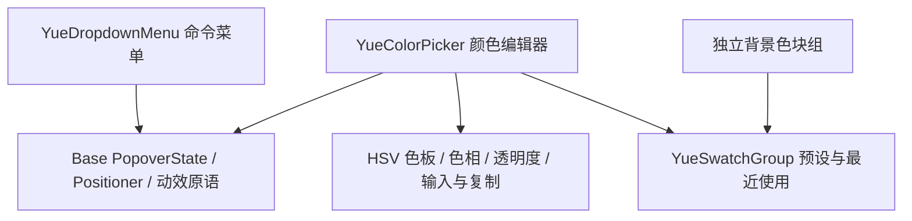

# 11 YueColorPicker 设计方案

状态：首版已实现（2026-11-01）。基于 GPUI Kit / Base 0.8.0、GPUI 0.3.9，限 Windows。公共 API、Showcase、源 token 和生成快照已落地；无头测试与真实窗口验证的边界见第 14 节。

首版范围定稿：**HSV 负责色板交互，HEX/RGB/HSL 负责数值输入，Alpha 单独控制透明度。**色板横轴为饱和度 S、纵轴为明度 V，独立色相条控制 H；切换 HEX/RGB/HSL 只改变输入表示，不切换色板坐标，也不改变当前 RGBA。不提供额外的坐标选择器。

视觉沿用第二份 demo 与截图：顶部通栏色板、预览与色相/透明度双滑条、分通道输入、最近在前/预设在后。首版保留复制、预设/历史、独立色块组及弹层/内嵌两种形态；不增加 HWB、Lab、LCH、OKLab、OKLCH 的转换、输入或色板。

## 1. 结论与组件边界

ColorPicker 是**颜色编辑器与 Popover 的组合**。它和 Dropdown 共用触发、定位、关闭及焦点生命周期，但内容与键盘模型不同，因此新增独立组件，不给 `YueDropdownMenu` 添加颜色菜单项，也不将交互表单塞进 `YueMenuItem`。

| 层次 | 可以复用 | ColorPicker 自己负责 |
| --- | --- | --- |
| 触发器 | Base Button、Yue 的控件尺寸、焦点与禁用规则 | 当前颜色色块、格式化色值、展开提示 |
| 弹层 | Base `PopoverState` + Yue 统一 `PopupHost` / `PopupAnchor`、Positioner、Presence/transition | 非模态 Dialog 语义、面板结构、内部焦点顺序 |
| 内容 | YueInput、YueNumberInput、Button、Base Slider/Radio | HSV 色板、透明度、颜色转换与解析、格式切换、最近使用 |
| Dropdown 行模型 | 仅格式选择菜单可以使用 | 主编辑面板不做 MenuItem、typeahead、逐行入场或选择即关闭 |



保持当前 Base-only 依赖，不启用 `gpui-kit/component`，不增加新的窗口或 Root。定位与过渡直接接入工作区已经存在的统一 Popup 基础层（见 `docs/12-popup.md`）；不在 ColorPicker 中复制一套定位器。

同一编辑内容提供 `YueColorPickerPanel` 内嵌形式，供属性面板或截图中的常驻调色器使用；`YueColorPicker` 是触发器 + 同一 Panel + Popover。两者共享状态、输入、事件与绘制，不维护两套编辑器；同一 Entity 同时只挂载一个可编辑面板，避免焦点和拖动会话冲突。

## 2. Demo 中实际存在的能力

参考：[GPUI Kit 组件文档.html](../refer/GPUI%20Kit%20组件文档.html)。已读取样式、页面定义及脚本，以下不只依据 API 表格推断。

| 参考位置 | Demo 表现 | Yue 决策 |
| --- | --- | --- |
| 355–369 行 | 色块 + 色值 + 箭头触发；256px 浮层；140px HSV 色板和色相条 | 保留字段触发器；面板改用下述第二份 demo 结构和尺寸 |
| 656–659 行 | 基础、禁用、独立色块组、色块组附自定义颜色四个示例 | 四个场景均列入交付范围 |
| 745–778 行 | HSV 转换、HEX/RGB 输入、复制、预设、最近使用 | 保留；补充严格解析、事件边界和失败路径 |
| 759–764 行 | 色板拖动，横轴 S、纵轴 V；方向键与 Shift 加速 | 保留 HSV 模型；不能误用 HSL 的 L |
| 581–582、811、826、832 行 | 独立色块可表示棋盘格、纯色，自定义用浏览器 `input[type=color]` | 区分颜色值与背景选项；自定义入口使用同一个 YueColorPicker 面板 |

Demo 的限制与修正：

- 使用 `.menu` CSS 只是借用了浮层外观，不意味着内容属于 Menu 语义；触发器实际上写的是 `aria-haspopup="dialog"`。
- 最近颜色保存在页面全局 `RECENT`，且预置了三个历史值。库组件默认历史为空，不伪造使用记录，不默认跨窗口共享。
- 复制失败仍显示成功。GPUI 的剪贴板写入 API 无成功返回值，Yue 不承诺经过操作系统确认的写入成功。
- 输入 `maxlength=16` 不能容纳所有完整 `rgb(255, 255, 255)` 表达式。Yue 按自身明确的语法和容量处理，不照抄 16。
- 最近颜色在拖动结束、blur 和预设点击时写入，键盘路径不完整。Yue 按一次编辑操作结束统一记录，不能在每个 pointermove 记录一条。
- 色块选择环和键盘焦点环使用同一种 outline。Yue 分开表达选择与焦点。
- 任意 CSS 背景并不等于 `Rgba`，棋盘格不能通过一次 RGB 转换变成合法颜色。

### 2.1 第二份 demo 与截图：本版主要视觉参考

来源：[deepseek_html_20261101_dd58ad.html](D:/000_Inbox/020_Browser/021_Edge/deepseek_html_20261101_dd58ad.html)，文件位于仓库外；本文已记录设计要点，构建不依赖该文件。截图是放大后的视觉参考，以 HTML 的逻辑尺寸为基准，不直接照搬截图像素。

| 源码位置 | 实际表现 | Yue 决策 |
| --- | --- | --- |
| 34–80 行 | 300px 面板，180px 色板通栏贴顶；下面 controls 独立 16px padding | 采用此轮廓；色板仅顶部圆角，底边直角；不把整块色板再套一层四周 padding |
| 82–144、253–267 行 | 左边当前色预览，右边色相和 alpha 两条滑杆；棋盘衬底 | 采用；alpha 条和预览叠加当前 RGBA，色板本身保持不透明 |
| 269–289、454–467 行 | 格式选择 + HEX 或 RGB/HSL 通道 + 独立 alpha%；最近在前、预设在后 | 采用；保留上一版复制能力，放独立的紧凑操作位，空间不足则换行 |
| 315–384、429–440 行 | 内部 HSV，HSL 通过 RGB 转换；透明度独立 | 同样分离模型；HSL 的 L 不是色板纵轴 V，切格式不反向转换并改值 |
| 386–424、552–564 行 | 最多 8 个最近颜色，拖动结束记录，点击历史回填 | 保留操作结束记录原则；库默认历史为空，颜色身份包含 alpha |
| 573–595 行 | 十个固定预设和三个伪造的最近颜色 | 只用于 Showcase 业务示例；组件默认预设仍为空，不叫“系统预设”，避免暗示 Windows 或 Yue 强制提供该调色板 |

源码缺陷不跟随：

- HEX 模式的所有字段共用按 `e.target.value` 解析 HEX 的分支。修改独立 alpha 字段会被当成 HEX 报错，或者被当成颜色；Yue 按字段身份处理，修改 alpha 只改变 alpha。
- HEX 用 `parseInt` 而没有完整字符校验，RGB/HSL 用 `parseInt(...) || 0` 并静默 clamp；非法、部分合法文本可能变成别的颜色。Yue 不静默修正文本错误。
- 拖动调用 `render(false)`，数值字段直到松手才更新；结束后又通过 `innerHTML` 重建全部输入，可能丢失焦点/选区。Yue 保留稳定输入 Entity，未编辑字段实时同步，正在编辑的草稿不被覆盖。
- alpha 先四舍五入到两位小数，再转 HEX，不能保留全部 256 级 alpha。Yue 统一 RGBA8 精度，不采用两位小数 alpha 作为真实值。
- `rgbToHsl` 显示取整数、灰阶 hue 清零；不能把这些格式化结果反写为新的当前色，或在灰/黑处丢掉用户选定的 hue。
- 只有鼠标/触摸事件，没有完整键盘、焦点和可访问性契约；不照搬错误抖动、色块 hover 缩放和布局重建。

## 3. GPUI Kit / Base 源码核对

以下路径相对各 crate 的 `src/`，以当前 Cargo.lock 中的 0.8.0 为准；不修改 registry 内上游源码。

| 来源 | 已核实能力 | 使用与限制 |
| --- | --- | --- |
| Base `color_picker.rs::ColorPickerState` | `value/preview/displayed_color`；HEX 输入；`HslaSliders`；`Change(Option<Hsla>)` | 状态为 HSLA，不提供 HSV 二维色板、RGB 格式、最近历史或复制 |
| 同文件 `set_value` | 外部同步不 emit Change | 借鉴静默外部同步契约 |
| 同文件 `select_color/commit_hex` | 提交并关闭；`update_color` 提交但不关闭 | 不符合本方案“预设和输入完成仍保持打开”，不能直接照搬 |
| 同文件 `hex_input` | 输入受 `^#[0-9a-fA-F]{0,8}$` pattern 限制；底层解析接受短/长 HEX 与 alpha | 不能在该输入中直接显示 RGB；解析 alpha 也不等于具备二维色板和独立 alpha 条 |
| Base `ColorPicker` root | Button role、expanded、可选 FocusHandle、Enter/Escape 的开合请求 | 不构建色板或 popup；无 disabled 无障碍投影，Space 开启也不能仅由此 root 假定成立 |
| Base `ColorSwatch` | 默认 RadioButton、toggled/selected、颜色名称、disabled 时不注册激活、tab_stop | 不提供组导航或公开外部 focus handle；disabled 不投影到无障碍树。不能把“不响应点击”等同“读屏报告禁用” |
| Component `color_picker.rs` | Palette / HSLA 两个面板、featured colors、ColorSelect 字段触发器 | 没有 demo 的 HSV 二维编辑器；需要启用 styled Component 层，不适用于本库依赖边界 |
| Base `popover.rs` | `PopoverState::show/dismiss`、焦点捕获与条件恢复、关闭订阅、deferred 注册清理 | 作为唯一开合与焦点生命周期所有者；不在颜色状态里再存一份 open bool |
| Base `Popover` wrapper | 触发器 Enter/Space；内容 Dialog、tab_group、Escape、外部点击关闭；按 Anchor 建 popup | 没有完整 side/align/margin/disabled 公共面板策略；若只用 wrapper，禁用父级仍可能收到点击，不可只给内部按钮变灰 |
| Base `Positioner` | side、placement、align、offset、margin、on_position，返回最终位置 | 用于默认下方、Start 对齐、翻转及窗口约束；沿用 Dropdown 已验证的 Base 路径 |
| Base `slider.rs` | `SliderState`、Slider/Track/Thumb；Change、Release；numeric value/min/max/step/orientation；增减无障碍 Action | 复用色相/alpha 的行为与语义；仍需 Yue 补焦点、方向/Home/End/Shift 键盘路径，不宣称 Base 已完整提供 |
| GPUI `color.rs` | 两个色标的 `linear_gradient`、`Background::color_space(ColorSpace::Srgb)` | HSV 色板可分层绘制；彩虹条需要六段双端渐变，不能虚构多色标 gradient API |
| GPUI `App::write_to_clipboard` | 写入 `ClipboardItem`，返回 `()` | 可提交文本，无法从返回值判断系统已成功保存 |
| 当前 Yue Input | 基于 Base InputState；Tab/Shift+Tab 在输入上下文为缩进 | 本弹层需实现**局部** Tab 导航，不能声称现有输入已支持表单遍历 |

最终不包装 Base `ColorPickerState`：即使本版增加 HSL 输入和 alpha，它仍会引入 HSLA 编辑坐标、HEX pattern、额外 open 和提交关闭规则，而这些都要被覆写。直接复用更小的 Base 原语，将 HSV/alpha/文本草稿/历史放在一个 Yue 编辑状态中，避免两个颜色状态互相同步。色相、alpha 各用一维 Slider；HSL 只是数值输入格式。

## 4. 范围与默认值

### 4.1 V1

- `YueColorPicker`：字段式触发器默认，也支持仅色块的紧凑触发器；Small/Medium/Large；禁用。
- `YueColorPickerPanel`：同一编辑器的常驻内嵌形式，不带触发器/浮层。
- HSV 饱和度/明度二维色板、色相条、alpha 条及棋盘格预览。
- HEX/RGB/HSL 三种输入格式、独立通道和 alpha 百分比、复制、可配置预设色、最多 8 个最近使用颜色。RGB/HSL 数值入口提供色板的精确和辅助技术替代路径。
- 灰/黑/白端点的 hue/饱和度记忆；切换输入格式本身不改变 RGBA，不发颜色事件，也不写历史。
- 即时生效，不提供应用/取消事务模式；预设选中后面板保持打开，Escape/外部点击/再次点击触发器关闭。
- `YueSwatchGroup` 独立使用，同一个实现用于预设和最近颜色；支持纯色、棋盘格、线性渐变背景预览及自定义纯色入口。
- Light/Dark × Azure/Neutral × neutral tones；rem/DPI 缩放；完整键盘路径。

### 4.2 明确不做

V1 编辑 **8-bit sRGB + 8-bit alpha 的纯色（RGBA8）**。不做多坐标切换、HWB/Lab/LCH/OKLab/OKLCH 输入、广色域/HDR、色域映射流程、屏幕吸管、Windows 系统颜色对话框、任意 CSS 字符串解析、渐变编辑器、最近历史持久化或受控 open API。HSL 输入不表示支持另一种色域；透明色也不表示删除背景或无选择。

## 5. 状态、公共 API 与事件

### 5.1 颜色编辑器使用 Entity

`YueColorPickerState` 持有可编辑 RGBA、HSV 坐标、alpha 编辑坐标、各字段文本草稿、格式、最近历史及必要订阅。宿主创建并保留 `Entity<State>`，与 Input 的使用方式一致。视图每帧新建；不在 render 中重新创建状态。

颜色状态只有一份：当前有效颜色由 state 持有，宿主通过事件观察，外部更新用 `set_value`。不同时提供 `.value(...) + on_change` 的第二种所有权方式。HSV 是编辑坐标，字符串是未完成草稿，二者不是额外业务模型。

拟议类型均从 `yue_component` 根部导出，字段私有：

| 类型/方法 | 契约 |
| --- | --- |
| `YueColorPickerState::new(window, cx)` | 初始不透明黑色、固定 HSV 色板、HEX 输入、无历史；不自行打开面板 |
| `.default_value(Rgba)` / `.default_format(ColorFormat)` | 构造时设置初值和输入格式；不发事件 |
| `ColorFormat` | Hex / Rgb / Hsl，仅表示数值输入格式；不提供 ColorModel 或 set_model |
| `value()` / `format()` / `recent()` | 分别读取当前有效 Rgba、Hex/Rgb/Hsl、最近有效颜色切片 |
| `set_value(color, window, cx)` | 外部替换颜色，撤销未完成草稿/拖动会话，静默更新输入与 HSV；不发 Change/Commit，也不写最近历史 |
| `set_format(format, window, cx)` | 格式化现有颜色，不改变颜色、不发颜色事件 |
| `set_recent(colors, cx)` | 导入历史、去重、最多 8 项；不发颜色事件，用于宿主显式共享/恢复历史 |
| `ColorPickerEvent::Change(Rgba)` | 真实用户操作使有效颜色变化时发出，用于实时预览；状态已更新，可安全读取 |
| `ColorPickerEvent::Commit(Rgba)` | 本次编辑完成且最终颜色不同于操作起点时一次发出，用于保存/撤销步骤；先 Change 后 Commit |
| `YueColorPicker::new(id, theme, &state)` | id 稳定，显式主题；与现有 YueInput 构造形态一致 |
| `YueColorPickerPanel::new(id, theme, &state)` | 同样的编辑内容直接嵌入宿主；无 Popover、无 Dialog role；默认宽 300，可显式 width |
| `.use_default_theme()` / `.theme(theme)` | 默认主题继承与实例覆盖 |
| `.label(text)` / `.accessibility_label(text)` | 可见组说明/无障碍名称，至少一个非空；色值不能代替“要编辑哪个对象”的名称 |
| `.size(ColorPickerSize)` | Small / Medium / Large，默认 Medium |
| `.trigger(ColorPickerTrigger)` | Field / Swatch，默认 Field；不开放任意 trigger slot |
| `.presets(IntoIterator<Item = Rgba>)` | 预设列表；默认空，业务预设由宿主提供；自动去重，按首次出现顺序 |
| `.show_recent(bool)` | 默认 true；关闭仅隐藏历史区域，不删除历史 |
| `.disabled(bool)` | 默认 false；禁止开启/编辑，打开期间变为禁用则关闭并中止未完成操作，不回滚已生效颜色 |
| `.placement(base::Placement)` / `.align(base::Align)` | 默认 Bottom / Start；允许四侧与三种对齐，实际位置可翻转；直接复用 Base 类型 |
| `.width/min_width/max_width/margin/flex_grow` | 作用于触发器外部；不把触发器宽度同时强加给颜色面板 |

Panel 复用 theme、label/accessibility_label、presets、show_recent、disabled 和外部布局属性；不提供 size/trigger/placement/align，不能暗示其内部密度随触发器档位变化。Panel 的 width 作用于编辑面板自身；Popover 面板宽度按本方案 token 与 viewport 决定。

值校验统一：NaN/Inf、越界 RGB/alpha 是 API 配置错误，明确 panic；字符串用户输入错误只进入校验态，不 panic。RGBA 各通道四舍五入到最近 8-bit，公开颜色和历史采用同一 RGBA8 身份；HSV/alpha 拖动坐标保留浮点精度，不在每帧由格式化文本反算，以免拖动抖动。同一个 8-bit 桶内的指针移动仍更新 thumb，但不重复发颜色 Change。

### 5.2 使用片段

以下是宿主保留状态和订阅的接入片段；完整可编译 seam 示例位于组件 rustdoc，运行示例见 `examples/windows-showcase/src/pages/color_picker.rs`：

```rust
// 在宿主 new 中创建；不要在 render 中重建。
let picker = cx.new(|cx| {
    YueColorPickerState::new(window, cx)
        .default_value(gpui_kit::rgb(0x1F75DB)) // 文档中的业务颜色数据
});
let subscription = cx.subscribe(&picker, |this, _, event, cx| {
    match event {
        ColorPickerEvent::Change(color) => this.preview_color = *color,
        ColorPickerEvent::Commit(color) => this.save_color(*color),
    }
    cx.notify();
});
// 宿主保留 picker 和 subscription。

// render 中
YueColorPicker::new("fill-color", theme, &self.picker)
    .label("填充颜色")
    .presets(self.document_palette.iter().copied());
```

这里只有业务颜色允许来自用户数据或示例 RGB 字面量；控件的边框、表面、焦点环等仍全部读取设计 token。

### 5.3 一次编辑如何结束

| 操作 | Change | Commit / 最近使用 | 是否关闭 |
| --- | --- | --- | --- |
| 色板/色相/alpha 拖动 | 颜色实际变化时持续发出；同一渲染帧可合并 | release 时一次，以最终有效颜色记录 | 否 |
| 方向键调整色板/色相/alpha | 每个有效更新 | 一次按键序列的 keyup；长按合并为一次；焦点离开也结束序列 | 否 |
| HEX / RGB / HSL / alpha 字段输入 | 完整合法文本导致实际 RGBA 变化时发出 | Enter 或离开当前字段完成一次，不为中间半成品生成历史 | 否 |
| 点击预设/最近颜色 | 值变了才发出 | 变化后一次；点击当前色不生成重复事件 | 否 |
| 切换格式、复制 | 无 | 无 | 否 |
| 关闭面板 | 不额外制造 Change | 结束尚未完成的有效编辑，非法草稿丢弃；最终值与起点相同时无 Commit | 是 |
| 外部 set_value | 无额外用户事件 | 中断会话，使用外部新值；不伪造 Commit 或历史 | 保持原开合状态 |
| 禁用 / 卸载 | 无额外用户事件 | 中断会话，不伪造 Commit；保留已生效颜色 | 是 |

Change 为实时结果，Commit 为操作分组，二者不是两份颜色。按住拖动再 Escape 只关闭，不恢复打开前颜色；若业务需要可取消的临时选择，应在上层事务中处理，不偷偷改变此模式。事件回调允许关闭或移除视图，后续工作通过弱引用和会话 revision 检查，不能继续向已失效对象提交。

最近使用：实例内按最终 **RGBA8** 值去重、最新在前、最多 8 项。相同 RGB、不同 alpha 是不同颜色；alpha=0 时仍保留隐藏 RGB，不全部归一成透明黑。只在有效 Commit 时更新；初值、打开、hover、格式切换和外部同步不写历史。需要 demo 那样跨两个选择器共享时，由宿主接收 Commit 后显式更新各实例历史；不新增全局单例、磁盘存储或历史管理器。

## 6. HSV、透明度、格式与输入规则

### 6.1 坐标与色相记忆

- 色板横轴 `S=x/width`，纵轴 `V=1-y/height`，均 clamp 到 `[0,1]`；色相 `H∈[0,360)`。**此处始终是 HSV，与格式下拉框选中 HSL 无关。**
- 鼠标按下即定位，拖到色板外继续更新并 clamp；松手/失焦/关闭后终止捕获。持续监听必须随实体/会话释放。
- 灰色 `S=0` 或黑色 `V=0` 时保留最后有效 H；只要只是调色相，就算 RGB 不变也更新潜在 H。黑色下保留最后编辑的 HSV S，重新提升 V 时不会莫名变灰。
- 导入无色相的外部颜色时保留该实例的潜在 H；首次黑/灰时 H=0。外部黑色的 HSV S 初始化为 0，色板拖动过程中变黑则保留编辑 S；通过操作来源区分，不从 RGB 猜测用户意图。
- HSL 输入另保留当前编辑会话中端点处不可推导的 H/S 草稿，例如 `HSL(240°,100%,100%)` 是白色，稍后降低 L 时仍应回到蓝色。此信息仅供编辑恢复，不是另一份业务颜色；外部 set_value 会结束会话。实现中为 HSV/HSL 各自的无色相端点写测试。
- RGB/HSV/HSL 转换统一位于私有纯函数。HSL 的 L（亮度）与 HSV 的 V（明度）严格区分；HSL S 也不能直接复用 HSV S。

### 6.2 透明度与真实色值

alpha 条横轴 `A=x/width`，范围 `[0,1]`，只改变 alpha，不改 RGB/HSV。反过来，拖色板/色相、编辑 RGB/HSL 通道不改变当前 alpha；点击预设/最近则加载该项的完整 RGBA，包括 alpha，不隐式保留旧透明度。

alpha=0 时仍保留 RGB/H/S/V；用户提高 alpha 后恢复原来的颜色。透明色预览通过棋盘衬底表达，不能因为看不到墨迹就把值清空。触发器、当前预览、预设和历史色块采用同一透明预览规则；它与独立 SwatchGroup 的“棋盘格背景选项”语义不同。

RGBA8 是唯一公开精度：alpha byte `n` 对应 `n/255`，数值字段显示 `100*n/255` 的至多两位小数（如 `128 → 50.2%`）。此精度可区分所有 alpha byte；显示格式不用于反写。拖动中保留连续坐标，Change/Commit、去重和复制都基于量化后的当前 RGBA。

### 6.3 分通道输入与格式

格式选择提供 HEX / RGB / HSL 三项。UI 使用当前格式的字段及一个独立 alpha 字段，不再同时放一行 HSV S/V 数字，以免混淆两套饱和度。每个通道必须有可访问名称和可见简短标识/说明，不仅靠顺序或 `%` 猜测含义。

| 格式 | 可见字段 | 合法输入 | 规范复制 |
| --- | --- | --- | --- |
| HEX | HEX 色值 + A% | 首尾空白、可选 `#`，严格 3/4/6/8 位十六进制，大小写不敏感；4/8 位含 alpha | 不透明 `#RRGGBB`，否则 `#RRGGBBAA`，大写 |
| RGB | R / G / B + A% | RGB 各为 0–255 的十进制整数 | 不透明 `rgb(R, G, B)`，否则 `rgba(R, G, B, a)` |
| HSL | H° / S% / L% + A% | H 0–360，S/L 0–100，最多两位小数；H=360 归一为 0 | 不透明 `hsl(H, S%, L%)`，否则 `hsla(H, S%, L%, a)` |
| A%（全部格式） | 透明度 | 0–100，最多两位小数 | 函数中的 a 使用 `n/255` 至多五位小数，足以还原 RGBA8 alpha |

HEX 字段显示完整当前 HEX，因此可与 A% 同时编辑同一个 alpha：改 A% 后立即重格式化未聚焦 HEX；输入含 alpha 的 HEX 时同步 A%。输入 3/6 位 HEX 明确将 alpha 设为 1；输入 4/8 位使用自带 alpha。**改 A% 只解析 A%，不能把它误当成 HEX，也不能被旧 HEX 覆盖。**

RGB/HSL 模式是分字段编辑，不接受在单个通道中输入整个 `rgb(...)`/`hsl(...)` 表达式；完整颜色表达式粘贴可后续另加统一入口，不宣称首版已有通用 CSS parser。HEX 保证逐 byte 可逆；HSL 格式化采用至多两位小数，复制 HSL 是可读表示，不承诺通过外部解析后仍逐 byte 一致。

所有数值必须完整解析，不接受尾随垃圾、指数、负数、NaN/Inf、越界或部分合法字符串。不使用 `parseInt(...) || 0`，不把空文本自动改成 0，不静默 clamp 用户文本；pointer 坐标的 clamp 与文本校验是两回事。

### 6.4 草稿、同步与格式菜单

打字时保留当前字段草稿和选区；只有完整合法输入使有效 RGBA 变化才发 Change。合法通道修改与其他通道的当前有效值合并，不从其他未完成草稿拼一个错误颜色。正在编辑的字段不被自己的状态回授重写，其他未编辑字段、色板、预览实时同步。切到拖动前先结束字段会话，非法草稿恢复最后有效值，拖动中所有字段随当前有效色更新，不等松手才刷新。

Enter 非法时就地提示并保留焦点，不关闭弹层或提交宿主表单；blur 非法时保留错误供修改，暂存当前有效颜色不变。关闭时恢复规范文本。格式切换前完成有效草稿，非法草稿恢复后再换格式；切换本身不通过显示用的舍入 RGB/HSL 数值反算，不发颜色 Change。

格式控件用 Button 触发 `YueDropdownMenu` 的三项 radio 菜单，复用现有命令菜单能力；此处确实适合菜单语义。选择格式仅关闭格式菜单，ColorPicker 保持打开，焦点回格式按钮。Escape 先关闭格式菜单，再次 Escape 才关闭 ColorPicker；外点到父面板只关子菜单，真正点到两层外面才关父面板。必须使用现有浮层栈规则并验证事件不会穿透；不能仅并排加两套外部点击监听。

每种格式的 Input Entity 在 state 中稳定保留，按当前格式挂载，不能像 demo 每次 render 重建。切换后同步可见字段并更新局部 Tab 列表，不在 render 内创建订阅。整组禁用、关闭、卸载或外部 set_value 均中止正在进行的草稿/拖动会话。

### 6.5 复制

使用 `cx.write_to_clipboard(ClipboardItem::new_string(text))` 提交上表的规范文本；任何可见字段存在非法/未完成草稿时禁用复制，避免所复制颜色与当前编辑内容不一致。图标 Copy → Check，短暂约 1200ms 后恢复，仅表达“已提交复制请求”，不宣称操作系统已确认保存。保留文本选中与 Ctrl+C。

计时使用 GPUI Task/epoch；连续点击重新计时，关闭/卸载取消，旧任务不能清掉新反馈。不弹全局成功 toast；需要系统写入确认时另作平台能力。

## 7. 独立色块组与自定义入口

`YueSwatchGroup` 是按稳定字符串 value 选择**选项**的受控组件，和编辑器的 Rgba 状态区分。默认单选、不允许点选已选项取消，未知 value 无选择；空列表保留说明，不生成幽灵 Tab stop。

拟议 API：

| API | 用途 |
| --- | --- |
| `YueSwatchGroup::new(id, theme, selected_value)` | 受控选择，不保存第二份业务 value |
| `.label/accessibility_label/options/disabled/on_change` | 与现有选择组件保持约定；`on_change` 请求 `&SharedString`，宿主写回 |
| `YueSwatchOption::solid(value, label, Rgba)` | 纯色色块；色值是数据，名称由宿主提供 |
| `YueSwatchOption::checkerboard(value, label, light, dark)` | 两色棋盘背景；不是“透明颜色”或 `None` |
| `YueSwatchOption::gradient(value, label, angle, from, to)` | 两个合法 Rgba 色标、有限角度（度）；固定 sRGB 插值；无任意 Background/CSS 字符串或渐变编辑能力 |
| `option.disabled(bool)` | 不可激活，导航跳过，语义为 disabled |
| `.custom_color(value, label, &Entity<YueColorPickerState>)` | 最后追加自定义纯色入口；与已有 value 不得重复 |

选项 value 必须非空唯一，label 必须有效。组宽度和换行由布局决定；预设、最近与独立组共用同一色块绘制和导航，不能为每个区域复制一套。

自定义入口使用调色盘/加号标识和同一个 ColorPicker 面板，不使用隐藏的系统颜色输入。打开时不改变组选择；明确完成一次有效选色操作后才请求自定义 value 一次；已经处于自定义 value 时，后续换色只通过 ColorPicker 的 Change/Commit 通知，组选择值不变。不因只是打开又关闭而选中自定义项。

“完成选色”和“颜色有变化”分开：例如显式点选当前黑色，或在输入中 Enter 确认当前有效值，虽然不产生颜色 Commit，仍可从其他背景切换到自定义黑色。为此，组与共享面板通过私有的操作完成通知连接，不以公开 Change/Commit 订阅推断用户是否选定；单纯 blur、Escape 或外部同步不触发这个选择请求。颜色 state 仍由宿主持有，组不另建颜色状态，也不新增公开颜色事件。

纯色预设通过 value → Rgba 映射驱动编辑器。棋盘格和渐变选择只返回稳定选项 value，由宿主设置背景，不经过 Rgba 颜色事件。demo 中“任意背景”因此被限定为有明确渲染能力的三类，未来确有用途再增加图像背景。

组语义为 RadioGroup，背景选项为 Base Radio；末尾自定义入口是具名 Button（expanded + 包含当前选中状态和色值的 description），因为它打开编辑器而不是立即选择。自定义入口带 Palette 标识、当前颜色预览和持久选择环；明确确认后才请求切换组值。焦点环与选择环分离。装饰色块/图标不产生第二套可访问节点。

## 8. 面板、尺寸与视觉

按第二份 demo/截图更新，主体从上到下：

1. **顶部通栏 HSV 色板**，仅顶部两角跟随外层面板；不加 controls 的左右内边距。
2. 带统一 16px 内边距的 controls。第一行左侧当前色预览，右侧垂直排列色相条、alpha 条，两者有独立命中区。
3. 格式选择 + 分通道输入 + A%。RGB/HSL 模式优先将格式按钮/复制置于上一操作行，下一行四个等宽通道；不能把截图中的五个控件强挤进 300px。HEX 较短可同排，但共享内容左右对齐线。
4. 最近使用颜色，默认上限 8；空时隐藏整区，不预置历史。
5. 预设颜色，业务可传 10 项或其他数量，自然换行；空时隐藏整区。标题“预设颜色”，不写“系统预设颜色”。

复制是第一份 demo 的保留能力，第二份没有，不因此删除。Showcase 同时展示 Popover 和独立 Panel；后者无弹层阴影，宿主负责外部间距，不在已有容器里再嵌套阴影卡片。

| 几何 | 建议基准 | 说明 |
| --- | ---: | --- |
| 触发器高度 Small / Medium / Large | 28 / 32 / 40 | 引用 control-height；只改变触发器，不同比例放大整个面板 |
| Field 默认宽度 | 160 | 显式 width 可相对父级；不自动撑满卡片 |
| 触发色块 | 16 / 16 / 20 | 文字与色块垂直居中 |
| 紧凑触发器宽度 | 对应控件高度 | 方形命中区域，有对象名称和当前色值描述 |
| 面板期望宽度 / 最低可用宽度 | 300 / 260 | 本版替代 280/240；浮层受窗口约束，内嵌 Panel 可显式 width |
| controls 内边距 / 组间距 | 16 / 12 | 顶部色板不继承此 padding |
| 色板默认高度 | 180 | 替代 140，与宽度分别解析，坐标使用实际 bounds |
| 当前预览色块 | 28 | 棋盘格衬底，居中于双滑条整体高度 |
| 滑条可见高度 / 命中高度 / thumb | 12 / 24 / 16 | 两条的命中区域不重叠；视觉间距 8 时中心距 20 会冲突，因此布局中心距至少 24，建议 28 |
| 色块墨迹 / 命中区域 / 间距 | 20 / 28 / 4 | 8 项为 252px，可在 268px 内容宽度排一行；10 项自动换行 |
| 分通道输入高度 / 通道间距 | 32 / 4 | 保留 3 位数字、两位小数和单位所需宽度；260px 时必要地将 A% 换到下一行 |
| 面板圆角 / 浮层阴影 | radius-lg / shadow-2 | 色板覆盖外层顶部内边界，controls 不再加第二道卡片边框 |
| 锚点间距 / 窗口安全边距 | 8 / 8 | 翻转/clamp 后保留焦点环与阴影空间 |

数值进入源 token，并经 rem/DPI 适配。300 是期望宽度，不是强制最小值。窗口空间不足时依次换行操作/通道、减少色块列数、缩小色板宽度；viewport 高度不足时面板内部单一纵向滚动，色板不做 sticky。最低可用宽度 260；低于此值须由宿主约束窗口，实施时明写边界。

视觉状态：

- 触发器用输入/选择器式边框、背景和 hover/focus；展开保留活动边框。
- 禁用保持真实 RGBA 预览，外框/文字取禁用 token；不整体叠 opacity，不因禁用修改颜色或透明度。独立 Panel 禁用时所有字段、滑杆、色块与格式操作同样不可编辑。
- 白、黑、同背景色都有中性边界；选择标记和键盘焦点环分开，均在色块外侧。不强制在任意业务色上放白色 Check。
- 面板文字、边框、错误和焦点取主题；色板/彩虹/业务颜色不随主题重着色。
- 指针 thumb 用浅内环 + 深外环，在黑白/高饱和区可见；0%/100% 边缘中心可落在色板边界，装饰不能被色板的圆角 clip 截掉。
- 不复制 demo 的错误抖动和色块 hover 放大；使用错误文字/边框以及既有 hover/focus 反馈，避免额外位移动画干扰选择。

## 9. 绘制与动效

HSV 平面以当前 hue 的纯色为底，叠加从白到透明的水平渐变，再叠加从透明到黑的垂直渐变。对应 `RGB = V × ((1−S) × White + S × Hue)`。渐变指定 sRGB，避免 GPUI 默认色彩插值空间与数值转换不一致。

GPUI 当前一个 Background 只有两个 gradient stop；色相条分红→黄→绿→青→蓝→洋红→红六段绘制，共享边界坐标，不累计取整。alpha 条是棋盘衬底 + 当前 RGB 的 `a=0 → a=1` 渐变，两端 RGB 相同，避免黑色端点造成脏边；实际 GPU 混合须验收。色板不叠当前 alpha，否则半透明时难以判断色域。

两条滑条均为胶囊，绘制圆角半径等于可见轨道高度的一半：默认 12px 高对应 6px 半径。GPUI 的 `rounded_full + overflow_hidden` 不能将子 Canvas 的绘制裁成圆角，所以色相第一段只给左侧两角半径、最后一段只给右侧两角半径，中间接缝保持直边；Alpha 渐变自身绘制圆角，棋盘格逐格用矩形 content mask 截取同一个完整胶囊 quad，避免方角棋盘从渐变两端露出。滑块内部的彩色/棋盘 Canvas 同样显式绘制圆角，滑块保持圆形。禁用及退出阶段复用同一绘制路径，不新增形状选项或 token。

没有纹理生成、资源加载或逐像素 CPU 位图。色板渐变层仅裁切顶部两角，thumb 在独立装饰层绘制，不被渐变 clip 截断。棋盘格用 canvas 按物理像素对齐重复绘制；透明预览的两种格子色取中性主题 token，SwatchGroup 的独立棋盘背景则读取选项数据，两者共用绘制函数而不混用语义。

拖动中的 thumb 和颜色立即跟随输入，不插值色值或位置，否则指针与当前值脱节。hover/focus 读取现有 interaction 动效；弹层整体透明度/小幅位移建议 enter 200ms、exit 100ms，使用标准 enter/exit ease，无逐行 stagger。两条滑条的 thumb 已实现按压缩放，使用 state duration/ease，只影响装饰层，不影响坐标、文字或命中区域。

reduced motion 全部即时定位，保留选择反馈。resize、rem、DPI 或滚动后直接用新 bounds 重算，不从旧屏幕位置追赶；拖动中关闭或触发器卸载立即释放会话和任务。图标使用项目 Tabler：ChevronDown、Copy、Check、Palette；不引入 Lucide 资源或第二套 SVG 加载。

## 10. 键盘、焦点和无障碍

### 10.1 语义

触发器为 Base Button，提供对象名称、当前规范色值说明和 expanded；浮层为**非模态 Dialog**并具有名称。GPUI 当前没有可直接套用的完整浏览器 `aria-haspopup="dialog"` 契约，不虚构 setter；必须验证实际 Windows 节点层次。

二维平面不是单一数值 Slider：使用有名称/当前 HSV S/V 描述的可聚焦 Group，RGB/HSL 输入提供精确替代路径。色相为一维 Slider，min=0/max=360/step=1，端点 360 归一为 0；alpha Slider 对外报告 0–100%、step=1。数值输入分别命名为红/绿/蓝或色相/饱和度（HSL）/亮度，以及透明度，避免将 HSL 的 S/L 播报为 HSV S/V。由 Base Slider/Radio 获得能复用的语义，不伪造二维 slider role 或 aria-invalid setter。

独立 Panel 为具名 Group，不是 Dialog；不自动抢焦点、不捕获宿主 Escape 关闭命令，也无“恢复触发器”步骤。格式子菜单在两种模式下都保留自己的 Menu 语义和关闭规则。

### 10.2 输入表

| 焦点/输入 | 行为 |
| --- | --- |
| 触发器 Enter / Space / 单击 | 打开/关闭；所有路径均检查 disabled |
| 打开 | 记录原焦点，聚焦色板；不在每次重渲染重置焦点 |
| 色板 Left / Right | S 减/增 1%；Shift 为 10% |
| 色板 Up / Down | V 增/减 1%；Shift 为 10%；边界 clamp |
| 色相 Left / Right | H 减/增 1°；Shift 为 10°；首尾循环 |
| 色相 Home / End | 首/末有效色相；与 slider 的一维值保持一致 |
| alpha Left / Right | 减/增 1 个百分点，Shift 为 10 个百分点，边界 clamp；Home/End 为 0%/100% |
| RGB/HSL/A 数值输入 | 在第 6 节范围内精确编辑；方向键按数值输入本身规则，明确字段名称 |
| 色值输入 Enter | 校验并结束当前输入编辑，保持面板打开，不提交外层表单 |
| 格式/复制 Enter / Space | 格式按钮打开三项 radio 菜单；复制只写剪贴板，不穿透父层触发器 |
| 色块组方向键 / Home / End | 按当前列数移动焦点，跳过禁用；不在仅移动时选中 |
| 色块组 Space / Enter / 单击 | 激活当前项；已选项无重复颜色/选择事件 |
| Escape | 格式菜单开着先关它；否则只关闭颜色 Popover，清理非法草稿；若焦点仍在面板内则还给触发器。内嵌 Panel 不吞宿主 Escape |
| 外部点击 | 关闭；外部对象已取得焦点时不强行抢回 |
| Tab / Shift+Tab | 按视觉顺序遍历；预设与最近色块组各只有一个入口；末端离开弹层并关闭，反向从起点返回触发器 |
| Ctrl/Alt/系统修饰的方向键 | 不拦截宿主快捷键；Ctrl+C 在输入中保留正常复制 |

色块组采用“移动焦点后 Enter/Space 激活”的手动选择模式，避免浏览色板就不断修改业务值。组内方向导航由 Yue 实现，不声称 Base ColorSwatch/Radio 已提供。

### 10.3 Tab 是必须解决的实现项

Base 输入把 Tab 绑定到缩进；本项目 Input 的已知边界继续成立。ColorPicker 安装一次私有面板 key context 及 Tab/Shift+Tab action；在捕获阶段消费 Base Input 的 IndentInline/OutdentInline，按当前可用 FocusHandle 有序列表导航。不能只拦截原始 key-down：GPUI 先派发匹配的 action，宿主 Root 或 Input 会早于 raw handler 执行。测试在真实 Base Root 下发键，覆盖 HEX/RGB/HSL 和正反向退出。Enter 只由 InputEvent::PressEnter 确认，面板消费向上冒泡的 Base Enter action，防止重复确认与表单穿透。

列表按实际布局为色板 → 色相 → alpha → 格式 → 当前通道字段/A% → 复制 → 最近组入口 → 预设组入口；操作行换行时对应调整视觉次序，不能与遍历次序相反。复制禁用、格式字段变化、空组等均更新列表并修复焦点。非模态弹层不 trap 焦点；Tab 离开后关闭，并在本帧面板移除后定位到触发器前/后的宿主目标，避免遍历到已卸载节点。内嵌 Panel 在边界将焦点移交前/后宿主节点，不关闭、不循环。格式菜单开启时由最上层菜单处理键盘，父 Panel 不抢它的 Tab/Escape。此局部策略不修改全局 Input 或 YueForm 的键盘语义。

使用 Base PopoverState 的焦点恢复需注意：只有其内部 focus_handle 包含当前焦点时才恢复；不能仅设置 tracked_focus_handle 就以为恢复正确。实现应按现有 Dropdown 模式跟踪面板根，并为“外点不抢焦点、Escape 返回、在 Dialog 内嵌套”补测试。

## 11. Token 来源与新增清单

来源仍为 `D:/100_Projects/110_Daily/Yue-Design-System/packages/tokens`。当前 ColorPicker 63 项、Swatch 12 项并同步（ColorPicker 首版 59 项，滑块效果修订新增 4 项）；全库数量以同步生成的 inventory 为准，包含其他组件正在补充的 token。

源文件为 `component-tokens/color-picker.css` 与 `swatch.css`，已登记 imports、catalogue、词表和轴。修复语法解析器按已登记 namespace 最长匹配，避免把 color-picker 误判为 color；未知 namespace/属性继续拒绝。新增 18 项源测试覆盖 16 种 profile/tone 组合、解析和对比度。`sync-yue-theme.mjs` 已生成 inventory 和类型化 keys，离线构建不依赖外部目录。源全仓既有失败另列，不声称总审计通过。

| Token 组 | 实现引用/默认 |
| --- | --- |
| `--color-picker-height-sm/md/lg` | control-height：28/32/40 |
| `--color-picker-padding-inline-sm/md/lg` | control-padding-inline |
| `--color-picker-font-size-sm/md/lg` | control-font-size 对应档位；文本行高沿用宿主 typography |
| `--color-picker-swatch-size-sm/md/lg` | 16 / 16 / 20px |
| `--color-picker-trigger-width`、`--color-picker-trigger-gap` | 160px、space-8；宽度经 rem 适配 |
| `--color-picker-background/color/border-color/radius` | surface、text-primary、border-default、radius-md |
| `--color-picker-border-color-hover/open` | border-control / focus-ring-color 对应语义 |
| `--color-picker-disabled-background/color/border-color` | disabled-container、text-disabled、border-default；不降低业务色块 opacity |
| `--color-picker-panel-width/min-width/padding/gap` | 300px / 260px / space-16 / space-12；padding 仅 controls |
| `--color-picker-panel-background/border-color/radius/shadow` | surface-level-2、surface-level-2-border、radius-lg、shadow-2 |
| `--color-picker-panel-offset/window-margin` | space-8 / space-8 |
| `--color-picker-sv-height` | 180px；顶部两角取面板 radius，底部为 0，不另造不协调圆角 |
| `--color-picker-preview-size` | size-28 |
| `--color-picker-hue-height/hit-height`、`--color-picker-alpha-height/hit-height` | space-12 / size-24，各有独立语义入口 |
| `--color-picker-slider-gap` | space-16；12px 可见条 + 16px 视觉间距 = 28px 中心距，24px 命中区互不重叠 |
| `--color-picker-checker-size/light-color/dark-color` | space-4 / 两个中性表面色；透明预览专用，不由当前 alpha 改色 |
| `--color-picker-channel-min-width/gap` | 62px / 4px；高度和字段视觉由 YueInput 管理；单位在可见标题中，避免挤占输入文字 |
| `--color-picker-thumb-size/border-width/shadow` | size-16 / border-2 / shadow-1 |
| `--color-picker-thumb-border-color/outline-color/outline-width/drag-scale` | 固定白色 / 黑色 20% / border-1 / 1.15；双色轮廓用于彩虹和透明渐变，不随主题反转；半径按物理像素取整，中心不漂移 |
| `--color-picker-focus-ring-color/width/offset` | 全局 focus-ring 三角色 |
| `--color-picker-error-color`、`--color-picker-recent-color` | error-foreground、text-secondary；Error 必须达到可用文字对比度 |
| `--color-picker-enter-duration/exit-duration/state-duration` | motion-duration-enter / motion-duration-exit / motion-duration-interaction |
| `--color-picker-enter-ease/exit-ease/state-ease` | motion-ease-enter / motion-ease-exit / motion-ease-standard |
| `--swatch-size/hit-size/gap/radius/border-color` | size-20 / size-28 / space-4 / radius-sm / border-control |
| `--swatch-selected-color/width/offset`、`--swatch-focus-ring-color/width/offset` | 选择与焦点分别命名，引用 accent/focus 语义及基础 border/space |
| `--swatch-checker-size` | space-4；颜色由背景选项数据传入 |

不为 H=0/60/120 等数学原色、当前 RGB、拖动每个百分比和每个预设位置生成 token。S/V 的白黑渐变及彩虹条属于颜色模型数据，和主题装饰色分开；复制恢复 1200ms 是反馈停留时间，不机械套用动画时长。

## 12. Showcase 与实现组织

新增组件页 `pages/color_picker.rs`，侧栏“组件”按英文升序：Checkbox → **ColorPicker** → Dropdown。现有“设计 → Color”展示主题规范，保留独立职责。

页面章节：

1. 基础：蓝/珊瑚两个实例、实时值和 Change/Commit 次数、外部更新按钮。
2. 尺寸与触发器：Small/Medium/Large、Field/Swatch、显式宽度与父级百分比宽度。
3. 完整面板：通栏 HSV、双滑条与透明预览、HEX/RGB/HSL 分通道输入、复制、最近在前/预设在后；另示常驻 Panel。
4. 禁用：初始禁用、打开后禁用、disabled 选项；色块保持真实颜色。
5. 独立色块组：深/浅棋盘格、白/黑、渐变背景、预览同步、自定义纯色入口。
6. 边界：白/黑/灰的 hue 保留、alpha=0/半透明/1、HEX 与 A% 双向同步、非法文本、未知组 value、空预设/历史、多个实例与显式历史共享。
7. 四主题、长标签、缩放、窗口四边与内部滚动、Dialog 中嵌套；提供键盘使用说明。

实施顺序：

1. 记录现有 workspace、headless、Input/Dropdown/Tooltip/Segmented 基线；先为颜色数学、解析、事件与 Tab 写失败测试。
2. 完成源 token、词表/语法/对比度测试并同步快照；此时才调整外部源仓库。
3. 先做 RGBA8/HSV/HSL 状态、解析、SwatchGroup，再做独立 Panel 的色板、双滑条与分通道输入，证明数值/色板/透明度一致。
4. 接入 Base PopoverState/Positioner 组成 ColorPicker，验证滚动跟随、禁用、局部 Tab 和格式菜单嵌套关闭顺序；主编辑器不复制 Menu 行调度。
5. 加复制、历史、棋盘/渐变预览和自定义入口，最后接入 Showcase。
6. 完成自动化与真实 Windows release 验收后，将本文更新为实现记录。

实现模块 `color_picker/{mod.rs,element.rs,state.rs,color.rs,panel.rs,paint.rs}`，分别承载公共 seam、编辑生命周期、纯颜色算法和面板；`swatch/mod.rs` 为确有独立消费者的色块组。命名和拆分以最终实现复杂度为准，不为尚未实现的功能先建大量空模块。

## 13. 验收范围

| 层次 | 必须证明 |
| --- | --- |
| 数学单元 | HSV/RGB/HSL 主色/灰阶/黑白转换与误差；RGBA8 舍入；HSV/HSL 端点 hue/S 记忆；拒绝 NaN/Inf/越界；256 级 alpha 的百分比和文本往返 |
| 解析单元 | 3/4/6/8 位 HEX；RGB 整数、HSL/A 小数及边界；拒绝越界/部分输入/尾随垃圾；格式往返零 Change、RGBA8 不变 |
| 状态/事件 | Change 实时且去重；Commit 每次操作一次且有变更才发；set_value 不回授；操作中外部更新/关闭/卸载的 revision 处理 |
| 历史 | 初始为空、只写操作最终值、去重前移、上限 8；不同 alpha 不合并；透明 RGB 保留；实例隔离、显式共享，无 hover/中间帧 |
| 指针 UI | 色板/色相/alpha 映射、越界拖动/外部松手、thumb 中心定位；两个滑杆命中区域不重叠；resize/rem；先取得焦点再禁用验证 |
| 字段同步 | 改 A% 不走 HEX parser；HEX 8 位更新 A%、6 位恢复不透明；RGB/HSL 修改保留 alpha；拖动实时同步数值且不重建 Input；alpha=0 再恢复不丢 RGB |
| 键盘 UI | 实际 Tab/Shift+Tab 穿过各格式输入不缩进；色板/色相/alpha/色块导航；Enter 不穿透表单；格式菜单 Escape 只关子层，父 Panel 不抢键 |
| 弹层 UI | 四侧翻转、窗口 margin、触发器滚动/卸载、打开期间禁用、外点保留外部焦点、Escape 恢复、Dialog 嵌套 |
| 色块组 UI | 受控选择与拒绝写回、稳定 value、重排、跳过禁用；焦点/选择分离；自定义打开不改选择，明确完成有效选色后才请求自定义项；确认同色也可从其他背景切到自定义 |
| 布局/绘制 | 默认宽不撑满卡片、RGB/HSL 四字段换行、窄窗单滚动、六段渐变接缝、顶端两角裁切但 thumb 不截断；透明预览/alpha 条混合正确，禁用不改业务色 |
| 语义 | Button expanded/name、Popover Dialog、内嵌 Panel Group、双 Slider 数值与字段名称、RadioGroup/Radio disabled；二维面板不冒充单数值 Slider |
| 复制 | 请求文本与格式一致；非法草稿不复制；任务重置/关闭清理；无头仅验证请求路径，不宣称操作系统已确认写入 |
| 主题/动效 | 全 profile/tone 可用文字 ≥4.5、必要边界/焦点 ≥3；reduced motion；拖动不滞后；不逐帧 layout 缩放文字 |
| 真实窗口 | Windows 100%/150%/200% DPI、GPU 的 sRGB 渐变/圆角、IME/粘贴、剪贴板实际内容、读屏、真实 Tab 导航、release 拖动帧率 |

实现后的本地门禁沿用 README：token 两种检查、fmt、普通/无头 workspace 测试、系统字体组件测试、两组 `clippy -D warnings`；源设计系统按 token 维护门禁另验收。该源仓库当前有既有失败，实施前重新记录基线，不将其总门禁预先写成通过。

已完成的验收证据和剩余环境边界见第 14 节。上表是完整验收目标，不代表每一项已做真实窗口验证。


## 14. 实施交接（2026-11-01）

### 滑动条效果修订（2026-11-01）

按用户指定的 `refer/GPUI Kit 组件文档.html` 取色器调整两条滑动条：保留完整胶囊渐变轨道、以轨道当前颜色填充圆形滑块，使用白色描边、细暗外轮廓和阴影；按住放大至 1.15 倍，松开恢复，使用 state motion token 并遵守 reduced motion。透明度滑块在棋盘格上显示当前透明色；色相滑块显示当前纯色相，不受 S/V/A 影响。放大只影响以滑块中心为原点的绘制，不改变轨道命中区、滑动范围和布局，也不对拖动位置或业务色值插值。退出阶段沿用相同的静态外观，不保留放大或交互。此次不新增公共组件选项，不复制参考页的单一 HEX/RGB 字段或全局历史行为。

### 14.1 交付与所有权

- 组件为 GPUI RenderOnce + retained Entity<State>，弹层瞬态、Panel 常驻。公共类型从 crate root 导出；prelude 包含主要组件。未启用 styled Component / Lucide，也没有新增第三方依赖或第二个 Root。
- 主体、算法、状态、绘制分别位于 `src/color_picker/`；独立受控背景选项在 `src/swatch/mod.rs`。示例入口为“组件 → ColorPicker”，与“设计 → Color”分工独立。
- 触发器默认 160px、面板独立 300px。显式 width 和父级百分比 width 已覆盖；300px 时 RGB/HSL 四字段同排，260px 时 A% 换行。62px 通道最小宽度来自实际可用宽度：300 − 2边框 − 32内边距 = 266px，4×62 + 3×4 = 260px。
- 两条滑杆可见间距 16px；12px 可见条配24px命中区，中心距28px，命中区不重叠。颜色拖动即时响应；色值本身不插值。Popover 入退与触发器边框使用源 motion token 并尊重 reduce motion。
- 常规背景选项只通过 on_change 请求受控 value；自定义打开不改选中值。私有确认通知与公开颜色事件分离，同色确认可选中自定义项，已选中后不重复请求选择。
- 没有替换或删除既有测试，没有提交。开发期允许重构，本次新增公开 API 不引入兼容适配层。

### 14.2 Base 适配与回归修复

vendored Base Slider 新增 caller-owned `track_focus`，真实 Slider 语义节点跟踪同一个 FocusHandle；不是只给外层 div 加焦点。另新增 `cancel_interaction`，只使该 Slider 的旧指针会话失效，直到新 press 才接受移动；不会停止别的控件的全局 drag，也不改变 Base silent setter 契约。维护记录见 `vendor/gpui-base/YUE-PATCH.md`。

回归先新增测试并观察失败，再修实现：独立色块方向导航后的原生 Tab、Enter 同色确认重复回调、带 Root 时 Tab 先执行宿主 action、外部 set_value 被仍按住的 Slider drag 覆盖。最终测试保留这些原始期望。Slider 的 assistive Increment/Decrement 使用静默 setter，通过 retained observer 同步颜色而不产生回授循环；测试验证该代码路径，未声称已验证 Windows 读屏实际播报。

取消编辑时还会将字段标记为待同步，下次 prepare 恢复规范色值，避免非法草稿在重新挂载后残留；sync 完成后解除同步标记，确保外部 set_value 后辅助技术的 Slider 更新仍能到达颜色状态。新增私有状态测试覆盖这两条路径及 HSV/HSL 端点坐标记忆。

独立消费项目已用 registry `gpui-kit = 0.8.0` 与本地组件 path dependency 编译验证。调用方 workspace root 必须显式添加 `[patch.crates-io] gpui-base = { path = "…/GPUI-Yue-Component/vendor/gpui-base" }`：依赖仓库里的 patch 不会传递给调用方。接入示例和补丁原因见 README，不能省略此项而假设另一套 GPUI Kit 框架会自动使用本地 Base。

### 14.3 验证记录

2026-11-01 16:58–17:00（Asia/Shanghai）重新运行下列门禁。日志保存在 `target/color-picker-*.log`，逐项命令、退出码和摘要在 `target/color-picker-validation.json`；验证材料不提交。共享工作区同时有 Tooltip/Popup 重构，以下记录的是各命令运行时的结果，不把运行中的其他改动覆盖或回滚。

| 检查 | 实际结果 |
| --- | --- |
| 本地 token 快照检查、对照源设计系统检查 | 两种 `sync-yue-theme.mjs --check` 均通过 |
| `cargo test --workspace --locked` | 通过；包含组件单元 113 项、图标 1 项、组件 doctest 18 项和图标 doctest 1 项 |
| `cargo test --workspace --locked --features headless-tests` | 通过；组件 lib 152 项，ColorPicker 交互 32 项，其他控件及 Showcase 回归也通过 |
| `cargo test -p yue-component --locked --no-default-features --features headless-tests` | 通过；ColorPicker 32 项及组件其余测试、doctest 均通过 |
| ColorPicker 定向覆盖 | 32 项交互、5 项颜色算法、3 项私有状态和 1 项 Showcase smoke 均包含在上述通过结果内，不能再重复计入全仓总数 |
| `cargo check -p windows-showcase --locked` / `cargo build -p windows-showcase --locked --release` | 均通过；release 已重新构建，未替换或终止正在运行的 debug 窗口 |
| 独立 consumer workspace | `cargo check --offline --locked` 通过；显式 root Base patch，使用 registry Kit 与本地 Yue 组件 |
| ColorPicker/Swatch 源文件、交互测试、示例文件的定向 `rustfmt --check` | 通过；`git diff --check` 也通过 |
| 全仓 `cargo fmt --all -- --check` | 未通过：Tooltip/Popup 及其 Button、Segmented、root 导出接入处仍有格式差异；ColorPicker 专属文件无格式差异 |
| 两组全仓 `cargo clippy --all-targets -- -D warnings`（普通与 headless） | 未通过：当时 Tooltip 有 3 处 `collapsible_if` 和 1 处 `attach` 参数数量 lint；没有用放宽 lint 代替门禁，不能宣称全仓验收全绿 |

源设计系统另行验证：新增 `token-color-picker.test.mjs` **18 项通过**；已有浏览器 `verify:visual` **通过**，只证明该源仓库已有页面的视觉门禁，不证明 GPUI 新组件的像素表现。`verify:all` 为 **743 通过、11 失败**，实施前基线为 **725 通过、11 失败**；失败项名称一致，集中于 API 文档、架构快照/审计摘要、prototype/package 对齐、全仓语法和 token usage。新增 71 个 token 也扩大了库存和 prototype 映射差异，不能把全部差异都归为既有问题。

`audit:tokens` 仍未通过既有词表/轴治理门禁；ColorPicker/Swatch 新 token 无语法错误，1074 个 token 的不可达、未声明引用、重复定义和层级违规均为 0。源仓库总门禁仍待其文档/映射治理收口，没有为了通过而改掉断言或隐藏错误。

### 14.4 边界与后续验证

- 数据限定 RGBA8 sRGB；数学渐变中的黑/白/原色属于颜色数据，不是主题装饰色。独立棋盘与两端渐变是背景选项，不是可编辑的渐变颜色模型。
- 一个 state 同时只应挂载一个可编辑面板；历史默认实例内存，不自动落盘。不做吸管、广色域或其余颜色模型，这些是明确非目标。
- 当前内建界面文案为中文，沿用此 Windows 组件库现有做法；未新增 Vue locale key 或 Vue 组件。Vue/SFC/SSR/Tarball 的组件验收项不适用于 Rust 组件；外部源仓库只改 token 和其审计工具。
- 无头测试不验证 Windows GPU 色板像素、圆角接缝、100%/150%/200% DPI、系统 IME 候选、系统剪贴板确认、真实读屏或 release 拖动帧率。这些需要新构建的真实窗口继续检查；源仓库浏览器视觉门禁也不能代替 GPUI 渲染验收。
- 低于260px的编辑面板不保证完整可用，宿主需约束最小窗口宽；弹层在受限视口中仍按共享 Popup 定位和可用高度滚动。独立 Panel 不自动加宿主滚动容器。

### 14.5 滑动条修订验收（2026-11-01 17:16）

- 参考前文「滑动条效果修订」所述本地 demo；原来的纯白静态滑块改为彩色圆形滑块、白色描边、细暗外轮廓和阴影。按住不动也进入放大，移到轨道外松手恢复。色相颜色不受 S/V/A 影响，Alpha 滑块在棋盘格上绘制实际透明色；没有把参考中不含 Alpha 的编辑能力当成本组件限制。
- Base 保持唯一指针状态所有者，增加只读 `is_dragging`，thumb 按下即进入交互，按下/松开通知观察者；没有为放大另建一份鼠标状态。放大以中心为原点，半径按物理像素取整，固定 16px 的 Base thumb 和 24px 轨道命中区不随动画改变。
- 源 token 新增 4 项：thumb border color、outline color、outline width、drag scale，并登记词表、测试及同步生成文件；现有 size/border-width/shadow/state motion 复用原 token。没有新增第三方依赖、公共 Yue 配置项或交互角色。
- 新增 3 项交互回归，覆盖中心与命中区稳定、外部颜色更新取消按压、正常动画的中间状态与即时指针定位；其中 reduced-motion 路径验证即时完成。原 32 项仍保留，最终 **35 项通过**。无头测量会按物理像素舍入，测试不要求 18.4 个逻辑像素必然精确落在渲染像素上，但要求中心不移动。
- Rust 门禁：普通 workspace、带 headless 的 workspace、系统字体组件测试通过；两组全仓 `clippy --all-targets -- -D warnings` 最终通过；全仓 fmt、两种 token check、Showcase check、独立 consumer check 和 release build 通过。清理了此前 ColorPicker 测试中一个无意义的 `.into()`；没有删除或放宽旧断言。最终 headless workspace 组件 lib 为 163 项，ColorPicker 为 35 项；其他并行开发的测试数单独变化，不算作本次新增。
- 设计系统：专项 **18 项通过**，`verify:visual` **通过**；`verify:all` 仍为 **743 通过、11 失败**，`audit:tokens` 仍失败，失败领域与第 14.3 节一致。新 4 项无语法错误；源仓库 CRLF 工作文件按 `cr-at-eol` 约定检查所改文件，无尾随空格问题。Vue 的视觉门禁并非 GPUI 新滑块截图验收。
- 本节是第 14.3 节之后的新一轮结果，尤其全仓格式和两组 Clippy 已收口。最终日志见 `target/color-picker-slider-*-final.log`、`target/color-picker-clippy-headless-final.log` 和 `target/color-picker-slider-source-*.log`；前面运行时的失败保留为历史，不能和最终结果混用。仍未实测第 14.4 节的 Windows GPU/DPI/读屏等环境边界，未提交。

### 14.6 胶囊轮廓修复（2026-11-01 17:29）

修复第 14.5 节实现中“容器有圆角、Canvas 仍绘制方角”的缺陷。两条轨道及键盘焦点外框明确使用胶囊圆角；渐变、棋盘格和圆形滑块内部填充的实际绘制轮廓也修正，不能只靠父容器的 `overflow_hidden`。轨道宽高、指针坐标和按压动画保持原合同，无公共 API、依赖或源 token 变更。

新增绘制数据回归 `slider_gradient_quads_have_semicircular_ends_and_no_internal_rounding`：修复前实际 quad 的半径为 0px，而 12px 轨道期望 6px，测试失败；修复后在 12/18/24px 高度下，两端半径、内部直边、共享接缝和 Alpha 胶囊 quad 均通过。该测试证明传给 GPUI 的绘制几何，不替代真实 GPU 像素验证。原 35 项交互测试、全 workspace headless 测试、带 headless 的全仓严格 Clippy、全仓 fmt 和 Release 构建均通过；日志为 `target/color-picker-capsule-*.log`。Release 示例已重新构建，未提交。
