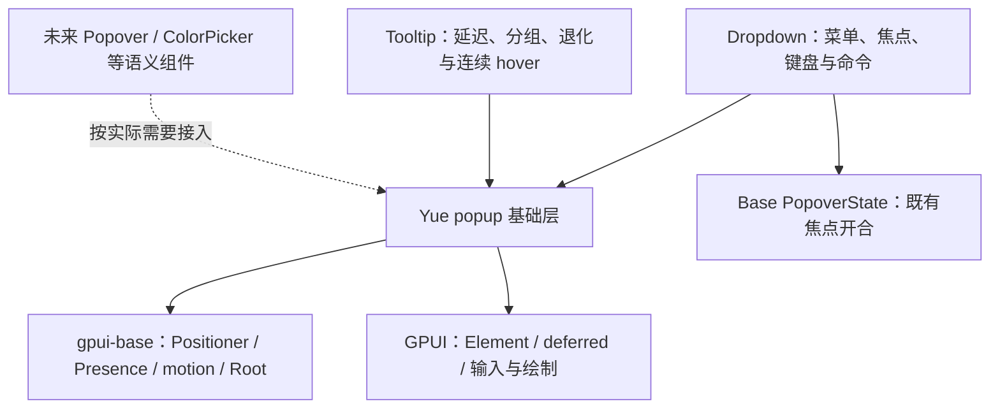

# 12 Popup 基础浮层设计

状态：基础层已实现，Dropdown 已迁移，Tooltip 已作为第二个消费者接入。实施日期：2026-11-01。依赖为 `gpui-kit 0.8.0`、仓库内维护补丁的 `gpui-base 0.8.0`、`gpui-pre 0.3.9`。本文的 Popup 指 **Yue 内部、无业务语义的基础浮层机制**，不是完整的用户交互组件，也不是新建一套 GPUI 后端。阶段 A / B 的历史检查见第 14 节，Tooltip 接入和最新检查见第 15 节。

依赖顺序：**设计并实现 Popup 基础层 → 迁移现有 Dropdown 并通过回归 → 基于 Popup 实现 Tooltip**。阶段 A / B / C 已接通；Tooltip controller、分组策略与交互时序见 [Tooltip](10-tooltip.md)，不进入基础层默认规则。

## 1. 目标与定位

将 Dropdown 已有的锚定、定位、箭头、deferred 绘制和退出清理整理为可共享机制，避免 Tooltip 再实现一套。公共基础层解决“一个 surface 如何安全地出现在锚点附近”，语义组件决定“为什么打开、谁获得焦点、用户能做什么”。

参考 [用户提供的 Popup 页面截图](assets/popup-reference.png)，采纳其中十二方位、箭头、可控显示、内容、嵌套和关闭生命周期的需求。截图是网页组件的能力目录，不是 Rust API 模板；不能把 hover、click、focus、contextmenu、disabled、皮肤和 CSS 挂载属性一并塞进基础层。

关联文档：[Dropdown](07-dropdown.md)、[接入与架构](08-integration-hardening.md)、[Tooltip](10-tooltip.md)。本文是二者共同基础设施的主文档；Tooltip 中的时序、尺寸退化、连续平移及按钮避让仍由 Tooltip 负责。

### 1.1 依赖与可见性



- V1 放在 `crates/yue-component/src/popup/`，经 `pub(crate)` 暴露给库内兄弟组件，不在 crate 根重导出公共 `YuePopup`。先由两个真实消费者验证内部接口，再决定是否发布低层 API。
- 基础模块不导入 Dropdown、Tooltip、业务页面、`YueTheme` 或 `theme::keys`，不启用 `gpui-kit/component`。
- 需要的颜色、半径、边框、阴影、间距和动画参数由上层解析后传入；基础层可用这些值绘制通用几何，但不选择视觉语言。
- 通用的定位能力缺口应补在 Base 的受维护源码中；Yue 保留适配、注册与上层组合，不复制 Base 定位算法。

## 2. 责任边界

| 事项 | Popup 基础层 | 上层组件 / 宿主 |
| --- | --- | --- |
| 锚点 | 稳定身份、实际几何、可见性、失效通知 | 选择按钮、菜单行或鼠标点作为来源 |
| 定位 | side / align、完整包络、候选求解、窗口约束、resolved snapshot | 选择首选位置、fallback 次序与特殊规则 |
| 箭头 | 安全区、投影、方向、通用路径与边框连接 | 显示开关、尺寸、颜色、样式 |
| 显示 | 消费 present 目标、Presence、退出完成后卸载 | 单一 open 真值、受控回调、触发方式 |
| 动效 | 接收策略，采样当前几何、透明度与退出阶段 | 选择时长、曲线、滑动方向、内容交接、连续会话 |
| 输入 | 指针阻挡模式、区域登记、顶层候选与关闭请求原因 | 菜单导航、hover/focus 时序、命令、是否关闭 |
| 焦点 | 不主动调用 focus；保留原 dispatch 归属 | 采用 Base PopoverState 或自身焦点策略 |
| 语义 | 不强制 role / label / Tab stop | Tooltip / Menu / Dialog 等正确角色和名称 |
| 约束与避让 | 已登记区域的几何检测、结果反馈 | 指定必须保护谁、没有空间时如何降级 |
| 嵌套 | 父子浮层关系、绘制顺序、内部/外部区域判断 | 哪些子项展开、菜单深度、模态操作 |

V1 不包含菜单项模型、方向键/typeahead、子菜单 dwell、TooltipDefaults、auto-hide、TooltipGroup、单行/等宽退化、颜色变体、表单、选择值或 Modal focus trap。Popup 也不是应用级“所有浮层自动互斥”的业务管理器。

## 3. 已核实的基础能力与缺口

源码路径相对对应 crate 的 `src/`；下表记录已发布 `gpui-base 0.8.0` 的原始能力。仓库内补丁补齐的接口见第 3.1 节，不将其冒充已发布 API。

| 来源 | 已有能力 | 使用与限制 |
| --- | --- | --- |
| Base `popup.rs::Popup` | trigger 测量、初次同步、corner 位置更新、deferred host；有 content 即挂载 | 固定 `.occlude()`、priority 100；不能配置非阻挡、完整 side / align、Presence 或箭头，不能直接作为两个消费者的统一宿主 |
| Base `positioner.rs::Positioner` | `side`、`corner`、`placement`、`align`、`offset`、`margin`、`on_position`、可选 `occlude` | 复用核心求解；side 只尝试首选/相反侧，fit 判断未包含 offset，clamp 不缩小内容 |
| Base `ResolvedPosition` | 最终 bounds 与可选 side；`on_position` 在 children prepaint 前调用 | 可在同帧为箭头绘制提供结果，不自动提供来源存活、clip、父子层关系 |
| Base corner 跟随 | `tracked_corner_position` 在 prepaint 读取共享坐标 | 是 `pub(crate)`，外部不可调用；不能凭其存在声称 Yue 具有公开的同帧 side 跟随接口 |
| Base `PopoverState` | 开合、焦点转移/恢复、dismiss 订阅、deferred popover 登记 | Dropdown 保留使用；不是 Tooltip 或通用基础层的强制状态模型 |
| Base `Root` / `RootPlugin` | 每窗 retained 插件、decorate、初始化注册 | 用于共享注册和路由；不新增第二个 Root，不自动搬走原控件的 dispatch 子树 |
| Base Presence / transition | 退出保留、值补间、当前值续接、reduced motion | 复用采样；关闭不等于可交互状态，基础层必须显式区分 |
| GPUI `elements/deferred.rs` | deferred 推迟 prepaint / paint，但 child 的 request_layout 仍在原布局阶段运行；保留元素树关系 | 仅包 `deferred(...)` 不能把 render 时捕获的旧 bounds 自动变成本帧 bounds |
| 当前 Dropdown | `MenuHost` + `MenuPanel::popup` 已组合上述机制，箭头读取 resolved cell | 混有菜单状态；锚点在 render 读取前帧值，滚动有一帧滞后；固定箭头及 margin 需参数化 |

### 3.1 同帧 side 跟随是前置技术关卡

在 `Positioner::side(old_bounds)` 后包一层 canvas / deferred，不能补救已捕获的旧锚点。不得通过 `transmute`、访问私有字段、修改 Cargo registry 文件或复制 `resolve` 函数解决。

该关卡通过仓库内 `vendor/gpui-base` 维护补丁解决，workspace 使用 `[patch.crates-io]`，没有修改 Cargo registry。来源为 crates.io `gpui-base 0.8.0`，上游 commit `1676826d9d49b90f4d7b6808b69924f58796f6f1`；来源、许可证、差异与移除条件记录在 [YUE-PATCH.md](../vendor/gpui-base/YUE-PATCH.md)。

补丁尚未发布：外部 workspace 以 path 依赖接入 Yue 时，也需要在自己的 workspace 根配置相同的 `[patch.crates-io]`，指向这份受维护的 Base 源码；Cargo 不继承依赖库 manifest 中的 patch。待上游提供等价公开接口后，再移除该接入要求。

本次真实新增并已编译验证的 Base 接口：

- `Positioner::anchor_source(...)`：prepaint 时读取当前 anchor；`None` 使该帧不 prepaint / paint 内容，也不插入阻挡 hitbox。
- `Positioner::resolve_in(...)`、`available_bounds(...)`：公开复用同一个 resolver 和装饰 inset，供有限候选探测及完整包络验算。
- `Positioner::flip(false)`：固定侧探测；没有复制第二份求解算法。
- `Positioner::position_with(...)`：在 child prepaint / hitbox 之前拒绝非法结果，或采用当前动画采样位置。
- 原 resolver 的 fit 检查计入 offset。Yue 对最终采样调用 GPUI 的 `pixel_snap_bounds`，让 snapshot、箭头、实际内容与 hitbox 使用同一物理像素网格。

无头测试已覆盖首次同帧定位、真实 scroll offset、窗口 resize、嵌套 deferred 与 cached subtree 复用；证据位于 `src/popup/tests/interaction.rs`。Windows 实窗 DPI、字体和像素连接仍须单独验收。

## 4. 最小内部组成

只提取已有消费者的机制，不先发布万能框架。以下为内部组成，字段私有，使用构造器和 reader；`PopupRegistration` 在实现中名为内部 `Registration`。

| 部件 | 生命周期与输入/输出 |
| --- | --- |
| `PopupAnchor` / `PopupAnchorHandle` | element bounds 或窗口内 point；稳定 id、弱存活标记、几何 revision、有效 clip；可由 Root 外的同窗控件共享 |
| `PopupSpec` | 本帧声明：id、可选 parent、anchor、present、位置偏好、约束、指针模式、箭头、动效、关闭路由策略 |
| `PopupHost` | 一个 content 根的基础 Element / RenderOnce 入口；委托 Base 定位和 deferred，消费上层的 present，不产生第二份业务 open |
| `PopupSnapshot` | 只读结果：阶段、有效性、锚点/表面/箭头/外包络 bounds、最终 side、revision；align 是定位输入，clamp 后以实际 bounds 为准；仅在对应布局阶段后有效 |
| `PopupRuntime` | 每窗 retained 注册器；父子关系、存活、有效输入层、顶层候选、路由；不持业务值或菜单项 |
| `PopupRegistration` | RAII / 弱生命周期登记；更新同一 id，卸载注销；不是每帧新建的计时任务 |
| `PopupDismissRequest` | 原因、目标 id、来源事件；请求上层关闭，上层决定并写回 present |

```text
上层 controller ── present + spec + content ──> PopupHost
      ↑                                           │
      └── dismiss / invalidation request ─────────┤
                                                  ↓
AnchorHandle → Base Positioner → resolved snapshot → surface / arrow paint
                       ↕
                 PopupRuntime（同窗注册与路由）
```

`content` 只消费一次，不因重新定位被重复运行有副作用的 builder。不同 surface 的独立身份不依赖 label 或列表下标。持续移动的 Tooltip 可保留同一 host id，只更新 owner/anchor；普通 Dropdown 的根面板和子面板使用不同且稳定的 id。

## 5. 内部契约草案

以下使用本轮实际内部接口展示组合关系；片段中的菜单内容、状态、token 和 id 由调用方提供，不是对外公共 API：

```rust,ignore
let spec = PopupSpec::new(
    popup_id,
    anchor.handle(),
    popover_state.is_open(),
    PopupPlacement::Side(Placement::Bottom, Align::Start),
)
.surface_gap(menu_gap)
.margin(window_margin)
.pointer_mode(PopupPointerMode::Block)
.dismiss_route(PopupDismissRoute::Owner)
.motion(PopupMotion::new(enter, exit).entrance_distance(px(4.)))
.arrow(menu_arrow_style);

PopupHost::new(spec).mount(
    |presentation, snapshot, window, cx| {
        build_menu_content(presentation.is_interactive(), snapshot, window, cx)
    },
    window,
    cx,
);
```

`mount` 接收 `FnOnce`，每次构建只消费一次内容；候选探测不会重跑 builder。未呈现且没有退出进度时根本不调用内容工厂。默认 pointer 为 PassThrough、motion 为 Instant。Tooltip 已组合相同接口，并显式提供 `protected_regions`、`translate_to_anchor` 和 Runtime 路由，没有新增自己的 Positioner / 箭头 / registry。

第二个消费者新增的内部 seam：

- `PopupCandidate::new(side, align, surface_gap)` / `PopupSpec::candidates_with(...)`：在 prepaint 得到真实自然尺寸后提供最多 12 个候选；每个候选仍由 Base Positioner 求解，不透传任意坐标改写。Tooltip 在此应用尺寸退化及组外侧轨道。
- `PopupSpec::can_translate(...)`：与 prepaint 共用候选、完整包络及扫掠路径证明，上层可在替换 owner 前决定平移或安全淡出。
- `translate_to_anchor(transition, max_distance, expected_anchor)`：仅指定目标可插值；真实 anchor 因布局/滚动偏离目标时立即跟随。箭头目标与 surface 由同一 Base transition 策略采样。
- `dismiss_unplaceable()`：默认不启用。显式启用时，没有任何安全候选会经现有 dismiss route 请求 `Unplaceable`；基础层始终抑制危险帧，不私自改 open。
- `PopupRuntime::parent_at(point)`：查询实际包含 trigger 的最深有效 surface，便于 RootPlugin 中的 Tooltip 登记正确 parent/depth；不自动推断所有第三方 overlay。
- `PopupHost::available_size(...)`：以相同 Base 内容视口、视觉保留与装饰 inset 约束自然排版，避免先按较宽窗口换行、再因箭头保留而错误判定 NoSpace；`arrow_within_anchor()` 则可选证明箭头沿边投影仍落在 trigger 范围，默认不改变菜单原有箭头策略。

输入分为相互独立的策略，不能靠组件名切换隐藏默认：

- **定位**：Side / Point；Side 使用 Base `Placement`、`Align`，Point 接收窗口坐标与 corner，无 side 时默认没有箭头。
- **present**：上层唯一真值；基础层只有呈现阶段，不提供 `default_open`、trigger 枚举或自动 toggle。
- **pointer mode**：`PassThrough` / `Block`；默认 PassThrough，Block 只挡当前 surface 完整交互区域，不创建全窗遮罩。
- **dismiss route**：`None` / `Owner` / `Runtime`；每个事件只选择一条关闭路径。上层显式请求 Escape、outside press 等原因，未声明的事件继续传播。
- **motion**：默认 Instant；上层提供进入/退出/移动参数及是否允许路径插值。基础层不自动给所有 popup 添加动画。
- **尺寸**：上层提供 min/max 约束与自然内容；基础层在可用视口内测量，超大内容返回约束/空间不足结果，不静默裁切或偷偷加滚动条。
- **parent**：可选同窗已注册 popup id；不接受跨窗引用、循环关系或已失效 parent。拒绝错误登记应给开发诊断。

内部 `PopupSpec` / snapshot / event 不暴露可随意改写的 pub 字段，不将 `Rc<Cell<_>>` 或 `Entity<...>` 泄漏为调用方必须维护的协议。需要被观察的几何用 reader 获取，避免调用方把前帧快照当永久布局事实。

## 6. 状态、存活与挂载

### 6.1 只有呈现状态，没有第二份 open

```text
Absent ── present + 有效几何 ──> Entering ──> Visible
Visible ── present=false ──> Exiting ── 退出完成 ──> Absent
Exiting ── present=true ──> 从当前采样值续接
任意阶段 ── 锚点/窗口/输入层硬性失效 ──> 安全隐藏并请求上层同步
```

present=true 但缺少有效锚点时处于不可呈现状态，不在窗口原点闪现。首次测量需要额外一帧时只申请必要帧，不创建重绘循环；首帧未得到有效几何不画 surface。

退出阶段保留完成动画所需的只读几何快照，基础层立即撤销阻挡和运行时输入资格。内容工厂接到 `presentation.is_interactive() == false` 后，上层必须省略 handlers、焦点追踪和可访问角色；基础层不会反射任意 GPUI 子树并自动删除其语义。Dropdown 已按此契约构建退出内容，并保留静态滚动偏移和裁切。`!present && progress <= 0` 必须直接卸载，保留 Dropdown 已有的透明 surface 回归保护。重新打开从当前采样值续接，不复活旧 owner 的 handler。

取消关闭动画不意味着重新运行菜单命令或 open 回调。present 同步不向上层反向发送 open=true。dismiss 是请求，不直接修改外部受控状态；安全失效可立即阻止呈现，旧 true 不得在每帧重复重开。

### 6.2 保持 dispatch 归属

Dropdown 的 content 继续作为其触发区域下的 deferred 子树，不能因为引入窗口 runtime 就被搬到 Root 的 sibling overlay。否则父 key context、菜单键盘处理和应用 Action 传播会变化。

Runtime 负责登记和协调，不统一重挂所有内容。Tooltip controller 可以位于 RootPlugin 内，并在那里挂自己的单一 PopupHost；这是 Tooltip 的呈现归属，不是把所有菜单都传送到那里。

### 6.3 生命周期

注册项以窗口、owner EntityId、局部 id、generation 和弱存活标记验证。登记与 capture lease 存入 GPUI keyed state，而不是仅由一帧的 Element 闭包保活；cached subtree 复用其状态，旧 generation 的延迟清理不删除新登记。capture lease 卸载后只为所属窗口申请一次失效重绘，point anchor 则由其持有者管理存活。

锚点销毁、window 销毁、parent 关闭、模态资格失效及时清理。未显示时不构建昂贵 content；显示期普通 repaint 不重建 Entity / subscription / FocusHandle。退出结束释放 snapshot、子登记和 motion 任务；稳定状态不请求持续动画帧。

## 7. 定位、尺寸与避让

### 7.1 统一坐标与阶段

所有几何使用窗口坐标的逻辑 `Pixels`；上层 token 的 rem→Pixels 在边界处解析，DPI / rem / 字体 / 视口 / clip / 内容变化触发 revision。不得重复乘显示缩放，也不能把屏幕坐标当窗口坐标。

区分三种 bounds：

1. `surface_bounds`：矩形内容、padding、border。
2. `visual_bounds`：surface + arrow + shadow 的完整可见包络，用于窗口与保护区域检查。
3. `interaction_regions`：实际可交互表面及显式子区域；阴影和整条移动通道不自动变成 hitbox。

测量内容 → 取得本帧 anchor → Base 求解候选 → 完整包络验算 → resolved snapshot → child prepaint / hit-test → paint。箭头读取同一 snapshot，不能按 preferred side 画而忽略 flip。

### 7.2 Side 与 Point

Side 提供四方向 × Start / Center / End 共十二种组合。默认策略是不自行选择某个产品方位；调用方必须提供偏好，避免 Dropdown 与 Tooltip 各自默认被基础层改写。Point 用于右键菜单，锚点即窗口内鼠标点，不伪装成零尺寸按钮后依赖 Tooltip 规则。

Base 已负责装饰 inset、首选/相反侧选择和 clamp，不复制。Yue 的 candidate adapter 可按上层明确的候选次序调用同一个 Base 机制；固定候选必须有界求解，不能 prepaint 内递归重排到“看起来合适”。普通内容至多一次重新测量和有限候选检查，无法收敛返回 NoSpace / Invalid，而非无限 request_animation_frame。

Base 当前没有公开纯 resolve 或试探指定侧且禁用 flip 的接口，也没有完整 offset-fit 支持。不能伪造这些方法。技术验证时优先在 Base 提供窄的可复用能力：可测量/试探的 resolved 结果及完整包络检查所需的几何入口；不把复制私有算法作为备选。候选回调时已处于 prepaint，若此刻结果无效，应阻止该帧可见绘制/输入，再由安全的下一次布局提交新候选，不能先露出错误位置。

### 7.3 避让是机制，保护对象是策略

基础层接受上层登记的保护区域、允许触碰边界及最小间距，报告相交/无空间与安全候选。不会扫描任意 child 推断“这看起来像按钮”。

Tooltip 将自身和 Group 内按钮/焦点环登记为必须保护；Dropdown 根据菜单、触发器和父子布局提供自己的约束。基础层不能全局规定任何 popup 都不能覆盖任何按钮，否则菜单无法正常覆盖主内容。

运动前检查完整包络的保守扫掠区域；途中布局变化逐帧重验。不能证明路径安全时返回不可平移，由上层选择原地淡出/安全位置进入。基础层只负责证明和执行允许的几何，不决定同行/同列的轨道、会话或何时重新等待 hover。

运动参数允许上层传入本次最大位移预算；基础层从当前采样 bounds 到目标 bounds 做几何校验，超预算返回不可平移，不能自动延长时长完成远距离飞行。基础层默认不启用平移，未提供许可/预算时直接采用目标。Tooltip 的同组/同轴/相邻判定、24px 间隔与 160px 距离设计参数、热会话及重新等待规则属于 [Tooltip 第 5.6 节](10-tooltip.md)，不成为 Popup 的全局默认，也不改变 Dropdown 的交互行为。

## 8. 箭头基础几何

从 Dropdown 提取 `caret_along`、边缘中心、路径生成和最终 side 读取思路，去掉 `MenuKind`、固定 16px 安全边距、固定 8px 菱形及 `YueTheme` 依赖。用参数支持 Tooltip 三角尖端和菜单现有描边连接，迁移初期保留菜单视觉。

输入：side、surface bounds、锚点目标、arrow 底宽/深度、各角半径、边框宽、填充和描边。输出：局部底边中心、尖端、填充/描边路径、visual envelope，以及是否存在合法安全区。

Top / Bottom 沿 X 投影，Left / Right 沿 Y 投影；边缘安全内缩至少容纳圆角与箭头底边半宽。上界小于下界不能继续 clamp；返回 ArrowDoesNotFit，上层可增加最小尺寸或关箭头并重算 gap。

明确 gap 的度量方式，避免迁移后菜单整体挪位：

- `SurfaceGap`：trigger 到矩形表面的距离；Dropdown 迁移先按旧值保留。
- `TipGap`：trigger 到箭尖的距离；Tooltip 使用，矩形表面距离另加 arrow depth。

基础层转换为 Base offset 后验算完整包络，不能让调用方重复加一次 arrow depth。底边连接处只画一次边框，无双线；point anchor 默认无箭头，需要时必须显式提供可信目标。

Tooltip 的“一行使左右 Start/End 退化”“气泡不宽于 trigger 使上下 Start/End 退化”**不写进 Popup**。Tooltip 先算 effective side/align，再调用基础层；菜单宽度小于按钮时也不会因此被强制居中。

## 9. 输入、关闭、焦点和层级

### 9.1 指针与关闭请求

PassThrough 不插入阻挡 hitbox；只读 hover 观察须保证不会覆盖真实按钮 hover。Block 只在可交互阶段调用对应阻挡机制；退出即移除，不能留下透明挡板。

外部按下以当前 popup 的区域及其有效 descendants 判定：点子菜单不算点父菜单之外。触发器可登记为 outside-press 排除区域，避免“先 outside dismiss、再 trigger toggle”导致关了又开。Exclude 区域不等于保护区域，也不自动增加 hitbox。

一次物理事件最多产生一次对应的关闭请求。原因至少区分 Escape、OutsidePress、AnchorInvalid、ParentClosed、WindowInactive；基础层不把 hover-leave 或菜单项执行解释成外部点击。

### 9.2 两种互斥关闭路由

- **Owner**：用于迁移中的 Dropdown。现有菜单 key handler / Base PopoverState 仍处理 Escape、焦点恢复和 dismiss；runtime 只提供嵌套区域、资格与顶层查询，不再绑定第二个同义关闭 handler。
- **Runtime**：用于 Tooltip 等不取得焦点的浮层。每窗 RootPlugin 持有、按 window id 过滤的 `intercept_keystrokes` 将 Escape 送入唯一 runtime 路由，无 focus dispatch path 时仍有效；outside press 通过非阻挡 canvas 观察真实鼠标事件。只请求最高有效层，不强制取得焦点。
- 两种路径都使用同一个区域/父子登记，避免旧 menu surfaces Vec 与新 registry 各自判定一次。handler 消费 Escape 后，当前事件不得继续关闭祖先；未处理的 Action 继续传播。

实现必须验证 Root decorate 包装后的 capture/bubble 顺序，确保内部 Input / 子菜单优先处理其专属键，而可见 Tooltip 又能按既定最上层顺序关闭。GPUI 未核实的 dispatch id / 全窗事件 API 不在本文伪造。若统一仲裁不能通过真实 nested 测试，就保留 Owner 路由，先修复窄的输入适配，不允许同时开启两条“试试看”的路径。

### 9.3 焦点及语义

PopupHost 不创建 Tab stop、不绑定 Enter/Space、不指定 `Role::Menu` / `Role::Tooltip`，也不自动恢复焦点。Dropdown 保留 Base PopoverState 作为唯一焦点主人；Tooltip 保持 trigger 焦点。

通用基础层不把 `PopoverState` 再包成人人必须使用的 `PopupState`。需要 Modal 的未来组件组合 Base focus trap，并向 runtime 登记有效输入层；单纯弹出 surface 不等于模态。

### 9.4 层级与范围

V1 在一处将 parent 深度映射到绘制 priority，保持 Dropdown 根层 `POPUP_PRIORITY`、子层逐级增高；同深度沿用 GPUI 的子树绘制顺序，运行时以有效深度和登记顺序查询顶层。V1 不提供跨组件的语义层类别；Tooltip 通过实际 trigger 所在 parent/depth 登记，已验证嵌套父 Popup 的分次 Escape，第三方 overlay 仍需显式集成。消费者不直接设置 raw z-index，CSS token 的 30/40 也不能直接当 GPUI priority。

绘制优先级不能代替输入资格。新模态打开即撤销背景提示；Base `active_focus_trap`（公开但 doc(hidden)）与 `FocusHandle::contains` 可用于已有焦点范围验证，但不是所有弹层的完整树。Yue 自身浮层用显式 parent / scope 登记补足；未登记的第三方层不能承诺自动互斥，应提供宿主的失效/范围接入点。V1 不改 Dialog 的第三方内部状态。

## 10. 动效机制与外观

基础层默认 Instant，复用 Base Presence / transition，不复制动画调度器。接受上层指定的 enter / exit / move 时长、曲线和明确许可的平移目标；只在安全路径上插值，并在稳定后停止申请帧。V1 的 Positioner 只偏移已测量内容，**不伪造内容尺寸动画**：Translate 遇到 side 或自然内容尺寸变化返回 `UnsafeMotion`，由上层选择淡出/重定位；Instant 可立即采用新尺寸。

- Dropdown 保留现有 fade + 4px 位移、菜单行 stagger 和高亮曲线。行 stagger 留在菜单，不移动到 Popup。
- Tooltip 采用首次 200ms 淡入并微移 4px、相邻 150ms 平移、离开 100ms 淡出并回收 4px；同行/同列轨道、内容交接、箭头目标和 grace 留在 Tooltip controller。自定义候选的静止 gap 同样叠加 Presence 位移，不能跳过 Popup 的统一动效采样。
- 通道 keyed 到稳定 surface，而不是每个新 hover owner。Base transition 的中断保证位置连续，不承诺速度连续；不把它描述成保速弹簧。
- 几何和 hit-test 使用当前显示位置的同一 snapshot，不能画在插值位置、hitbox 却先跳到目标。失效与安全关闭优先于完成动画。
- reduced motion 直接采用目标，不执行平移/尺寸/交叉淡化；hover 等待由上层保留。退出完全结束即卸载。

Popup 不定义 `--popup-*` 视觉主题或新调色板。由 Dropdown 继续读取 menu/popover token，由 Tooltip 读取自己的 token。通用箭头 renderer 接收已经解析的 brush / 半径 / 描边；基础层不得暗中套菜单 padding、最小宽度或大阴影。

## 11. 截图能力如何归层

| 截图属性/场景 | 本基础层对应 |
| --- | --- |
| triggerElement / 触发元素 | AnchorHandle 及单一 trigger 内容组合；不复制 DOM |
| 内容插槽 | 接收一个任意 GPUI content 根，不推断内部语义 |
| placement / showArrow | 位置、箭头机制；具体默认由上层提供 |
| overlayClassName / overlayStyle | 不透传 CSS；上层显式提供绘制参数和 content 样式 |
| visible / 可控显示 | 只消费 present，open / 回调属于语义适配器 |
| hover / click / focus / contextmenu | 不属于基础层，语义控制器或未来公共 facade 提供 |
| hideEmptyPopup / disabled | 上层决定是否提交 present/content；基础层只处理几何无效 |
| destroyOnClose | V1 固定退出完成卸载，不把任意隐藏交互树缓存作为开关 |
| attach / 挂载 body | 原生 GPUI 无 DOM body；deferred 保留原 dispatch 归属，不开放跨窗挂载 |
| 嵌套弹出层 | 显式 parent、区域并集、顶层路由与绘制顺序 |

若后续要发布截图那样的完整 `YuePopup` / `YuePopover`，应另写 facade 设计，组合该基础层及明确的焦点/触发策略；不扩充本基础层直到它等同于菜单、Tooltip 和 Dialog 的并集。

## 12. 文件与实施顺序

已新增 `src/popup/mod.rs`、`anchor.rs`、`host.rs`、`geometry.rs`、`arrow.rs`、`runtime.rs`、`tests.rs` 和 `tests/interaction.rs`；按实际职责拆分。`mod.rs` 为内部稳定 seam；`lib.rs` 只加私有模块，不重导出公共类型。

### 阶段 A：技术验证与基础层

1. 最小 consumer 证明本帧 side 锚点、嵌套 deferred / cached view、非阻挡命中、Root decorate 路由；记录 Base 能力扩展及来源。
2. 完成无样式 host、anchor、snapshot、Presence、箭头和有限候选约束，独立验证几何与清理。
3. 建立每窗 runtime、父子区域与互斥路由；不接入任何业务 trigger delay。

### 阶段 B：迁移 Dropdown

1. 提取通用箭头和包络工具，菜单传入现有参数，先保持像素与 gap 度量。
2. 将 `MenuPanel::popup` 的 Positioner / Presence / deferred 挂载替换为 PopupHost；保留 `MenuHost`、`MenuMotion`、PopoverState、命令及导航。
3. 根面板 / 子面板分别登记 parent 与区域，以 runtime 的嵌套查询替代私有 surfaces Vec；Owner 路由保持一次关闭。
4. 旧定位路径同时移除，不让新旧 surface 双重绘制或双重命中；修复前帧 anchor，保留零透明退出保护。
5. 根菜单、右键区域、SplitButton、勾选/单选、submenu、typeahead、键盘焦点、宽度/快捷键布局全部回归。公共 Dropdown API 不改名。

### 阶段 C：实现 Tooltip

Dropdown 回归通过后，Tooltip controller 通过 PopupHost 提交自己的 anchor、effective placement、保护区域和动效目标。移除其单独建 Positioner / 箭头 / priority / dismiss registry 的计划；它只实现 show/grace/auto-hide、owner 仲裁、Group 轨道与连续内容交接。按钮和 Segmented 便捷入口最后统一迁移。

## 13. 验收与证据

| 验证层 | 必须证明 |
| --- | --- |
| 依赖 | Base-only、无新增 GPUI 后端、无 Component feature、无 registry 源码修改；任何 Base 扩展来源可追溯 |
| 单一所有权 | Popup 不保存第二份 open；受控同步不回调；Dropdown 仍只有 PopoverState 管焦点，Tooltip 不抢焦点 |
| 几何 | 十二位置、Point、flip、clamp、装饰 inset、完整 gap/箭头包络、超大内容和 NoSpace，无错误帧露出 |
| 同帧 | 滚动/resize 后锚点、surface、箭头、hitbox 同步；缓存子树和嵌套 deferred 不滞后/崩溃 |
| 生命周期 | 初始无测量不在原点出现；zero-progress closed 不挂载；退出无输入/语义；卸载/重开/销窗清理，不持续申请帧 |
| 指针 | PassThrough 不改变下层 hover/click；Block 只挡自身；子菜单内部点击不关父层；触发器不会关了又开 |
| 路由 | Owner 与 Runtime 不重复处理；一次 Escape 只关预期顶层；输入控件自身命令与宿主 Action 不被笼统吞掉 |
| 保护区域 | 区分 visual / interaction / exclude / protected；安全起终点但路径相交时拒绝平移；未登记对象不虚报保护 |
| 嵌套 | 父关闭撤销子层，移除旧 owner 不伤新 owner，多窗隔离；模态输入资格不由 priority 冒充 |
| 箭头 | 最终 side、尺寸、安全区、三角/菜单连接与无双线；Popup 不擅自套用 Tooltip 方位退化 |
| 迁移 | Dropdown 原有输入、焦点、行布局、动效和公开接口回归；没有新旧 host 同时运行 |
| 性能/动效 | keyed 通道、当前值续接、当前几何 hit-test、reduced motion、稳定停止绘制；无重画创建 timer/Entity |

无头交互测试应使用真实输入与已解析 bounds，纯几何测试覆盖边界和路径相交。Windows 实窗验证 DPI、真实像素、箭头连接、字体和输入，观察树测试不能冒充屏幕阅读器结果。

实施后运行：

```powershell
cargo fmt --all -- --check
cargo test --workspace --locked
cargo test --workspace --locked --features headless-tests
cargo test -p yue-component --locked --no-default-features --features headless-tests
cargo clippy --workspace --locked --all-targets -- -D warnings
cargo clippy --workspace --locked --all-targets --features headless-tests -- -D warnings
node tools/sync-yue-theme.mjs --check
```

实施记录须分别列出基础层完成、Dropdown 已迁移、Tooltip 已接入及各自验证证据。本轮实现与验证结果见第 14 节；自动化结果和 Windows 实窗验收分别记录，不混为同一证据。


## 14. 2026-11-01 实施记录

### 已实现与迁移

- 内部 Popup：live anchor、side / point、十二方位、有限候选、resolved snapshot、通用箭头、Presence / deferred、默认透传、保护区域与位移预算。
- 生命周期：GPUI keyed state 保留 capture / registration，generation 防止旧 owner 清理新 owner；退出不阻挡，零进度关闭完全卸载，稳定态不持续请求帧。
- Runtime：每窗独立、父子区域与 trigger exclude、Owner / Runtime 互斥路由、无焦点 Escape / outside press 请求；`yue_component::init` 在开窗前注册 Base RootPlugin。未调用 Yue 初始化的宿主仍可使用 Owner 路由，Runtime 输入路径要求该插件。
- Dropdown：删除私有 surfaces Vec 和独立 Positioner / Presence / deferred / 箭头路径，全部经 Popup；保留 Base PopoverState、原 dispatch 子树、菜单模型、导航、typeahead、勾选/单选、submenu dwell、行 stagger 与高亮动画。沿用现有淡入淡出、4px 位移和 token，而非重新选择动效。
- 完整视觉包络计入菜单传入的阴影、箭头和描边，包括箭尖 miter join 超出半描边宽度的部分；窗口边缘现在为完整包络保留空间，可能比旧版本仅按矩形 clamp 更早翻转或内移，菜单正常位置的 SurfaceGap 不变。

### 验证证据

- Popup 定向测试：27 项通过，覆盖全部十二方位、Point、offset flip、首次/scroll/resize 同帧、cached nested deferred、透传/阻挡、实际动画位置与 hitbox、路径保护、预算拒绝、代际清理、多窗与稳定停帧；另验证四侧箭尖描边包络、Dropdown 的进入/退出均保留 4px 位移，以及 reduced motion 直接采用远距离、新尺寸目标。
- Dropdown：迁移前 23 项基线通过；迁移后 23 项交互回归全部通过，包含行布局、键盘/指针高亮、typeahead、禁用、勾选/单选、子菜单 Escape 与焦点恢复。

2026-11-01 本轮最终工程检查记录（headless 两组追加 `--no-fail-fast`，以便其他测试目标也执行完毕）：

| 检查 | 结果 |
| --- | --- |
| `cargo test --workspace --locked` | 通过；Yue 单元测试 113 项，文档测试 16 项，其余 workspace 目标通过 |
| `cargo test --workspace --locked --features headless-tests --no-fail-fast` | Yue 单元测试 136 项全通过；Dropdown 23 项及其他目标通过；ColorPicker 31 项中 5 项失败 |
| `cargo test -p yue-component --locked --no-default-features --features headless-tests --no-fail-fast` | Yue 单元测试 136 项全通过；Dropdown 23 项及其他目标通过；同样 5 项 ColorPicker 测试失败 |
| 两组 `cargo clippy --workspace --locked --all-targets … -- -D warnings` | 未通过；12 项诊断均位于并行开发的 `color_picker/`、`swatch.rs`；本次 Popup / Dropdown 文件无诊断 |
| `cargo fmt --all -- --check` | 未通过；差异位于并行改动的 ColorPicker、共享 `lib.rs`、showcase `main.rs` / `sidebar.rs` |
| Popup / Dropdown / application / Base Positioner 的定向 `rustfmt --edition 2024 --check` | 通过 |
| `node tools/sync-yue-theme.mjs --check` | 通过 |

本次检查时失败的 ColorPicker 测试为 `sliders_are_focusable_independent_and_keep_alpha_or_rgb`、`actual_tab_crosses_inputs_without_inserting_indentation`、`tab_exits_popup_and_returns_to_host_in_both_directions`、`color_panel_tab_exits_after_moving_within_a_swatch_group`、`rgb_and_hsl_tab_paths_cross_every_field_and_leave_no_indent`，集中在其键盘焦点路径。全仓结果不是全绿；待并行实现收敛后重新执行上述工程检查。Popup、Dropdown 的定向通过不能代替该项验收。

### 当前边界

- 本节为阶段 A / B 完成时的历史记录；Tooltip 在后续阶段 C 已接入，见第 15 节，不再使用按钮旧的原生 Tooltip 路径。
- V1 Translate 只支持相同 side、相同内容尺寸的平移；被拒绝的路径返回 `UnsafeMotion` 并抑制该帧，不自动远距离飞行或偷偷转为跳位。上层可根据 snapshot 改用 Instant 或安全淡出策略。
- Exiting 内容的无输入/无语义由类型化呈现契约和语义组件共同保证，不保证任意调用方忽略该契约时仍被自动清洗。
- Base focus trap 可用于显式 `scope` 验证，宿主仍须接入自身未登记模态/输入范围的失效；未实现所有第三方 overlay 的自动互斥和统一语义层排序。
- Windows 实窗 DPI、真实像素、屏幕阅读器、性能测量未在本轮无头测试中验收。


## 15. Tooltip 作为第二个消费者接入

2026-11-01 完成阶段 C。Tooltip 使用同一个 PopupHost / PopupRuntime，提交自然尺寸、有效候选、箭头样式、保护区域及动效目标；Button 与 Segmented 的原生 Tooltip 路径已迁移。show/grace/auto-hide、单行/窄气泡退化、分组邻接及轨道由 `src/tooltip/` 持有，没有下沉为 Popup 隐藏默认。

本次新增的基础 seam 见第 5 节：按实际测量提供有限候选、统一内容可用尺寸、预检平移、限定指定目标而让真实滚动立即跟随、可信箭头、无安全位置的显式关闭请求，以及触发器所在最深 parent 查询。候选、预检与逐帧挂载共用 Base resolver 和完整包络校验；没有第二份手写定位算法。

Runtime 的 Escape 改为每窗插件持有、按 window id 过滤的 keystroke interceptor，沿用同一个顶层路由。这样没有 focused dispatch path 的提示也可关闭；Owner 路由仍留给 Dropdown。真实嵌套测试验证：第一次 Escape 仅关 Tooltip、父 Popup 保持且焦点不动；第二次再交给父 Popup 原有键盘处理。outside press 继续非阻挡观察，不拦截目标按钮命令。

### 最新验证

本节结果取代第 14 节阶段 A / B 的历史失败状态：

| 检查 | 结果 |
| --- | --- |
| Popup / Tooltip 定向回归 | 27 / 27 与 26 / 26 通过 |
| Dropdown / Segmented 回归 | 23 / 23 与 12 / 12 通过 |
| 默认 workspace 测试 | 通过；组件单元 113 项、组件 doctest 18 项及其他目标通过 |
| workspace + headless | 通过；组件单元 163 项、Showcase 6 项、全部集成测试及文档测试通过 |
| no-default-features + headless | 通过；组件单元 163 项、全部集成测试及文档测试通过 |
| 默认 / headless 两组 Clippy | 均以 `--all-targets -- -D warnings` 通过 |
| workspace fmt | 通过 |
| token 离线生成检查 / 外部源对比检查 | 均通过 |

V1 仍只允许同 side、同实际布局尺寸的 Translate。Tooltip 已在更换 owner 前选择平移或安全淡出；没有把不同尺寸的 hitbox、绘制和布局伪装成尺寸补间。Windows DPI、真实像素、UIA 朗读及第三方 overlay 的完整集成不包含在本次自动检查结论内。API、演示和测试详情见 [Tooltip 第 12 节](10-tooltip.md#12-2026-11-01-实施记录)。
