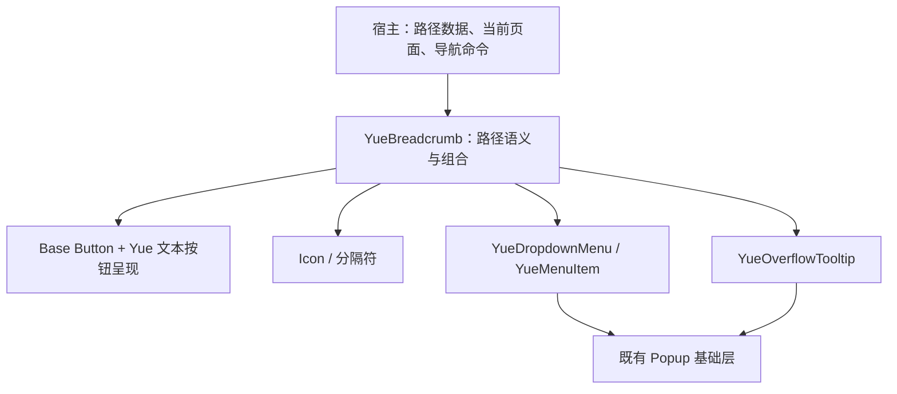

# 15 YueBreadcrumb 面包屑组件设计

状态：V1 已实现，自动化验证见第 9 节；Windows 实窗视觉 / UIA 验收待完成。日期：2026-11-01。参考[用户提供的 Breadcrumb 截图](assets/breadcrumb-reference.png)，基于当前 GPUI Kit 0.8.0、Base-only 架构与 Yue 现有组件能力。

## 1. 目标与组成

面包屑展示**当前页面在层级结构中的位置**，让用户返回任一可访问的祖先层级。路径按根节点 → 当前页排列；不是历史访问记录，不代替侧栏、Tab 或前进 / 后退。

采用用户提出的组合方式：**文本按钮 + 图标 / 分隔符 + 下拉菜单**。其中当前页默认是静态文本；路径较短时不创建菜单。

```text
首页  ›  项目  ›  Yue Component  ›  Button
按钮     按钮       按钮           当前页文本

首页  ›  …  ›  组件  ›  Button
按钮    菜单触发器    按钮   当前页文本
         └─ 项目
            Yue Component
            设计规范（禁用）
```

| 部件 | 职责 | 实现来源 |
| --- | --- | --- |
| 文本按钮 | 激活祖先层级，提供完整名称、键盘与焦点反馈 | Base `Button` 行为 + Yue 文本按钮呈现 |
| 前置图标 | 辅助识别首页、目录、资源类型 | 现有 `IconDefinition` / Tabler 图标 |
| 分隔符 | 表达相邻层级关系，无点击、焦点或旋转 | 默认 `YueIcon::ChevronRight`，支持文字或其他装饰图标 |
| 当前页 | 说明当前位置，默认不可激活 | 普通文本与可选图标 |
| 折叠触发器 | 打开被隐藏的连续祖先层级 | 文本按钮 / 图标按钮 + `YueDropdownMenu` |
| 隐藏层级列表 | 按原路径顺序展示、导航，保留 disabled | `YueMenuItem` |
| 截断提示 | 仅在实际文字溢出时展示完整名称 | 现有 `YueOverflowTooltip` |

范围覆盖截图中的基础、带图标、自定义分隔符、批量配置、折叠、自定义省略标记和点击导航。参考图中的覆盖率徽章、网页 Tab、代码操作区、贡献者和大面积空白不属于组件。

## 2. 依赖与责任边界



- 宿主保存完整路径，处理导航、权限、异步加载和失败；组件只发出导航请求。点击后不自行截短路径、不提前切换当前页、不发网络请求。
- `YueBreadcrumb` 是 `RenderOnce` 组合元素，不新增业务 `Entity<YueBreadcrumbState>`。菜单开合、焦点、hover 和测量缓存由既有行为状态或稳定 keyed state 保存。
- Dropdown 继续负责开合、菜单键盘、选中执行、Escape、外部点击、焦点恢复及动效；Breadcrumb 不直接调用 Popup 拼另一套菜单。
- Tooltip 继续负责延迟、定位、避让、隐藏和 reduced motion；Breadcrumb 不使用 GPUI 的独立原生 tooltip。
- 不引入第二个 Root，不启用 `gpui-kit/component` 或 Lucide assets，不增加路由框架依赖。

### 2.1 能力与实现边界

| 项目 | 基线能力 | V1 实现 |
| --- | --- | --- |
| Base Breadcrumb | `vendor/gpui-base/src/` 当前没有独立 Breadcrumb | 组合已有行为，不虚构 `base::Breadcrumb` |
| Kit styled Breadcrumb | 本机解析的 `gpui-component 0.8.0/src/breadcrumb.rs` 有基础实现 | 仅作本地能力对照；其主题依赖、按位置赋 ID、普通点击节点不直接复制进 Yue |
| YueButton Text | `ButtonVariant::Text` 颜色偏链接语义，保留普通按钮尺寸 / padding | `breadcrumb/action.rs` 的内部 `TextAction` 复用 Base Button，补充中性文字、截断与焦点环；普通按钮默认外观不变 |
| Dropdown | 已有菜单键盘、关闭、焦点恢复、Popup 动效 | 新增库内 `with_state`、`with_action_trigger` 和静态 Info 行；隐藏项使用稳定 value ID，按钮本体负责键盘激活 |
| 当前页语义 | GPUI 可用 `aria_description`，当前通用 Div 没有 `aria_current` builder | V1 用当前页静态角色及可本地化描述；不得把 `aria_selected` 冒充 current-page |
| Breadcrumb token | 实施前没有 `BREADCRUMB_*` 专属键 | 源设计系统新增 19 个组件 token、词表 / grammar 与测试，再同步离线快照与 generated；详见第 7.2 节 |
| disabled 语义 | Base 已有原生 disabled 适配器，原来仅库内可见 | 公开导出 `A11yDisabledExt` / `A11yDisabled`，复用既有实现，不在 Yue 复制适配代码 |

文本按钮是组成部件，不意味着复刻 Button 行为。若需要共享内部 label slot、截断测量或焦点环绘制，应在 Yue 内部提取最小 helper，仍由 Base Button 处理激活 / disabled / 焦点；不增加面向业务的任意子节点样式覆盖 API，也不改变普通 `YueButton` 的既有默认外观。

## 3. 公共 API

以下接口已由 crate 根导出；prelude 导出 `YueBreadcrumb`。沿用本仓库 builder 风格；字段保持私有，以构造器、builder 和 reader 暴露。

```rust
YueBreadcrumb::new("project-path", theme)
    .label("面包屑")
    .items([
        YueBreadcrumbItem::new("home", "首页").icon(outline::Home),
        YueBreadcrumbItem::new("projects", "项目"),
        YueBreadcrumbItem::new("yue", "Yue Component"),
        YueBreadcrumbItem::new("button", "Button"),
    ])
    .on_navigate(cx.listener(|this, request: &BreadcrumbNavigate, window, cx| {
        // 宿主按 request.value() 执行导航；成功后更新路径并 notify。
        // 不以展示文字或当前数组位置标识业务目的地。
    }));
```

### 3.1 路径项 `YueBreadcrumbItem`

| 接口 | 合同 |
| --- | --- |
| `new(value, label)` | 非空且路径内唯一的稳定 value、非空完整文字；value 使用 `SharedString` |
| `icon(impl IconDefinition)` | 可选前置装饰图标；不增加独立点击区 |
| `disabled(bool)` | 默认 false；保留显示、层级位置和完整名称，不可激活 |
| `description(text)` | 可选补充说明，例如不可访问原因；不取代可见 label |
| `value()` / `label()` / `is_disabled()` | 只读数据访问，不公开字段 |

本轮不提供图标独占路径项，图标总有文字名称。重复文案允许，重复 value 或空白 value / label 属于配置错误，应在归一化阶段明确拒绝。祖先与当前页的身份来自完整路径位置，不从 label、disabled 或可点击性推断。

### 3.2 容器 `YueBreadcrumb`

| 接口 | 默认值 / 合同 |
| --- | --- |
| `new(id, theme)` | 稳定根 ID、显式主题；默认单行、内容宽、无折叠 |
| `item(item)` / `items(iter)` | 追加类型明确的路径项，共用一个有序集合；不另外维护 options 数据源 |
| `on_navigate(handler)` | `Fn(&BreadcrumbNavigate, &mut Window, &mut App)`；路径按钮与菜单条目共用 |
| `separator(BreadcrumbSeparator)` | 默认 ChevronRight；支持 `::text("/")` / `::icon(icon)` |
| `collapse(BreadcrumbCollapse)` | 不设置则不按条目数量折叠，详见第 5 节 |
| `ellipsis(BreadcrumbEllipsis)` | 默认文字 `…`；支持 `::text("更多")` / `::icon(icon)`，只改变菜单触发器内容 |
| `current_clickable(bool)` | 默认 false；显式 true 且有导航处理器时允许当前页触发请求 |
| `item_max_width(DefiniteLength)` | 单项文字区的上限；默认 12rem，实际可用空间更小时继续收缩 |
| `label(text)` | 导航区域名称，默认 `Breadcrumb`；可本地化 |
| `overflow_label(text)` | 折叠菜单触发器 / 菜单名称，默认 `Show hidden levels`；可本地化 |
| `current_description(text)` | 当前页描述，默认 `Current page`；与项自身 description 合并 |
| `theme` / `use_default_theme` | 显式局部主题 / 应用主题继承；菜单和 Tooltip 同步主题 |
| `width / min_width / max_width / margin / flex_grow` | 沿用 `ControlLayout`，只调整外部布局 |

`BreadcrumbNavigate` 仅携带稳定 `value()` 与 `source()`；`BreadcrumbNavigateSource::{Item, OverflowMenu}` 用于观察来源，不承载路由对象、不传元素引用。指针、键盘或辅助技术的成功激活均走同一条路径，每次只通知一次。

不同时引入 item-level `on_click` 与 container-level `on_navigate` 两条业务通道。宿主可在一个处理器内按 value 分派。没有处理器时所有路径项作为只读文本；折叠菜单仍可打开查看隐藏项，但不创建无操作的菜单命令，详见第 5.3 节。

截图的 options 配置对应 `.items([...])`，无需同时发布 `options` 和 `children` 两套同义接口。自定义省略符不接收任意交互 Element 或 JavaScript 式 Function / Slot；需要弹出隐藏项时始终使用本组件的 Dropdown 合同。

## 4. 路径语义与激活

| 条目状态 | 显示 | 激活 / 焦点 |
| --- | --- | --- |
| 可访问祖先 + 有处理器 | 中性文本按钮，含可选图标 | 指针 / Enter / Space 发一次请求，Tab 可达 |
| 当前页 | 更明确的正文色，标识当前位置 | 默认静态文本，无 Tab stop，不发导航 |
| 当前页 + `current_clickable(true)` | 保持当前页视觉和描述，具有文本按钮反馈 | 有处理器且非 disabled 时可激活 |
| disabled | 禁用文字色，保留位置；有原因时提供完整描述 | 不发请求、不进入 Tab / 菜单方向键导航，不显示可激活反馈 |
| 无处理器的祖先 | 静态次级文本 | 不制造假按钮或假链接 |
| 分隔符 / 装饰图标 | 中性、视觉从属 | 无独立角色、焦点或回调 |

- 最后一个输入项始终为当前页；V1 不另设可与路径矛盾的 `current(value)`。空路径不输出空 Navigation 区域；单项路径仅显示当前页，不出现分隔符或折叠触发器。
- disabled 不改变 current 身份。最后一项 disabled 时仍说明“当前页”，但不能激活；空 / 禁用条目不会使前一项自动变成当前页。
- 点击祖先、当前页自定义激活和折叠项都不自动更改路径。导航失败或异步尚未完成时，原路径继续表示真实页面。
- 应用内部层级切换使用 Button 语义与默认箭头光标。V1 不提供 `href` / `target`，不调用 `App::open_url`，不把应用导航伪装成 `YueLink`；真实外部资源链接是单独的后续扩展议题。
- 根节点是具名 `Role::Navigation`，内部按路径顺序组织 `Role::List` / `Role::ListItem`。可操作项保留 Button 角色；静态当前页具有完整文字与 current 描述。装饰分隔符不重复朗读。

## 5. 折叠与隐藏层级菜单

折叠只隐藏一个**连续的中间路径区间**，不丢失顺序，不隐藏当前页；省略号表示存在可查看的层级，不是导航目的地。

### 5.1 确定性规则

使用 `BreadcrumbCollapse::new(max_items).before(b).after(a)`：

- 默认 `before = 1`、`after = 1`，只有显式设置 collapse 才启用。
- `max_items = M` 同时是启用折叠的条目数量阈值和折叠后可见槽位的上限；省略触发器计一个槽位。
- `N <= M`：显示全部 N 项，不出现省略号。
- `N > M`：显示前 b 项、一个省略触发器、后 a 项；隐藏区间为 `[b, N-a)`。
- 配置须满足 `M >= 3`、`b >= 1`、`a >= 1`、`b + a + 1 <= M`，否则明确拒绝。不静默改参数，不生成连续两个省略号。
- b、a 是明确保留数，不为填满 M 自动增加；例如 M=5、b=1、a=2 的折叠结果是 4 个可见槽位。

| 输入 / 配置 | 输出 | 隐藏内容 |
| --- | --- | --- |
| N=3，M=5 | `1 › 2 › 3` | 无 |
| N=5，M=5 | `1 › 2 › 3 › 4 › 5` | 无 |
| N=8，M=5，b=1，a=1 | `1 › … › 8` | 2–7 |
| N=8，M=5，b=2，a=2 | `1 › 2 › … › 7 › 8` | 3–6 |
| N=6，M=5，b=2，a=2 | `1 › 2 › … › 5 › 6` | 3–4 |

```rust
YueBreadcrumb::new("deep-path", theme)
    .items(path_items)
    .collapse(BreadcrumbCollapse::new(5).before(2).after(2))
    .ellipsis(BreadcrumbEllipsis::icon(outline::Dots))
    .overflow_label("显示隐藏的层级")
    .on_navigate(navigate);
```

### 5.2 菜单行为

- 点击、Enter / Space 打开；V1 文本动作触发器不额外声明向下键打开。默认向下、起始边对齐，窗口碰撞交给 Dropdown / Popup 处理，不强制越界方向。
- 隐藏项按原路径由浅到深排列；保留原 value、完整 label、图标、disabled 和 description，不改为倒序、不添加“页面 1”之类合成业务名称。
- 普通模式将每项适配成 `YueMenuItem::new(label).id(value)`，有图标时 `.icon(...)`，禁用时 `.disabled(true)`；回调复用同一个 navigate handler，source 为 OverflowMenu。
- 选择可用条目：菜单关闭、请求只执行一次；没有 `keep_open`。Escape / 外部点击只关闭，不导航。
- 方向键、Home / End、typeahead、滚动和焦点恢复继承 Dropdown，菜单行的 padding、图标槽和尺寸保持一致。
- 不将隐藏祖先改造成复选项、Radio、子菜单树或新的路由选择器。

### 5.3 只读与全禁用路径

无 on_navigate 时，省略触发器仍可查看路径，隐藏条目使用 Dropdown 的库内 `YueMenuItem::info` 静态内容行，以 `Role::Caption` 暴露完整名称，不附命令处理器，也不挤用 heading 语义。全 disabled 的隐藏区间仍可打开，条目保留 disabled 原因；菜单沿用 Dropdown 的容器焦点和 Escape 返回合同。

### 5.4 动态数据与焦点

- 所有交互节点以 `(breadcrumb id, item value)` 或固定 overflow 子 ID 稳定标识；不以渲染数组索引 / 文案作为 ID。可见项和菜单项使用不同角色子键，避免同 value 的焦点 / 动效通道冲突。
- 菜单打开期间，路径成员、顺序、折叠配置或当前页变化，先关闭旧菜单并取消旧导航闭包，再展示新路径。只改文案 / 图标 / disabled 时同步当前数据，不触发业务通知。
- 激活时再次校验该 value 仍属于本帧隐藏区间且可用；已删除或新禁用项的旧指针事件不能导航。不得仅依赖 render 时捕获的 index。
- Breadcrumb 的 keyed runtime 保存最新 items、隐藏区间、handler 和 generation，并通过 Dropdown 库内 `with_state` 共享 Base `PopoverState`；结构变化先调用现有 `sync_open(false, ...)`，再递增 generation。旧闭包必须同时通过版本、成员、状态与可见区间校验。
- 若关闭时触发器仍存在，沿用 Dropdown 焦点恢复；若折叠消失，恢复到仍可见、可操作的最近祖先；整条路径移除时将焦点移交宿主原有焦点范围，不保留已卸载 FocusHandle。
- 用户完成导航后焦点最终进入何处由宿主决定；菜单关闭恢复不得覆盖宿主在导航回调内明确设置的新焦点。

## 6. 单行布局与超长文字

面包屑沿父内容区的起始边排布，垂直居中，默认不强制撑满。采用一致文字行高、图标槽和间距；没有卡片底色、整体边框或阴影。

- **条目数量折叠**与**文字截断**独立：max_items 只读路径数量，不等于按宽度自动折叠；窗口缩放不会让本来聚焦的按钮因为宽度阈值消失。
- 每项默认文字区上限 12rem，受 `item_max_width` 与父容器实际空间共同约束；图标、分隔符和 overflow 触发器保持固定尺寸，文字区 `min_w_0`、单行末尾省略。
- 优先给当前页分配可读文字空间，其次在祖先文字区间收缩；一旦所有项到达最小可用宽仍放不下，进入横向滚动兜底。不得裁掉当前页、隐藏焦点环，或让分隔符独占换行。
- 横向滚动区域要跟随真实键盘焦点；首次布局 / 当前页变更时确保当前页可见。普通重绘不重置用户滚动位置。V1 不提供横向自动折叠、文字换行和拖动重排。
- 截断依据真实 shaped text 与文字槽宽度，不按字符数猜测。溢出才启用 `YueOverflowTooltip`，完整 label 同时保留为可访问名称。
- 静态当前页的溢出提示可在 hover 查看；它不为 Tooltip 单独增加 Tab stop。按钮获得焦点时可查看溢出提示，菜单打开后抑制触发器 Tooltip。
- 菜单内保留完整 label 数据，显示遵循 Dropdown 既有宽度上限；不能将主路径里已截断的显示字符串作为菜单文本。

12rem 默认上限来自 `--breadcrumb-item-max-width: calc(var(--space-48) * 4)`；GPUI 将基准 192px 转换为 rem，随字体缩放。源码只读取生成 token，不散落 192px 呈现常量。当前页不参与祖先的普通 flex 收缩，同时以父宽为上限；祖先缩到最小宽后由滚动兜底。

## 7. 视觉与动效规格

以下语义映射已登记为 `--breadcrumb-*` token。基准尺寸按 rem 缩放，文字和边界使用当前主题，不从截图取硬编码浅灰。

| 部分 | 规格来源 / 目标 |
| --- | --- |
| 文字 | 现有 `--font-size-md` / `--line-height-md`，常规字重 |
| 可用祖先 | `--text-secondary`；hover / 菜单展开时过渡到正文色与 `--surface-subtle` 背景；输入激活仍由 Base 处理 |
| 当前页 | `--text-primary`，默认常规字重；通过位置、描述和颜色共同说明身份 |
| disabled | `--text-disabled`，不对整个路径统一降 opacity |
| 图标 | 与文字同一基线，中等文字配 16px 基准图标；走 `IconSize` / token 适配 |
| 图标与文字间距 | `--space-4` |
| 分隔符左右间距 | 各 `--space-8`，不将按钮内 padding 重复计入层级间距 |
| 行高与命中区 | 文字按 body 行高；命中区至少 24px 基准，采用现有控制 / 间距规格组合，按 rem 放大 |
| 焦点环 | Yue 通用 focus 语义、小圆角，外绘不重排，不被自身滚动裁剪 |
| overflow 触发器 | 与文本项等高；默认 `…`，无常驻边框和按钮底色；焦点 / 打开状态明确 |
| 菜单 | 完整继承 Dropdown 的颜色、行高、padding、圆角、阴影和状态 |
| 截断提示 | 完整继承 Tooltip 的主题、位置和时间策略 |

### 7.1 动效选择

- 路径文本只做现有交互时长 / easing 的颜色或浅背景过渡；不放大、缩小、弹跳或平移文字，避免路径在 hover 时抖动。
- 分隔符固定，不因打开菜单旋转；前置目录图标也不旋转。省略号只是打开入口，不套用 Disclosure 的 Chevron 旋转。
- 折叠菜单使用 Dropdown 已有进入 / 退出动画，不新增 Breadcrumb 专属弹簧或 Popup 默认动画。
- 路径变化和折叠配置变化在同帧采用新布局，不做跨层级滑动或长度 morph；首版没有两个 breadcrumb 之间的共享浮层平移动画。
- Reduced motion 下交互过渡与菜单到达最终状态；功能、焦点和完整名称不依赖动画。

### 7.2 Token 实施纪律

源文件：`D:/100_Projects/110_Daily/Yue-Design-System/packages/tokens/src/component-tokens/breadcrumb.css`，共 19 项：

- 前景 4 项：`color`、`color-hover`、`color-current`、`color-disabled`。
- 字体与几何 8 项：`font-size`、`line-height`、`icon-size`、`height`、`gap`、`separator-gap`、`item-min-width`、`item-max-width`。
- 交互 7 项：`background-hover`、`border-radius`、`focus-ring-color`、`focus-ring-width`、`focus-ring-offset`、`duration`、`ease`。

均带 `--breadcrumb-` 前缀并引用既有语义 / 基础 token。源 `_index.css` 已接入，词表 / grammar 已登记；`tests/token-breadcrumb.test.mjs` 包含命名规则及四个 theme/accent profile × 4 个 neutral tone 的 17 项测试，检查尺寸、正文 4.5:1、焦点 3:1 和动效。

已通过 `tools/sync-yue-theme.mjs --write` 同步到本仓库 `tokens` 快照和 `theme/generated.rs`；后续先改源再同步，不手改 generated。源码只用静态 `theme::keys::BREADCRUMB_*`。

消费者继续需要根 workspace 的 Base patch，详见 [YUE-PATCH](../vendor/gpui-base/YUE-PATCH.md)；本次只扩展 disabled 适配器的可见性，其实现不变。

## 8. 键盘与可访问性

| 输入 | 路径区域 | 折叠菜单 |
| --- | --- | --- |
| Tab / Shift+Tab | 按可视顺序访问祖先按钮和 overflow；跳过静态当前页、disabled、图标和分隔符 | 继承 Dropdown 的退出 / 焦点合同，不创建额外焦点陷阱 |
| Enter / Space | 激活当前按钮一次；overflow 打开菜单 | 激活可用条目并关闭 |
| Up / Down、Home / End | 普通路径不新增 roving 模式 | 沿用 Dropdown |
| Escape | 无菜单时不吞宿主 Escape | 关闭顶层菜单，恢复有效焦点，不导航 |

- 根名称、完整项名称、disabled 原因、overflow 名称和当前页描述都可由宿主本地化。
- 不同时给 wrapper 与真实按钮各放一个 Tab stop；图标不重复播报文字，视觉省略号不充当唯一可访问名称。
- 空路径、无导航处理器、全禁用隐藏项、先聚焦再禁用、菜单打开后删除路径都要有确定行为。
- 当前页使用 description 是当前 GPUI 适配边界，不宣称已经提供 AccessKit / UIA 的原生 current-page 属性。读屏实际播报须在 Windows 实窗验证。

## 9. Showcase 与验证

已在 **组件 → Breadcrumb** 增加独立页，按英文升序放在 Button 前。沿用现有 Showcase 的 section、间距、主题开关，不复制网页演示容器。运行 `cargo run -p windows-showcase` 查看。

| 示例 | 展示 / 配置 |
| --- | --- |
| 基础路径 | 3 项路径，当前页静态；通过真实文本按钮返回祖先 |
| 图标路径 | 首页图标、目录图标与文字共同展示 |
| 自定义分隔符 | ChevronRight、`/`；公开 API 另支持自定义装饰图标 |
| 深层路径 | 8 项，开关折叠、切换首尾各 1 / 2 项；示例阈值固定为 5，API 可配置 |
| 自定义省略标记 | `…` / “更多” / Dots 图标，都打开同一类型菜单 |
| 导航行为 | 请求计数、最后 value / source；演示当前页自定义激活与 disabled |
| 长文字与宽度 | 中文长文字、固定窄容器与真实溢出 Tooltip；自动化另覆盖 16 / 24px rem |
| 主题与只读 | Light / Dark × Azure / Neutral；只读、单项禁用与当前页可点击开关 |

验收要求（逐项实际覆盖情况见后续记录；本列表不代表全部已经执行）：

1. 纯规则测试覆盖 N=0/1/M/M+1、最短隐藏区间及多个隐藏项、before / after 边界、非法参数、空白 / 重复 value、重复 label、全部禁用；原路径不被修改，当前页永远保留。按本折叠公式，启用折叠时至少隐藏 2 项，不产生单个隐藏项。
2. Base Root 下验证文本按钮和菜单条目角色、Tab / Shift+Tab、Enter / Space、菜单方向键 / typeahead / Escape / 外部点击；每次导航恰好通知一次，无业务回调时不出现假命令。
3. 验证可见项与折叠项使用同一个 value / handler，source 正确；disabled 与 current_clickable 合同保持一致；导航回调设置的新焦点不会被菜单清理覆盖。
4. 菜单打开时删除、重排、替换、禁用或清空路径，保证无旧闭包导航、无残留菜单与失效焦点；更换折叠配置不复用旧隐藏区间。
5. 布局测量覆盖 16 / 24px rem、长中文 / 拉丁串、父宽缩小、单项上限、横向滚动与 focused item 可见；Tooltip 只在实际溢出时出现，不额外占焦点。
6. 视觉 / 主题测试覆盖全部 profile / neutral tone；动画中间值、反向打断和 reduced motion；已有 Button、Dropdown、Tooltip 回归不退化。
7. Showcase 配置须通过真实点击改变预览和宿主导航结果，不能只验证控件计数器。
8. 最后用 Windows 实窗检查文字基线、图标与分隔符间距、焦点环不被裁剪、DPI、菜单定位与读屏；无头测试不冒充 GPU / UIA 验收。

### 9.1 自动化记录（2026-11-01）

- Breadcrumb 定向测试：15 项通过（6 项模型 + 9 项 Base Root 下无头交互），无默认特性构建同样通过。覆盖折叠边界 / 非法参数、稳定 value、指针 / Enter / Space / Tab、disabled、当前页、菜单键盘、source、Escape / 外部点击、菜单打开时路径删除、动态禁用与焦点移交、全禁用隐藏路径、16 / 24px rem、真实延迟溢出提示。
- Showcase 配置测试通过：真实点击折叠菜单后宿主 depth 从 8 变 3；恢复路径；切换图标、分隔符、首尾保留数、自定义省略标记、只读和当前页激活，核对预览语义与导航结果。
- 源 Breadcrumb token 17 项通过；离线快照 / 外部源两种同步检查通过。
- `cargo test --workspace --locked --no-fail-fast` 默认特性回归通过；`cargo clippy --workspace --locked --all-targets --features headless-tests -- -D warnings` 通过；格式及 `git diff --check` 通过。
- 最新一次 Workspace 无头回归：193 项库测试（含 Breadcrumb 15 项）、Showcase 12 项与 Dropdown 23 项均通过；`tests/color_picker.rs::hue_pointer_drag_commits_once_and_external_sync_cancels_the_old_gesture` 失败，Commit 计数实际 2、预期 1。全仓因此不能标记通过；日志：`target/breadcrumb-headless-regression.log`。
- 验证期间检测到本任务以外的 Slider / Input 同步改动：早先 Slider 两项失败在后续回归已通过；随后单独复验 ColorPicker 时被 `input.rs` 中 `YueIcon::Minus/Plus.size(...)` 编译错误阻塞。本轮未修改这些文件，不覆盖并行工作，也不将先前通过结果冒充最新整个工作区构建通过。
- 源 `pnpm audit:tokens` 失败：25 项既有 Checkbox 命名 / frozen vocabulary 错误；Breadcrumb 定向 grammar 和 token 测试通过，未扩大本轮范围修改 Checkbox。

无头测试不替代 GPU / Windows UIA 验收。实窗的 DPI、文字基线、焦点环裁剪、菜单位置和实际读屏仍待人工确认；所有排列 / 替换组合和动画中间帧也不宣称已穷举覆盖。

## 10. 实现结构与非目标

实现按以下职责划分：

1. **路径与文本项**：归一化模型、稳定 ID、当前页、disabled、导航请求、图标 / 分隔符、最小共享按钮呈现；先跑基础键盘与宿主命令测试。
2. **折叠菜单**：数量规则、Dropdown 适配、自定义省略标记、菜单数据失效与焦点恢复；复用 Popup，不增加第二套定位和动画。
3. **文字与验收**：真实截断测量、Tooltip、窄宽滚动、主题、Showcase 全矩阵、文档与 Windows 验收。

代码边界：[`breadcrumb/model.rs`](../crates/yue-component/src/breadcrumb/model.rs) 保存数据与折叠规则；[`action.rs`](../crates/yue-component/src/breadcrumb/action.rs) 提供库内文本动作呈现；[`mod.rs`](../crates/yue-component/src/breadcrumb/mod.rs) 负责组合、runtime 与导航校验；[`tests.rs`](../crates/yue-component/src/breadcrumb/tests.rs) 验证真实交互。crate 根导出组件及选项，prelude 只增加常用组件。Showcase 使用 [`pages/breadcrumb.rs`](../examples/windows-showcase/src/pages/breadcrumb.rs)。

本轮设计不包含：路由器、URL 解析、浏览历史、异步路径查询、权限计算、树形选择器、编辑路径、拖动排序、任意交互插槽、自动按宽度折叠、多行路径、外部资源链接或新增 Popup 基础层。

## 11. 本地依据

- [用户参考图](assets/breadcrumb-reference.png)：基础、图标、分隔符、批量配置、折叠及点击导航。
- [Button](02-button.md)、[现有实现](../crates/yue-component/src/button/mod.rs)：行为复用与当前 Text variant 的呈现边界。
- [Dropdown](07-dropdown.md)、[现有实现](../crates/yue-component/src/dropdown/mod.rs)：菜单、稳定行 ID、disabled、回调与焦点。
- [Popup](12-popup.md)：共享定位、浮层与动效基础。
- [Tooltip](10-tooltip.md)：溢出提示与浮层避让。
- [Link](13-link.md)：应用内命令与外部资源链接的边界。
- [token 键](../crates/yue-component/src/theme/generated.rs)、[Icon](../crates/yue-component/src/icon/mod.rs)：实现使用的静态主题键与图标适配。

本次交付包含 Rust 组件、Dropdown 最小内部适配、Base disabled 适配器导出、源 token 及同步快照、Showcase 与自动化测试；未新增路由器或独立 Popup 行为层。
