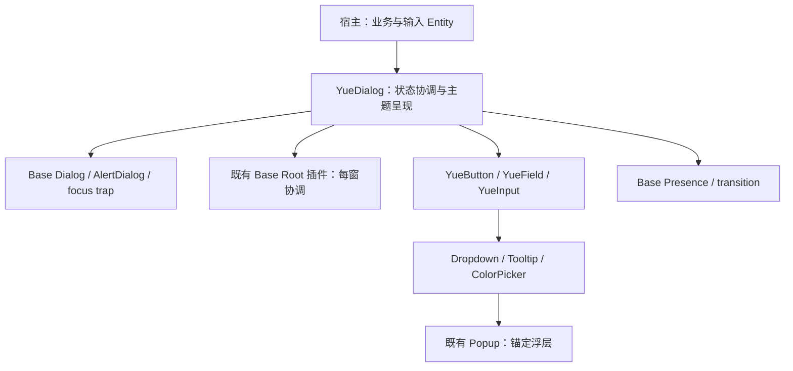

# 17 YueDialog 对话框组件设计

状态：首版窗口模态 Dialog 已实现，已完成自动化回归与 Windows 实窗冒烟检查。日期：2026-11-01。实际实现和平台验证边界见第 16 节。

参考[用户提供的 Dialog 截图](assets/dialog-reference.png)，结合仓库实际使用的 GPUI Kit 0.8.0、受维护的 `gpui-base`、Yue token 与 Base-only 架构制定。截图用于提炼功能范围，不直接移植网页 DOM、Vue 插件或 CSS API。

## 1. 定位与组成

Dialog 用于需要暂时中断当前工作的一次明确决策或短表单。宿主负责业务数据、校验、异步任务与结果；组件负责模态交互、呈现、生命周期与焦点。

组成：**模态行为宿主 + 遮罩 + 对话框表面 + Header / Body / Footer + 既有按钮和表单组件**。普通确认、异步保存、自定义内容和拖动共用同一个 Dialog 合同，不各建一套浮层。

```text
窗口内容（模态期间不可交互）
└─ Scrim：覆盖当前窗口内容区
   └─ Dialog surface
      ├─ Header：标题、补充说明、关闭按钮
      ├─ Body：文字 / 表单 / 自定义内容，必要时独立滚动
      └─ Footer：取消、明确的提交动作，或自定义操作
```

截图中的覆盖率标记、网页示例容器、代码操作区、贡献者与 FAQ 页脚不属于组件。桌面对话框不是独立系统窗口，不代替 Sheet、Popover、通知或完整工作区。

## 2. 基础能力与依赖边界



Dialog 与 Popup 共享 GPUI / Base 和动效机制，但不把 Dialog 塞进十二方位锚定 Popup：Dialog 以窗口内容视口定位，拥有模态阻挡和焦点约束；Popup 以触发器定位，明确不拥有 Modal focus trap。允许复用通用机制，不给 Popup 增加 `is_dialog` 分支或窗口中心的虚假锚点。

### 2.1 已核实与待补齐

第 2.1 / 2.2 节记录设计编写时的源码基线。实施已通过受维护的 Base 补丁补齐 typed intent、独立键盘策略、层序与原生语义边界；当前实现见第 16 节和 `vendor/gpui-base/YUE-PATCH.md`。

| 来源 | 当前事实 | 设计处理 |
| --- | --- | --- |
| Yue crate 根 | 目前没有公共 `YueDialog` | 本文是实施规格，不将拟新增接口当成现成 API |
| Base `dialog.rs` | `Dialog`、`DialogHandle`、语义 parts、确认 / 取消回调、Escape / 遮罩策略、focus trap | 优先复用现有机制，不从 Div 重写模态交互 |
| Base `alert_dialog.rs` | 特化为 `Role::AlertDialog`，默认禁止遮罩关闭 | 危险确认使用正确语义，普通表单不统一标为 AlertDialog |
| Base Root | 插件生命周期与焦点约束机制 | 复用每窗 Root，不能为每个 Dialog 或局部示例再建 Root |
| Yue Popup | 内部锚定 surface、位置求解、箭头、Presence 与关闭路由 | 保持职责；需为模态内子浮层明确层级与关闭顺序 |
| Yue tokens | 源系统已有 `dialog.css` 与模态层语义 | 先用已存在的命名与映射，缺项须从源系统登记再同步 |

Base 的现成 parts 不等于已完成 Yue 的多层协调、初始焦点、退出保留、异步防重入、拖动、滚动隔离或可访问关系；这些均必须在实施前逐项对照源码，按后续章节补齐并验证。

### 2.2 必须先解决的行为缺口

以下是当前源码的真实边界，不是已提供的 Yue API：

1. Base `Dialog::close_on_escape` 当前通过同一个 `Dialog` key context 启停 Escape 与 Enter 绑定。Yue 需要独立的取消与默认提交策略，不能关闭 Escape 后顺带让提交失效。
2. Base `on_close` 在接受关闭请求时运行，不代表退出动画结束；`open(false)` 会直接返回空元素。Yue 的逻辑关闭与视觉卸载必须拆开，不能把 Base `on_close` 当作 `Closed`。
3. Base `DialogChangeReason` 目前将 Escape、关闭按钮等归入 Cancel，且没有完整的 typed 关闭请求入口。若发布精确关闭原因，先给 Base 补最小可复用机制和测试，不能从一个合成 `ClickEvent` 猜来源。
4. Base 的 `.layer(index, topmost)` 只在遮罩点击处检查 topmost，deferred priority 当前为 `10 + layer`；Yue Popup 当前为 `POPUP_PRIORITY + depth`。这不自动满足模态与所属子浮层的关系，不能把 CSS 的 `--dialog-z-index` 数字直接当成正确的 GPUI 绘制顺序。
5. Base Dialog 目前不主动保存 / 恢复打开前焦点。`DialogTrigger` 是指针按下包装器，不是完整的键盘按钮；Yue 的入口必须用真实 `YueButton` / Action。
6. Base 的 Dialog host 尚未暴露完整语义名称、描述、模态状态和后台语义隐藏的组合合同；focus trap 也不等于屏蔽后台鼠标、滚轮或系统可访问操作。
7. Base 遮罩目前在 mouse-down 即尝试关闭；本设计采用完整点击判定，必须避免从内容区按下、拖到遮罩释放也被当作取消。仅延用当前 mouse-down 回调不满足这个合同。

通用的 typed dismissal、独立按键策略、宿主层序 / 可访问适配能力在受维护的 Base 中补齐；Yue 保留视觉、策略选择与每窗登记。不能修改 Cargo registry、复制整个 `Dialog` / focus trap，或启用 styled Component 来绕过缺口。新增 Base 补丁须同步 [YUE-PATCH.md](../vendor/gpui-base/YUE-PATCH.md) 和消费者接入说明。

## 3. 截图能力与首版范围

| 截图内容 | Yue 设计 |
| --- | --- |
| 基础对话框与属性开关 | 标准 Header / Body / Footer，独立配置关闭按钮、Escape、遮罩点击与可见遮罩 |
| 确认 / 取消、反馈类型 | 普通 Dialog 与明确决策的 AlertDialog；Info / Success / Warning / Danger 为可选状态图标和动作强调，不整框染色 |
| 异步确认 | 明确的 pending 状态、防重复提交、成功关闭、失败保留输入与就地反馈 |
| 自定义内容 / 头部 / 底部 | 显式语义 slots；内容可组合既有 Field / Form / Input / Dropdown |
| 多层对话框 | 每窗有序模态栈，只允许栈顶交互；不是每点一次再叠一张遮罩 |
| 拖动位置 | V1 可选，仅通过明确的 Header 拖动区；保留键盘操作与视口约束 |
| 挂载到 body / 指定元素 | V1 固定当前窗口内容视口；局部作用域属于后续独立能力，见第 12 节 |
| 插件式 / 命令式打开 | V1 通过宿主保留的 `Entity<YueDialogState>` 打开；不先提供全局 `$dialog` / `WindowExt::open_dialog` 同义入口 |
| `destroyOnClose` | 关闭后退出结束再卸载元素；输入 Entity 的保留 / 重置由宿主决定，不照搬 DOM 布尔属性 |
| `preventScrollThrough` | 模态合同始终阻止后台滚动，不发布会破坏合同的可关闭开关 |

多步向导、独立操作系统窗口、自由缩放、全屏工作区、任意 CSS 注入、DOM attach、原生文件选择和全局通知不属于本组件。

## 4. 状态归属与公共 API

`YueDialog`、`YueDialogState`、`DialogDecision` 等已从 crate 根导出；prelude 导出最常用组件和 state。公共示例以 doctest 编译，本文包含宿主业务字段的片段仍为组合示意。

### 4.1 单一状态源

- 宿主在构造期创建并保留 `Entity<YueDialogState>`；`YueDialog` 是接收该 Entity 的 `RenderOnce` 元素。一份 state 同时只能挂载在同一窗口的一个 Dialog 实例上。
- state 是逻辑 `open` 的唯一真值，另外持有会话 / 提交 revision、焦点、拖动位置和呈现阶段。业务表单值、错误文案、网络请求与 Task 属于宿主。
- 不同时发布 `.open(bool)`、`.default_open(...)` 和第二套内部 `DialogHandle` 真值。Base 的受控 `.open(...)` 接收是否还需呈现的投影，不能再自行决定业务开合。
- 每窗通过库内 `DialogLayer` RootPlugin 协调实例登记、模态栈、阻挡与跨浮层路由；不持有业务内容、全局选中对象或网络任务。组件内容仍在宿主元素树中构建，保留原 dispatch / Entity 归属。
- 初始化挂入现有 `yue_component::init`，并在创建窗口 Root 前完成。已创建的 Root 不会自动获得后来注册的插件，不能靠再嵌套 Root 补救。

调用方式：

```rust,ignore
// 设计示意：在宿主构造期创建 state 和 InputState，保留订阅。
let dialog = cx.new(YueDialogState::new); // 初始关闭

// 在事件 / Action 中打开，不从 render 打开。
dialog.update(cx, |state, cx| state.open(window, cx))
    .expect("open dialog");

// 在宿主 render 中持续挂载声明；返回决策的回调用弱宿主显式 update。
// 标准 cx.listener 的回调没有返回值，不能拿它传回 DialogDecision。
let owner = cx.weak_entity();
YueDialog::new("rename-project", theme, &self.dialog)
    .title("重命名项目")
    .description("新名称会显示在项目列表中。")
    .confirm_label("保存")
    .cancel_label("取消")
    .initial_focus(&self.name_focus)
    .child(YueField::new(theme).label("名称").input(name_input))
    .on_confirm(move |request: &DialogSubmitRequest, window, cx| {
        owner.update(cx, |this, cx| {
            // 宿主校验 / 执行命令；异步流程见第 6 节。
            this.validate_and_save(request, window, cx)
        }).unwrap_or(DialogDecision::KeepOpen)
    });
```

片段中的业务方法、字段及 `name_input` 为占位示意，不是新增框架 API；既有 Field / Input 的完整构造方式以各自文档为准。

### 4.2 元素与选项

| 现有接口 | 默认值 / 合同 |
| --- | --- |
| `YueDialog::new(id, theme, &state)` | 普通 Dialog；稳定 id；默认关闭与否由 state 决定 |
| `YueDialog::alert(id, theme, &state)` | AlertDialog 语义；默认不允许遮罩关闭、不以 Enter 隐式执行危险操作 |
| `title(text)` | 可见标题兼语义名称，非空；默认 Header 必须提供 |
| `label(text)` | 自定义或隐藏 Header 时提供非空语义名称；默认从 title 取得 |
| `description(text)` | 可选短说明兼可访问描述；不把整个长 Body 拼成一次播报 |
| `child / children` | Body 内容；只负责内容组合，不检查任意后代寻找标题或操作按钮 |
| `header(element)` | 替换默认标题视觉区；仍须通过 `label(text)` 提供完整语义名称；关闭按钮位置由 shell 保留 |
| `drag_handle(element)` | 自定义 Header 的显式非交互拖动区域；配合 `draggable(true)`，不自动把自定义控件包进拖动区 |
| `header_visible(bool)` | 默认 true；隐藏 Header 时拖动停用，若保留关闭按钮则在 shell 独立操作区预留空间，不能遮住 Body |
| `footer(DialogFooter)` | 默认 `Standard`；另有 `ConfirmOnly`、`None` |
| `footer_content(element)` | 替换默认 Footer；不再生成第二套确认 / 取消按钮，默认 Enter 提交同时停用，除非显式重新声明 |
| `confirm_label / cancel_label` | 默认 `OK` / `Cancel`；业务提交应写“保存 / 创建 / 删除”等明确结果 |
| `confirm_disabled(bool)` | 默认 false；校验或权限禁止提交时使用，与 pending 独立 |
| `confirm_on_enter(bool)` | 普通标准 Footer 默认 true；Alert、自定义 Footer 默认 false；受第 7 节输入优先级约束 |
| `closable(bool)` | 默认 true，仅控制 Header 关闭按钮；不隐式修改 Escape / 遮罩策略 |
| `close_label(text)` | 关闭图标按钮名称，默认 `Close`，允许本地化 |
| `close_on_escape(bool)` | 默认 true，与 Enter 策略独立 |
| `close_on_overlay_click(bool)` | 普通 Dialog 默认 true，Alert 默认 false；只处理起止都属于遮罩的一次主按钮点击 |
| `overlay(bool)` | 默认 true，仅控制遮罩是否可见；false 仍维持模态输入与滚动隔离 |
| `draggable(bool)` | 默认 false；有 Header 的普通 Dialog 可显式开启，见第 9 节 |
| `size(DialogSize)` | `Small / Medium / Large / ExtraLarge`，默认 Medium；映射既有宽度 token |
| `width(DefiniteLength)` | 显式首选宽度，仍受视口和安全边距限制；不暴露任意 x/y 坐标覆盖 |
| `initial_focus(&FocusHandle)` | 可选初始焦点；必须属于此对话框并且可用 |
| `status(DialogStatus)` | 可选 Info / Success / Warning / Danger 图标提示；不自动改变模态角色或关闭策略 |
| `on_confirm(handler)` | 返回 `DialogDecision::{Close, KeepOpen, Pending}`；没有处理器时默认确认仅确认信息并关闭，不执行业务 |
| `on_close_request(handler)` | 所有正常关闭入口的同步 guard，`Fn(DialogCloseReason, &mut Window, &mut App) -> bool`；不等同于关闭完成 |
| `theme / use_default_theme` | 显式局部主题 / 应用默认主题；自身按钮、遮罩与所构建的子浮层采用一致主题策略 |

Dialog 不套用普通控件的 `margin / flex_grow` 来设置窗口层几何，也不对外实现任意 `Styled` 覆盖内部壳层。外层宽度是内容需求，Header / Body / Footer 的结构、状态和安全边界由组件保证。

### 4.3 State、事件与原因

已提供 `YueDialogState::new(cx)`、`open(window, cx)`、`open_child(&parent_state, window, cx)`、`close(window, cx)`、`confirm(window, cx)`、`cancel(window, cx)`、`is_open()`、`is_pending()`。`open / open_child` 返回 Result：Root / 初始化缺失、窗口不匹配、未挂载有效声明、无效父层或已有无关模态时明确返回错误，不静默显示一个不受保护的 surface。重复打开同一已打开实例为幂等成功。

`close` 是 Programmatic 关闭请求，照样经过 pending 与 guard，不能作为绕过保护的第二入口；返回是否进入处理管线，最终是否接受由 `OpenChanged` 表达，已关闭则不重复通知。普通关闭不销毁 state。

`confirm / cancel` 给自定义 Footer 的真实按钮使用，与标准 Footer 进入同一提交 / CancelButton 关闭管线；采用最新挂载配置，仍检查 disabled、pending、会话和 guard，不能直接操作私有 open。尚未挂载、已退出或不属于有效栈顶时不执行旧回调。

宿主以保留的订阅观察 `YueDialogEvent`：

- `OpenChanged(change)`：逻辑目标接受变化后一次，`change` 以 reader 暴露目标与原因；首次默认关闭、普通重绘、同步主题均不发事件。
- `Opened`：进入呈现完成且仍属于本会话；reduced motion 也只发一次。
- `Closed(change)`：退出呈现完成且清理 / 恢复已完成后一次；不是网络命令成功事件。

`DialogCloseReason::{Confirm, CancelButton, CloseButton, Escape, OverlayPress, Programmatic}` 全为语义意图，不合成鼠标事件；精确来源由 Base 受控意图适配提供。正常请求在接受前按**栈顶 / 配置 → pending → guard**检查；关闭已接受则不再次运行 guard。

窗口销毁、宿主卸载与已关闭状态的数据清理属于生命周期取消，必须失效登记与 ticket，但不伪造一次用户取消，不承诺对已销毁的视图执行 `Closed` 回调。

## 5. 显示、关闭与生命周期

```text
Absent ── open ──> Entering ── 完成 ──> Present
                      │                   │
                      └─ 接受 close ──────┤
                                          v
                                       Exiting ── 完成 ──> Absent
                                          │
                                          └─ 同实例重新 open ──> 从当前采样续接 Entering
```

1. 打开：递增会话 revision，记录有效返回焦点，登记模态栈，关闭后台瞬态浮层，然后在首个有效布局内设置初始焦点。不可每帧 focus。
2. 关闭请求通过后：逻辑 open=false，发一次 OpenChanged；立即禁止新的提交、拖动和子浮层打开，关闭所属子浮层，再进入 Exiting。
3. 退出期间仍保留内容、输入屏障、模态语义和焦点范围，不能让点击、滚轮或 Tab 穿过正在淡出的窗口。提交不再接受；重复 Escape 不触发父层关闭。
4. 退出完成：清理登记、卸载元素，恢复到有效的宿主焦点，再发一次 Closed。若同实例已重新打开，不得卸载新会话、恢复旧焦点或发送过期 Closed。
5. 保留输入与重置是宿主决策：保留 `Entity<InputState>` 即可再次呈现原值；需要重置时在成功关闭 / 下次打开的宿主方法中明确清空。卸载元素不自动销毁宿主持有的 Entity。

`closable(false)`、`close_on_escape(false)` 和 `close_on_overlay_click(false)` 是三个独立设置。允许三者都关闭，但必须提供清晰可达的完成 / 取消或确有结束条件的进行中任务，不制造无法退出的静态空对话框。

未保存变更通过统一 guard 拦截。guard 返回 false 保持原状态，不自动再弹一层确认框；宿主如需“放弃修改？”应显式展示一个子 AlertDialog，通过后再请求原层关闭。

## 6. 同步校验与异步确认

### 6.1 三种确认结果

| 结果 | 对话框行为 |
| --- | --- |
| `DialogDecision::Close` | 执行业务确认后请求以 Confirm 关闭，仍经过统一 close guard |
| `DialogDecision::KeepOpen` | 保持打开；宿主显示就地错误 / 校验信息并聚焦首个失败字段 |
| `DialogDecision::Pending` | 进入本次提交的 pending，显示真实等待，防止重复确认 |

确认开始时先分配不可伪造的提交 ticket，并锁住重入入口，再调用宿主回调；不得等下一帧 `.loading(true)` 才开始拦截双击 / 连续 Enter。回调可同步更新宿主或关闭组件，结束后须校验会话仍有效，不使用失效的借用或旧闭包。

### 6.2 Ticket 与完成

`DialogSubmitRequest::ticket()` 返回可克隆的 `DialogTicket`，内含弱 state 引用、窗口 / 会话与提交 revision，字段私有。宿主从事件启动自己的 GPUI Task，返回 Pending，完成时调用：

```rust,ignore
ticket.complete(DialogOutcome::Close, window, cx);    // 保存成功，走统一关闭流程
ticket.complete(DialogOutcome::KeepOpen, window, cx); // 失败或需补充输入，解除 pending
```

`complete` 已实现，返回本次完成是否有效。它幂等，只消费匹配的当前提交；旧结果、重复完成、窗口关闭、视图卸载、已关闭后重新打开的新会话均忽略。同步返回 Close / KeepOpen 会立即作废该 ticket。

有效的 complete 先消费 ticket 并解除本次 pending，再执行关闭 guard 或恢复编辑，不能被自身的 pending 关闭锁卡住；guard 拒绝成功后的关闭时也必须回到可操作的非 pending 状态。若 ticket 在宿主确认回调返回前已完成，以第一份有效终结为准，后到的 Pending 返回值不能重新锁定界面。

- pending 时标准确认按钮 `.loading(true)`；确认 / 取消 / Header 关闭按钮均不可再次激活，Escape / 遮罩 / programmatic close 请求被拒绝。不能只把确认按钮变灰而让另一路径破坏正在提交的上下文。
- 内容仍可阅读、选择文字和滚动；业务编辑区是否冻结由宿主决定，默认示例冻结正在提交的字段。不能用整框 opacity 掩盖真实状态。
- 失败保留输入与对话框，在相关字段或操作区显示可恢复错误，不自动改成另一张 Error Dialog；pending 解除后恢复焦点与重试。
- 关闭 UI 不等于取消服务器工作。V1 不自动取消 Future / Task，不提供“放行关闭但假装任务已取消”的选项；可取消业务须由宿主实现真实取消，再完成本次 ticket。
- 永远不在 render 中发请求，不把 Task 移进全局 DialogLayer，不用固定计时器冒充业务成功。

## 7. 键盘、焦点与可访问性

### 7.1 输入优先级

| 输入 | 规则 |
| --- | --- |
| Tab / Shift+Tab | 在栈顶 Dialog 的可用控件中循环；无可用控件时保留容器焦点 |
| Enter / Space 在按钮上 | 激活当前按钮一次，不同时触发 Footer 默认确认 |
| Enter 在单行表单 / 空白区域 | 仅在显式默认提交有效、未 pending、未禁用、无更深组件消费时提交一次 |
| Enter 在 Textarea / IME / 菜单中 | 保留换行、输入法确认或菜单激活，不冒泡成保存 |
| Escape | 先关闭顶层可关闭子浮层，再处理 Dialog；被配置 / pending / guard 拒绝时仍消费本层关闭意图，不穿透到后层 |
| 方向键 / Home / End | 保留给输入、菜单等控件；Dialog 不重建一套表单方向键导航 |

无需全局裸键盘监听模拟所有控件。独立绑定默认提交 / 取消，保留真实焦点 dispatch 子树；对输入法组合状态和子组件消费的确认必须有交互测试。

### 7.2 初始与返回焦点

- 优先使用有效的 `initial_focus`；普通短表单其次选首个可编辑字段；重要确认默认选择取消，不能因主按钮颜色醒目就默认聚焦破坏性操作。
- 若标题 / 内容需要先阅读或没有控件，聚焦语义容器，不给标题和装饰图标各加一个 Tab stop。
- 子 Dialog 返回到父 Dialog 的有效发起控件；最后一层关闭返回原触发器。触发器被卸载 / 禁用时，交还宿主有效焦点范围，不复活旧 FocusHandle。
- 宿主在成功命令中已显式聚焦新页面 / 新对象时，不用旧返回焦点覆盖它。快速切换、逆向动画与父子同时关闭使用会话身份仲裁。
- 模态期间后台不能通过鼠标、Tab、滚轮、应用快捷键或可访问激活获得操作权限；系统窗口级关闭、切换应用、复制等命令保持宿主 / 平台自己的合理规则。

### 7.3 语义合同

普通为 `Role::Dialog`，确需紧急 / 危险决策时为 `Role::AlertDialog`。名称来自 title / label，描述只关联短说明。语义 Dialog 的 bounds 应对应实际表面，不能将整窗遮罩当作内容；Base 当前角色在全视口 host 上，须在适配关卡明确拆分宿主阻挡与表面语义。关闭按钮使用真实 Button；状态图标和装饰不重复播报。

可访问性要求包括：正确模态状态，后台与下层对话框不作为当前可操作内容，pending 可感知，校验错误可读且焦点定位明确。GPUI 没有对应 builder 时，应在 Base 添加原生节点适配与测试；不得写不存在的 `aria_modal(...)` / `inert(...)`，或用 `aria_selected` 冒充模态。

自定义 Header 不得移除可访问名称；隐藏视觉 Header 必须显式 label，且拖动禁用。Window UIA / 读屏实际播报须人工验收，不能仅用 Role 快照宣称全部符合。

## 8. 尺寸、排版与滚动

### 8.1 几何

- 默认相对**当前窗口内容视口**居中，不相对触发器，也不跨屏幕居中；平台标题栏 / 原生非客户区不计入内容矩形。
- 首选宽度来自 `--dialog-width-*`：Small / Medium / Large / ExtraLarge 当前分别为 192 / 320 / 480 / 640px 基准，转换为 rem。小尺寸用于短信息；普通复杂表单显式选 Large，不默默扩大 Medium 的含义。
- 安全边距首版复用 `--space-16`；宽度上限为内容视口减两侧边距，Body 高度上限由视口扣除 Header / Footer 和边距后计算。缩窗时视口约束优先于首选尺寸。未来如需独立调整，应先在源设计系统登记 `--dialog-viewport-margin`。
- 没有标题栏顶出窗口、Footer 落在视口外或长文本把整窗撑开的状态。极小视口先压缩正文可视区，必要时退化为整个 shell 的单一滚动区，保证关闭 / 操作仍可到达，避免两层滚轮竞争。
- 普通动态内容不重新播放进入动效，不做宽高 morph。尺寸变化重新约束；无拖动时居中，有拖动时保留用户位置并 clamp。

### 8.2 结构

Header 和 Footer 用同一水平 inset 对齐；标题、字段、错误与操作形成稳定阅读边。Header 高度 token 作为**最小值**，长标题可以换行，不能固定 40px 把中文 / 放大字体裁掉。Body 是 `min_h_0 / min_w_0` 的独立内容滚动区，Footer 不跟随普通长内容滚走。

只有一个内容 inset owner：已有 `--dialog-padding` 为 shell 的默认 24px 基准内边距；`--dialog-section-padding` 的 16px 用于明确的分区变体，不在两层同时累计。Footer 按钮间距直接使用已有 4px token，不为了符合别处的 8px 习惯在组件里另写常量。

长说明换行；长无空格串需有明确折行 / 横向局部内容策略。正文滚动条贴在 Body 所属区域的边缘，内边距放在滚动 owner 内部。焦点环预留外绘空间，不被 shell 的圆角裁剪误切。

Body 的滚动遮罩也需预留焦点环：使用 `--focus-ring-width + --focus-ring-offset` 的 padding 与等量负 margin，保持原有内容对齐和分区间距。否则只有一行 Select 时，上、下、左侧外圈会被裁掉，只剩右侧蓝线。Select 的 Dialog 集成回归检查实际绘制遮罩中的四边，而非只断言焦点存在；长正文与极小视口的滚动回归继续覆盖。

后台滚轮、触控板惯性和 Body 到达边缘后的滚动链均不能落入后台。遮罩透明、Body 内容不够滚动以及退出动画期间同样如此。仅有 `.occlude()` 不足以证明滚动隔离。

## 9. 拖动

- 仅显式开启 draggable 后的 Header 空白 / 标题拖动区可拖；关闭按钮、输入框、按钮、链接和文字选择区不参与拖动手势。自定义 Header 要明确声明拖动区域，不能整框抢占 mouse-down。
- 按下记录当前实际表面位置和鼠标起点，越过手势阈值再进入拖动；指针捕获、释放、取消、窗口失焦和退出均须结束手势。只移动位置，不触发关闭 / 确认，不重排 Body。
- 约束整个表面在当前内容视口安全边界内；超高内容先通过第 8 节约束再拖动，不能用“至少留几像素标题”掩盖关闭按钮被拖出窗口。
- 拖动期间一对一跟手，不添加延迟或缓动；释放后不做惯性飞行、弹簧弹跳。边界 clamp 是机制，不是吸附特效。
- 窗口 resize、rem / DPI、内容尺寸改变后重新约束原偏移；同一会话保留位置，新一次完整打开默认重新居中。中途退出后反向重开属于同一呈现续接，不突然跳回中心。
- 不要求键盘用户拖动才能访问内容。V1 不提供键盘移动坐标的复杂模式，也不把 Header 变成普通 Tab stop；有重置需求由显式“居中”命令提供。

Base 当前没有本 Dialog 拖动合同。复用 GPUI 指针机制，并把可复用的拖动区域 / 边界计算放在 Base 或既有通用机制；Yue 只选择区域与 token，不将拖动行为复制到每个演示页。

## 10. 层序与其他浮层

### 10.1 每窗模态栈

层序必须表达所属关系：

```text
后台应用与后台瞬态浮层（不可交互）
    < 下层 Dialog（暂停交互、后台语义）
    < 当前唯一有效 Scrim / 输入屏障
    < 栈顶 Dialog
    < 该 Dialog 所属 Dropdown / ColorPicker / Tooltip
```

同窗独立顶层 Dialog 默认串行：已有模态或其退出屏障时，普通 open 返回冲突错误，不排隐形队列、不提前将第二个 state 置为已打开。显式 `open_child(&parent_state, ...)` 才压栈，要求 parent 是同窗当前有效栈顶。不同窗口独立协调，不使用 app-wide bool 把其他窗口一起锁死。

遮罩只有一层有效视觉实例，嵌套不把 0.5 透明度反复叠黑；它位于栈顶 Dialog 与下层内容之间。子层退场完毕才恢复父层交互 / 遮罩位置，不在子层仍可见时让父层抢到焦点。

### 10.2 与 Popup 的内部集成关卡

- Dialog 打开时使后台 Tooltip / Menu 等瞬态会话失效，而不是仅在其上涂遮罩；后台 hover / 计时任务不能在模态期间重新显示它们。
- 模态内 Popup 登记需要明确 `modal_scope` / owner，不能仅凭 pointer 坐标猜测所属对话框。Tooltip 不接收焦点，仍需要同一归属。
- 栈顶 Dialog 内的下拉菜单在其上方显示；按一次 Escape 先关闭菜单并返回菜单触发器，对话框保持打开。下一次 Escape 才按 Dialog 关闭策略处理。
- 点击 Dialog 内、子菜单外的位置，只关闭菜单，不把同一事件再解释成遮罩点击。点击子菜单自身不触发 Dialog 的外部关闭。
- 关闭 Dialog 时先使子浮层不可交互并递归清理；所属 Popup 不能超过父级有效生命周期。子层定位仍由 Popup / Base Positioner 负责。
- 退出中的模态仍占据栈与输入屏障；背景输入不因 `is_open=false` 提前获准，装饰动画不能改变安全层级。

库内协调器通过 `ModalScope` 交换作用域与栈序，Popup runtime 记录外部点击的消费结果；**不扩展 Popup 成模态管理器**。Base deferred priority 提供可配置的无视觉机制，真实同帧绘制 / hitbox / 键盘路径由集成测试验证。单改注册插件的顺序或 `with_priority(1000)` 不能算验收通过。

## 11. 视觉、主题与动效

### 11.1 既有 token 映射

源：`D:/100_Projects/110_Daily/Yue-Design-System/packages/tokens/src/component-tokens/dialog.css`；本仓库 `theme/generated.rs` 已有 34 个 `DIALOG_*` 键。以下记录当前基线，不是在本次新增 token：

| 内容 | 既有 token / 合同 |
| --- | --- |
| 表面、前景、边框、圆角、阴影 | `--dialog-background / color / border-color / border-width / border-radius / shadow`，转发对应 `--box-*-dialog` |
| 遮罩 | `--dialog-scrim-color → --scrim-modal`；当前为模式不变的黑色 0.5，按 token 使用 |
| 宽度 | `--dialog-width-sm / md / lg / xl`，不增加另一套相同宽度 ramp |
| 几何 | `--dialog-header-height / padding / section-padding / spacing / footer-gap` |
| 进入 / 退出 | `--dialog-duration-enter / exit`，当前 250ms / 150ms |
| 曲线 | `--dialog-ease → --motion-ease-standard`，当前 cubic-bezier(.2, 0, .38, .9) |
| 等待指示 | `--dialog-spinner-duration`，仅用于实际 pending，不以它模拟业务时长 |
| 模态层角色 | `--dialog-z-index → --layer-modal`；当前值 1000 是设计层角色，不替代 GPUI 层序合同 |
| 标准操作 | 真实 `YueButton` 的 Button token、焦点和 loading；不另造可点击 Div 以消耗旧 action 颜色别名 |

已有 `--dialog-action-*` 别名不意味着应绕过 YueButton。若按钮作为独立组件需要 Dialog 专用外观，先通过明确的语义 variant 映射与设计系统确认，不手工复制按钮状态矩阵。

实施可能新增的候选 token：`--dialog-viewport-margin`、`--dialog-motion-offset`、标题 / 描述字号与图标槽别名；均须先在源 token 系统登记词表、grammar、测试，再同步 snapshot / generated。本轮设计文档不修改源系统与生成文件。输入框、按钮、菜单沿用自身 token，不把它们重声明一遍。

### 11.2 动效选择

采用**短距离垂直平移 + 淡入淡出**，不缩放整框文字、不使用弹簧默认动效：

| 阶段 | Dialog 表面 | Scrim |
| --- | --- | --- |
| 进入 | 从下方一个 motion-offset 到最终位置，opacity 0→1；250ms | 从透明到 token 目标色，复用该阶段时长 |
| 退出 | 从当前采样位置到下方一个 offset，opacity →0；150ms | 无后续模态时淡出，有父模态时保持有效遮罩连续性 |
| 中途反向 | 从当前 opacity / 偏移续接，按上一段自己的时长和曲线先采样 | 不闪白、不回到初始端点 |
| Reduced motion | 直接到最终呈现状态，仍遵守一次生命周期通知和完整清理 | 同步到最终状态 |

offset 映射 `--space-8`，不是散落在 Rust 中的 8px。进入 / 退出沿用已有 `--dialog-ease`；若以后要采用不同曲线，先新增明确的源 token，不在组件中绕开当前来源。

使用 Base Presence / transition，Yue 选择策略。内容、主题和 pending 的普通变更不重新进场；不同 Dialog 实例不做共享位置平移，也不采用 Tooltip 在邻近触发器之间的连续滑动规则。拖动跟手与展示动效使用独立状态，关闭时从当前实际拖动位置开始退出。

## 12. 指定区域与命令式 API 的边界

截图的 body / attach / DOM 不是 GPUI 同义接口。首版始终是**窗口模态**：可在任意业务 view 声明，最终在当前窗口呈现，生命周期跟随宿主，不能泄露到另一个窗口。

局部区域模态作为后续能力，必须先定义区域几何 / clip、滚动跟随、区域失效、区域外是否可交互、是否仅约束区域焦点，以及不同作用域的 Popup 层序。只把 surface 放进一个容器，既不能称为已实现 attach，也不能继续宣称全窗模态。

命令式能力首版由 `state.open / close` 满足。后续如增加 `open_dialog / confirm` 便利入口，应返回可定位到同一 state 的句柄，复用相同 guard、ticket、事件和模态栈；不再建一套全局独立生命周期，不把自己的 `WindowExt` 与 Kit styled Component 的同名 trait 混用。

## 13. Showcase 与验收计划

已增加 **组件 → Dialog** 独立页，按英文顺序放在 Divider 前。保留现有页面 section、主题与密度，不复制参考网页的大面积留白或所有入口统一蓝色主按钮。会打开额外输入流程的入口用“编辑项目…”等明确文案。

| 分区 | 要展示的真实行为 |
| --- | --- |
| 基础配置 | 关闭按钮、Escape、遮罩关闭、可见遮罩、Header / Footer、宽度档、拖动开关 |
| 普通 / 重要确认 | 确认与取消结果、语义角色、危险动作与安全默认焦点 |
| 自定义内容 | 真实短表单、输入 Entity 保留 / 显式重置、自定义 Header / Footer |
| 异步 | 宿主 Task、pending 防重、成功关闭、失败保留、重试、过期结果忽略 |
| 多层与子浮层 | Dialog → Dropdown / ColorPicker，以及明确子 AlertDialog；逐层 Escape 与焦点返回 |
| 拖动与边界 | 拖至边界、缩窗、长内容、16 / 24px rem、关闭反向打开 |
| 主题 | Light / Dark × Azure / Neutral，长中文 / 英文与可访问名称 |

### 13.1 自动化要求

1. 状态 / 事件：开关幂等、guard 接受 / 拒绝、配置独立、所有关闭原因、回调次数 / 顺序、重入、退出反向、失效卸载。
2. 真实输入：Button / Action 打开；指针、Enter、Space 各一次激活；默认提交与单行输入；Textarea / IME / 菜单不误提交。
3. 模态：Tab / Shift+Tab 包含超过 100 个后台控件时仍不逃逸；无可用控件、多层对话框、后台程序化 focus、后台鼠标 / 滚轮 / 语义激活均有断言。
4. Pending：双击 / 连续 Enter 仅一个请求，pending 期间全部正常关闭入口被拦；成功 / 失败 / 重试；旧会话、重复完成、销毁后的 ticket 不改变新状态。
5. 层级：后台 Popup 先失效；本层子 Popup 在上方且可用；Escape 只关闭一个层级；子层外点击不串成模态遮罩关闭；退出期间不穿透。
6. 几何：当前窗口居中、安全边距、四种宽度、超长正文、长标题、自定义 Footer、极小视口、缩放、DPI、滚动条边缘和焦点环空间。
7. 拖动：Header 有效区、排除真实交互控件、边界、取消 / 失焦 / 退出、缩窗重约束；无拖动不创建手势处理与异常 Tab stop。
8. 动效：进入 / 退出中间值、不同策略下的反向连续、遮罩唯一性、拖动位置退出、reduced motion、普通内容更新不重新入场。
9. Token：四种 profile × `NeutralTone::ALL`；正文 4.5:1、焦点与有意义控件边界 3:1；同步检查通过，不能手改 generated。
10. Showcase：通过真实配置控件改变预览，核对宿主保存 / 取消的结果、错误恢复、事件与焦点，不能只数页面上有多少按钮。

UI integration testing 在 Base Root 下用实际组件和输入事件，按 role / label / 状态查找；几何与事件断言分开。运行定向测试后回归既有 Dropdown、Tooltip、Input、ColorPicker 和完整 workspace。实窗人工检查标题基线、阴影、透明圆角、拖动 / 窗口失焦、多显示器 DPI、UIA 与读屏；无头测试不能冒充这一步。

### 13.2 验证边界

本次已新增 Rust、Showcase 和真实 Base Root 下的输入测试。第 13.1 节保留完整验收清单，不意味着平台人工验收全部完成；实际检查结果见第 16 节。Windows UIA / 读屏、多显示器 DPI、GPU 像素与真实 IME 会话仍需实窗核对。

## 14. 实施顺序与代码边界

1. **行为关卡**：Base typed dismiss、独立 Escape / Enter、语义与层序；每窗 DialogLayer 与 Popup modal scope；先用最小测试证明父子层绘制、输入隔离和返回焦点正确。
2. **标准 Dialog**：`dialog/state.rs` 管理会话，`model.rs` 管理选项 / 事件，`mod.rs` 组合 Base 与 Yue 外观，补齐标准 Header / Body / Footer、尺寸 / 滚动与同步确认。
3. **生命周期与异步**：Presence、精确事件、关闭 guard、ticket、防重入 / 过期结果；没有这一步不发布“支持异步确认”。
4. **组合与拖动**：Alert 语义、自定义 slots、子浮层与子决策、约束拖动；行为放正确层，不在 Showcase 私自打补丁。
5. **交付**：Showcase、公共 doctest、Base patch 记录、主题 / 缩放 / 键盘回归、Windows 实窗与本文状态更新。

实现位于 `crates/yue-component/src/dialog/`，从 crate 根重导出组件、state 与必要选项；prelude 只增加最常用组件。RootPlugin、提交内部状态和 Yue 协调桥接保持库内可见；Base 的无样式 `ModalScope` / `ModalBoundary` 是跨层行为机制，不构成业务 Dialog 服务。

## 15. 本地依据

- [Dialog 参考截图](assets/dialog-reference.png)：能力范围和演示结构，不作为默认值 / 交互正确性的证据。
- [Base Dialog](../vendor/gpui-base/src/dialog.rs)、[AlertDialog](../vendor/gpui-base/src/alert_dialog.rs)、[FocusTrap](../vendor/gpui-base/src/focus_trap.rs)、[Root](../vendor/gpui-base/src/root.rs)：已核实的底层接口与缺口。
- [Popup](12-popup.md)、[Popup runtime](../crates/yue-component/src/popup/runtime.rs)：锚定层职责、所属关系和现有关闭路由。
- [Dropdown](07-dropdown.md)、[Tooltip](10-tooltip.md)、[ColorPicker](11-color-picker.md)：Dialog 内现有交互组件的复用边界。
- [Button](02-button.md)、[Input](03-input.md)、[motion](../crates/yue-component/src/motion.rs)：操作、输入和主题动效。
- [theme/generated.rs](../crates/yue-component/src/theme/generated.rs)：已有 `DIALOG_*` / `LAYER_MODAL` / `SCRIM_MODAL` 静态键；源 `dialog.css`、`semantics/modal-layer.css`、`semantics/motion.css` 为数值与语义来源。

本轮同时交付组件实现、Base 行为扩展、Popup 模态作用域和演示页；没有修改外部源设计系统或手改 token 生成文件。

## 16. 首版实现记录

- `crates/yue-component/src/dialog/`：唯一 retained state、标准 / Alert 外观、Header / Body / Footer、自定义 slots、四档宽度、关闭 guard、异步 ticket、会话失效和精确生命周期事件。
- `vendor/gpui-base`：受控 `DialogIntent`、独立 Enter 策略、完整遮罩点击、退出输入屏障、可配置 deferred priority、原生 modal / busy / hidden 边界、显式模态 focus scope、约束拖动与实时可编辑字段登记。
- `DialogLayer`：每窗串行顶层及显式子层；模态层卸载时递归终止后代；层序根据模态角色、当前模态和已登记 Popup 分配，不假定固定深度。
- Popup / Dropdown / Tooltip：登记声明作用域、模态转场失效、退出禁止新增子浮层、菜单关闭事件消费记录；无焦点的静态 Tooltip 也可正确归属于模态。
- 动效复用 Base Presence，250ms / 150ms、标准曲线、短距离垂直平移和淡入淡出；反向采样续接，嵌套保持一张有效遮罩。
- 安全边距和偏移分别复用已有 `SPACE_16` / `SPACE_8`；当前没有新增同义 token，也没有修改外部源词表。正文、标题、按钮、输入和菜单沿用各自语义 token。
- Showcase 增加 Dialog 页，位于 Divider 前；可切换尺寸、拖动、遮罩、Escape、关闭保护、长正文、自定义底部、异步成功 / 失败，并演示子 Alert、Dropdown 与 Tooltip。

`close / cancel / confirm` 返回是否进入处理管线；宿主回调通过 defer 在 state 借用释放后运行。最终是否接受关闭看 `OpenChanged`，退出完成看 `Closed`，不能把方法返回 true 当作业务成功。

### 16.1 回归结果（2026-11-01）

| 检查 | 结果 |
| --- | --- |
| `cargo test --workspace --locked` | 153 项测试通过，含 doctest |
| `cargo test --workspace --locked --features headless-tests` | 400 项测试通过，含 24 项 Dialog 测试和 doctest |
| `cargo test -p yue-component --no-default-features --features headless-tests --locked --lib dialog::tests` | 24 项通过，不依赖打包字体功能 |
| Base 独立 `modal::` / `constrained_drag::` 单元测试 | 各 1 项通过，使用 `--features test-support --offline` 和独立 target 目录 |
| `cargo clippy --workspace --all-targets --locked -- -D warnings` | 通过 |
| 同上增加 `--features headless-tests` | 通过 |
| `cargo build -p windows-showcase --locked` | 通过 |
| `cargo fmt --all -- --check`、`node tools/sync-yue-theme.mjs --check` | 通过，token 同步未漂移 |

Dialog 回归覆盖关闭 guard、幂等生命周期、pending 与过期 ticket、退出反向、单张连续遮罩、父子卸载、超过 100 个后台控件的 Tab 约束、单行 / 多行输入优先级、菜单逐层 Escape、外部点击消费、静态 Tooltip 作用域、16 / 24px rem 边界、拖动与关闭后重新居中。额外固定两个实窗发现的问题：

1. 初始焦点从**首次有效呈现后的帧**安排，而不是直接从 `open()` 安排；原生帧回调早于绘制，读取旧 dispatch tree 会误退回容器。显式初始焦点每个会话只应用一次，普通内容重绘不抢回焦点。
2. 表面只负责圆角裁剪，正常情况仅 Body 滚动；极小视口由内层 shell 滚动。拖动几何观察位于滚动内容之外，滚轮不会移动标题 / Footer 或污染表面边界。两条滚动回归分别验证正常长正文和 160px 高的极小视口。

### 16.2 Windows 实窗检查与边界

通过本地构建的 Showcase **组件 → Dialog** 检查首次输入焦点、模态背景 UIA 隐藏、Dialog / AlertDialog 角色、Dropdown 叠层与 Escape 返回、子 Alert 与连续遮罩、配置区换行、长正文固定标题 / Footer、标题拖动和视口约束，以及异步保存失败后的错误提示、输入保留与重新可提交状态。宿主示例只在 ticket 有效完成后写入业务反馈，过期任务不覆盖重新打开的表单。

原生 AccessKit 节点钩子与 UIA 树检查不等于 Windows 读屏完整验收；Narrator / NVDA、多显示器 DPI、真实 IME 组合输入和窗口失焦边界仍保留人工验证项。全局业务快捷键和绕过输入树直接执行的宿主命令，也必须由宿主按当前模态作用域约束。

