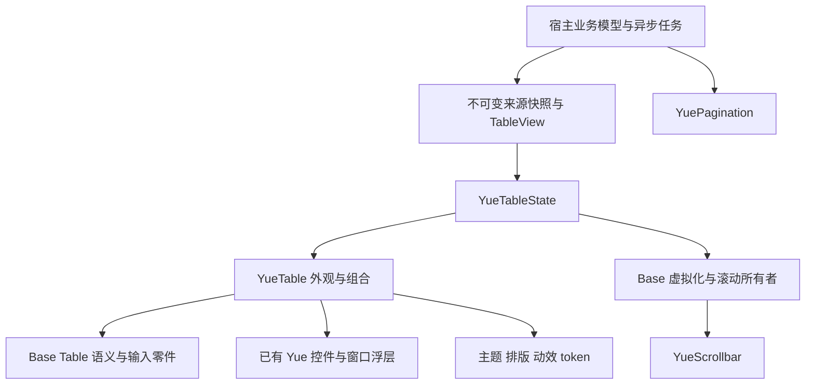

# YueTable 表格组件设计

- 日期：2026-11-11；状态：M1／M2 已实现并完成阶段自动化，计时噪声和原生验收边界单列。当前可调用能力见 [M1 使用指南](45-table-m1.md)和 [M2 布局指南](45-table-m2.md)，逐阶段证据见[实施进度](research/2026-11-11-table-delivery.md)；本文是 M1–M6 的完整目标，未落地阶段的类型和方法仍为拟定合同。
- 平台：Windows GPUI；依赖与目录遵循[组件架构](24-component-architecture.md)。
- 接入阅读顺序：本文第 1／4／17／19 节 → [API 与三个接入示例](45-table-api-examples.md) → 对应功能章节；性能实施使用[固定 workload 与门禁方案](performance/2026-11-10-table-benchmark-plan.md)。五项自评改进及三库复核见[完善记录](research/2026-11-10-table-design-hardening.md)。
- 依据：通过浏览器阅读 `refer/table` 内 Ant Design Vue、Arco Design、TDesign 三份本地网页，示例、API、限制和源码复用核对见[参考调研记录](research/2026-11-10-table-reference-review.md)。
- 源码补充：按 `refer/DataTable-Libs` 介绍顺序逐项调研；已完成 [Tabulator 6.7.1](research/2026-11-10-table-tabulator-review.md)、[TanStack Table 9.3.1](research/2026-11-10-table-tanstack-review.md)、[Glide Data Grid 6.0.4-alpha25](research/2026-11-10-table-glide-review.md)、[RevoGrid 4.31.4](research/2026-11-10-table-revogrid-review.md)、[MUI X Data Grid 9.17.0](research/2026-11-10-table-mui-review.md)、[react-data-grid 7.0.0-beta.64](research/2026-11-10-table-react-data-grid-review.md)、[Material React Table 3.2.1](research/2026-11-10-table-material-react-table-review.md)、[Grid.js 6.2.0](research/2026-11-10-table-gridjs-review.md)、[SlickGrid 6.0.0](research/2026-11-10-table-slickgrid-review.md)和 [Slickgrid-Universal 11.0.0](research/2026-11-10-table-slickgrid-universal-review.md)的源码与验证材料调研，十个参考仓库均已完成。MRT 的 Storybook 场景不作为独立测试断言；介绍中的版本和性能宣传不作为已验证事实。
- 范围：逐项覆盖用户给出的八类功能；交付阶段见第 20 节，组合能力与拒绝规则见第 17 节。设计覆盖不代表已经实现或所有功能可以任意组合。

## 1. 定位与基本决定

YueTable 用于按一致字段比较、选择和操作多条记录，例如工单、设备、订单、审批和数据分析结果。它是结构化数据组件，消费已有的滚动、虚拟化、编辑器和菜单基础；Table 自身不成为整个组件库的基础层。

公共入口统一为 `YueTable`，长期交互由 `YueTableState<D: TableDelegate>` 持有。这里的 Table 包含其他库常称 DataTable 的能力，不再平行建立一套同职责的 YueDataTable，也不照搬三个继承式 Table 产品入口。内部按列布局、视图投影、选择、编辑会话等真实职责拆分。

与已有组件的分工：List 用于异构内容扫描，Tree 用于独立层级导航，Descriptions 用于一条记录的属性配对。Table 不包办这些组件；Descriptions 不因外观像格子就改成 Table 的消费层。

关键决定：

1. 一个滚动所有者、一份列轨道结果、一份被宿主接受的数据视图，表头、正文、表尾及固定区共同使用。
2. 行、列、单元格始终按业务 key 标识；位置只表达本次排序与可见投影，不充当身份。
3. 默认格子不填背景色。边框、行状态、冻结区遮挡底板分别由明确的绘制者负责。
4. 有限视口默认采用行虚拟化；大量列显式采用双轴虚拟化。两者的尺寸合同不同，不能用一个 `virtual(true)` 掩盖。
5. 本地处理与远程结果明确分开；分页、排序、筛选、选择、展开、列配置和保存以请求／接受合同运行，不在 render 中发业务请求。
6. 复用已经存在的基础能力。新增 Base 扩展须由具体表格场景证明，记录补丁来源、测试和移除条件，不提前建设插件平台。

## 2. 参考项目的吸收与取舍

### 2.1 三份组件库网页

| 参考 | 实际看到的能力与限制 | Yue 采用方式 |
| --- | --- | --- |
| Ant Design Vue | columns 描述、body/header 插槽、固定列、分组表头、合并、排序筛选、远程分页、选中 key 保留、summary、响应式。固定布局说明反复要求统一列宽、防止连续长文本撑开。 | 提取稳定列模型、统一宽度、受控请求、显式合并与总结范围，不复制 DOM/CSS 属性。 |
| Ant Design Vue | `template 风格的 API` 被描述为 columns 语法糖且不推荐；大数据、行拖拽、列拖拽链接到 Surely Vue。 | Rust builder 是唯一列定义方式；不为 template 新造解析器，不将外链示例当作该离线页面已经实现的性能能力。 |
| Arco Design（React） | 选择／展开操作列、排序优先级、定制分页、空状态、summary。固定列需宽度约束；API 明示 `virtualized` 会关闭树形支持。 | 吸收显式操作列和单一请求快照；本项目按真实组合测试支持树形投影，不默默关闭树功能。 |
| Arco Design（React） | 伸缩、吸顶、拖拽示例分别借助 react-resizable、react-sticky、react-sortable-hoc。 | 借鉴交互，不引入这些 Web 依赖。列伸缩复用 Base ResizeHandle，拖拽复用 GPUI 输入及 pointer capture。 |
| TDesign（Vue Next） | 将表格分 BaseTable／PrimaryTable／EnhancedTable；有首尾冻结行、左右固定列、列配置、单／多字段排序、行高亮键盘操作、编辑、懒加载与虚拟滚动。 | 借鉴职责分离与完整用例；对外保留一个入口，内部按能力组织，不引入继承层级。 |
| TDesign（Vue Next） | 区分本地／远程分页和本地排序；列配置有确认前草稿与确认后的显示列；虚拟化声明覆盖大量固定／吸顶组合。 | 明确数据处理范围、草稿与已提交状态；逐个验收组合，不能凭参考声明推导 GPUI 已具备同样支持。 |

三份文件是已保存网页。已查看其浏览器渲染、说明和存在的 API 文本；没有把离线快照当成可完整运行的在线应用，也没有据此测量拖拽、网络或虚拟化性能。

### 2.2 DataTable-Libs 逐项源码调研

按用户要求一个项目一个项目完成，先记录源码与测试证据，再更新本设计，不先把介绍文档的完整功能表列为 Yue 的承诺。

| 顺序 | 项目 | 进度与本设计的实际补充 |
| --- | --- | --- |
| 1 | Tabulator | 已完成；投影分阶段失效、批次提交、行高合批与防重入、异步所有完成路径代次隔离、响应式状态恢复、编辑／尺寸回归、滚动误差测量。见第 5.4、7、9、14、15、21、22 节与[专项记录](research/2026-11-10-table-tabulator-review.md)。 |
| 2 | TanStack Table（`table`） | 已完成；状态所有者处理连续意图、无变化提交的去重、依赖与值缓存版本、结构索引／显示投影分离、统一列偏移、拖动末次坐标、范围选择和筛选候选来源。见第 5、7、11–13、19、21、22 节与[专项记录](research/2026-11-10-table-tanstack-review.md)。 |
| 3 | Glide Data Grid | 已完成；内容版本与 stable cell key 同批接受、稀疏失效、GPUI factory／实际绘制边界、图片使用者与有界缓存、空闲停帧、编辑完成去重。见第 5.6、9、14、19、21、22 节与[专项记录](research/2026-11-10-table-glide-review.md)。 |
| 4 | RevoGrid | 已完成；resize 连续覆盖、固定区预算与短内容尾行、尺寸按身份恢复、深处坐标／命中一致、已接受编辑的输入交接、重新挂载与旧任务隔离。见第 8.3、8.5、9、14、15、21、22 节与[专项记录](research/2026-11-10-table-revogrid-review.md)。 |
| 5 | MUI X Data Grid | 已完成；挂载订阅补偿、一致快照、业务批次顺序、删除缓存清理、闭包持有释放、编辑 flush／校验代次、浮层事件边界和 overlay 布局。Community／virtualizer 为 MIT，Pro／Premium 为商业许可，未移植商业实现。见第 5、8、9、14、15、18、21、22 节与[专项记录](research/2026-11-10-table-mui-review.md)。 |
| 6 | react-data-grid | 已完成；离屏活动格稀疏保留、列宽来源与临时约束恢复、键盘伸缩结算、逐轴定位避让、稀疏合并索引、外部修订与编辑协调、同击键模态路由和边界测试。见第 7–10、14、18、21、22 节与[专项记录](research/2026-11-10-table-react-data-grid-review.md)。 |
| 7 | Material React Table | 已完成；按 key 协调列配置、草稿权限重验、批量列操作、筛选算子和值原子切换、缓存交互正确性、虚拟拖动结算、加载／详情身份、宿主编辑表单与工具区。依赖 TanStack V8，区别于第 2 项 V9；本地未检出独立测试，示例不作通过证据。见第 7、11–16、21、22 节与[专项记录](research/2026-11-10-table-material-react-table-review.md)。 |
| 8 | Grid.js | 已完成；阶段缓存移除／执行中失效、完整 query 的宿主映射、零／未知总数、文本匹配范围、去抖生命周期与分层测试。源码对当前结果逐行渲染，不作为虚拟化证据。见第 5、13、15、21、22 节与[专项记录](research/2026-11-10-table-gridjs-review.md)。 |
| 9 | SlickGrid | 已完成；大跳／反向的场景覆盖、统一几何正反命中、同数投影变化、过滤集合复用的证明条件、重内容预算、编辑回调重入与订阅归属。当前快照为 unified pinning／docking；不引入任意行 pin 或跨冻结内容副本。见第 5、8、10、14、21、22 节与[专项记录](research/2026-11-10-table-slickgrid-review.md)。 |
| 10 | Slickgrid-Universal | 已完成；独立 common 核心与服务分层、跨入口查询代次、列偏好恢复白名单与批次、异步候选保留真实 editor，以及完整结果等价后计时。未引入 Web 包、协议查询生成器或插件平台。见第 7、13–15、21、22 节与[专项记录](research/2026-11-10-table-slickgrid-universal-review.md)。 |

源码调研的优点主要吸收到已有能力的正确性与成本合同，不额外扩充电子表格、导入导出、历史记录或动态插件系统。各轮仅改设计与调研记录，没有实现这些合同，也没有运行参考项目的测试或以源码阅读推导性能结论。

## 3. 用户功能大纲与交付映射

阶段 M1–M6 是实施顺序，不是不同产品版本。全部功能都有归属；标为宿主组合的功能仍须提供可操作 Showcase，不能以“可以自定义”代替示例和验收。

| 类别 | 功能 | 设计合同 | 阶段 |
| --- | --- | --- | --- |
| 基础展示 | 基础表格、带边框、紧凑型 | 统一行列模型；None／Rows／Grid 边框，三档尺寸 | M1 |
| 基础展示 | 自定义样式、行高亮、斑马纹 | 有限语义部件样式；hover、active、selection 和业务强调分开 | M1 |
| 基础展示 | 响应式 | 按实际容器宽度解析列约束，辅助列可配置隐藏，保留关键标识与操作 | M1、M2 |
| 基础展示 | template 风格 | 用列 builder＋renderer 表达同等内容定制，不另建模板 DSL | M1 |
| 基础展示 | 自动省略、空表格、自定义空状态 | 文本真实溢出提示、任意内容槽、YueEmpty；零值不误判为空 | M1 |
| 布局与固定 | 固定表头、固定行 | 区分视口内表头与数据行冻结；首尾数量和遮挡边界有合同 | M1、M2 |
| 布局与固定 | 固定列、固定表头和列 | Start／End 固定，统一轨道及单次命中，不能复制三张表同步滚动 | M2 |
| 布局与固定 | 页面表头吸顶、表尾吸顶／吸底 | 显式借用宿主滚动区域与可见边界，离开表格范围即解除 | M5 |
| 布局与固定 | 可伸缩列 | min／max、即时预览、完成提交、Escape 撤销、键盘调整 | M2 |
| 数据结构 | 自定义单元格／表头／表尾 | typed renderer；列级 footer 与整表 footer 分开 | M1 |
| 数据结构 | 分组／多级表头 | 列树只决定表头，叶列决定正文；共用轨道宽度 | M2 |
| 数据结构 | 行／列合并 | origin＋正跨度；显式索引与稳定 key，不逐帧遍历所有格子计算 span | M5 |
| 数据结构 | 前置操作列 | 选择、展开、序号、拖拽手柄是显式列，可配置位置与固定 | M1、M4、M6 |
| 数据结构 | 总结栏、表格属性演示 | 明示当前页／筛选结果／服务端总计；属性面板操作真实表格 | M1、M3 |
| 展开与树 | 展开／收起、定制展开参数 | 按 key 展开，独立 detail 槽，展开按钮和整行行为明确 | M4 |
| 展开与树 | 树形、嵌套子表格 | 共享 Base keyed tree 的结构投影；详情区可组合独立子表 | M4 |
| 交互编辑 | 单／多选、选择和操作、自定义选择项 | 唯一已提交选择，限定全选范围；批量操作由宿主执行 | M1、M3 |
| 交互编辑 | 单元格编辑、行编辑 | Base 编辑器＋Field／Form；草稿、验证、保存、冲突、回滚明确 | M4 |
| 交互编辑 | 列配置 | 显示／隐藏、顺序、固定、宽度快照；草稿确认后一次提交 | M2、M6 |
| 排序筛选 | 单／多列排序、筛选、受控排序筛选 | `TableQuery` 描述完整意图；本地适配或宿主远程执行 | M3 |
| 排序筛选 | 自定义筛选项／菜单、树型筛选 | 复用 Dropdown、Input、Select、Tree／TreeSelect、DatePicker | M3 |
| 拖拽 | 行排序、锚点／手柄排序、列排序 | 稳定 key 的 move 请求；目标前／后、禁用目标及取消明确 | M6 |
| 加载性能 | 自定义分页、远程数据、加载态 | 复用 YuePagination；已知总数与游标加载分开；业务请求属宿主 | M3 |
| 加载性能 | 懒加载、大数据、虚拟滚动 | 显式范围／尾部加载事件；有界工作集；不把逐步追加 DOM 当虚拟化 | M1、M4、M5 |
| API | 完整公开合同 | 类型、默认值、错误、事件、能力矩阵与使用示例一同维护 | 各阶段 |

## 4. 组件结构与复用



| 已有能力 | 复用方式与边界 |
| --- | --- |
| Base `Table`／`TableHeader`／`TableBody`／`TableRow`／`TableHead`／`TableCell` | 复用无样式语义部件与测试观测。当前只是语义壳，不包含列布局、排序、选择、固定、编辑引擎，不能称作已有完整 TableState。 |
| Base `VirtualizerState`／`VirtualList` | Fixed／Known／Measured 行路径、Attached 宿主、stable key、锚点、定位、预算与尺寸失效。 |
| Base `VirtualGrid`／`VirtualGridTrack` | Fixed／Known 双轴、同宿主滚动、约束轨道、精确 cell 保留；不重写前缀和、范围或 smooth。 |
| `VirtualGridSpan`／`VirtualGridSpanSet` | 已知轨道下显式合并、离屏 origin 检索、唯一构建；限制见第 10 节。 |
| `VirtualGrid::update_sizes`／`update_sizes_from_snapshots` | 当前源码已提供双轴尺寸批次先验证后应用；不在 Table 再拼两次不受保护的更新。 |
| Base `ScrollHandle`／附着合同、YueScrollbar | 一个位置事实、一处输入写入。所有展示滚动条共用这个 handle，使用已实现的无可见轨道外观。 |
| Base ResizeHandle、GPUI pointer capture | 列边界拖动、取消和捕获；YueResizable 用于 Showcase 宿主面板，不为每列嵌套一个 Resizable 面板。 |
| YueButton、Checkbox、Radio、Tabler Icon | 排序、选择、展开、操作、拖动入口的语义、禁用和键盘行为。 |
| YueOverflowTooltip | 单行／N 行文本截断和真实测量；使用单元格既有焦点，不给每段截断文本额外加 Tab stop。 |
| YueInput／NumberInput／Select／DatePicker／TimePicker／Textarea | 编辑内容、IME、光标、选区与弹层；不新做表格专用输入引擎。 |
| YueField／YueForm | 编辑校验、错误反馈、首个无效字段聚焦；业务保存由宿主执行。 |
| YueDropdownMenu／YueContextMenu／Popup、YueDialog | 筛选、列设置、行操作与必要确认；沿用窗口 Root 和浮层顺序。 |
| Base `KeyedTreeModel`、Tree 的窄公开适配 | 复用结构索引、展开、过滤、懒加载票据与选择规则；不将一个 YueTree 视图塞入首列冒充整张树表。 |
| YueEmpty、Spinner／Skeleton、Avatar／Badge／Tag／Progress／Link | 状态和内容槽；每个组件保留自己的背景和交互。站内操作用 Button，外部资源用 Link。 |
| YueTheme／Typography／motion／ControlLayout | 统一设计来源；没有 Table 私有主题副本，不启用 `gpui_kit::component`。 |

必要的新行为是列模型与轨道协调、逻辑单元格导航、数据视图接线，以及末端冻结／宿主吸顶等确实缺少的布局适配。无样式、可复用的几何与输入机制放 Base；Yue 保留表格产品合同与外观。具体新增项在对应阶段完成失败基线后再提取，不能只写空 trait。

## 5. 数据身份、视图与状态所有权

### 5.1 身份和坐标

`TableRowKey`、`TableColumnKey` 是非空稳定 key；`TableCellKey` 是二者组合，内部可桥接 `VirtualGridCellKey`。相同 key 的内容修订通过 revision 表达；行重排不能伪造删除再新增。

区分四种坐标：原始数据位置、筛选／排序后的投影位置、当前页的位置、屏幕工作集位置。回调同时提供稳定 key 与需要的投影坐标，绝不要求宿主把 `visible_index` 当原始数组下标。普通行、展开详情行、加载提示行有不同 `RowKind` 和身份；详情 key 由所属 row key 派生。

数据 row key 在当前结果域唯一，列 key 在整棵列树唯一。重复 key、无效跨度、非法尺寸必须在提交视图时给出类型化错误；失败保留上一份有效视图和滚动位置。

key 由宿主显式提供，不从数组 index、表头文案、字段路径替换字符或 `row + 分隔符 + column` 拼接推导。标题翻译、字段同名和 key 内含点号／下划线／分隔符不改变身份，`TableCellKey` 保持结构化二元组。

### 5.2 唯一事实所有者

| 事实 | 所有者 |
| --- | --- |
| 业务记录、数据 revision、权限、网络和保存结果 | 宿主；通过不可变 `TableSource` 快照共享给接受视图，delegate 只负责内容组合 |
| 被接受的查询、选择、展开 key、列配置 | 宿主提交的不可变 `TableView`；State 持其共享引用作为当前输入，不再保留另一份可独立修改的业务值 |
| 滚动、范围、行尺寸、阅读锚点 | 既有 Base 滚动与虚拟化 state |
| 活动单元格、导航焦点、resize／drag 预览、筛选草稿 | TableState 中最小会话 |
| 编辑文本、光标、选区、IME | 宿主保留的 InputState 等真实控件 Entity |
| 保存中的会话身份、错误和业务冲突 | 宿主编辑流程；TableState 只记录相关 cell／row 会话引用 |
| 列宽和位置解析结果 | 列布局 snapshot，带列配置／宽度／rem revision |

外部 `commit_view(...)` 静默同步已接受状态；用户行为统一通过 `TableEvent` 发请求。一次逻辑操作只发一次对应请求，不同时通过一个 callback 和另一个 Event 通道重复发送。可观察的 active／range 变化与业务请求用不同 variant，不把滚动事件当数据变更。

宿主拒绝时，保持已提交值并结束该次预览，不能让 Checkbox、列顺序或排序箭头停在未接受状态。回调允许同步接受、拒绝、卸载；事件结束后须重验 owner／revision，不访问失效引用。

每个修改请求携带实例内唯一的 `TableRequestId` 和基础 view revision。宿主同步接受时以 `commit_view(..., response_to, ...)` 关联请求，拒绝时调用 `reject_request(id, ...)`；程序化外部更新的 `response_to` 为 None。异步流程显式登记 pending，结束时仍以该 id 接受或拒绝；同一交互域不累积无界请求，过期响应不得结束新的会话。pending 仅表示等待处理，不是第二份业务值。拖动释放后结束指针预览，等待期间按已接受值绘制并可显示忙碌状态，不能悬挂捕获。普通远程查询可先接受新 query，再由宿主提交带来源标识的加载／结果快照，无须把整个网络等待伪装成拖动或筛选草稿。

借鉴 TanStack 的 owner updater 合同，请求除目标快照外保留足够的类型化意图，例如按 key 设置选中、切换某列排序、重置筛选；宿主在处理时针对最新 accepted view 验证和应用。不能将同一旧选择集合生成的两个完整目标互相覆盖，也不能在组件旧快照上提前判断“重置无变化”后丢掉排队中的真实操作。同步可接受的 UI 状态优先同步提交，后台保存另行处理；异步等待时同域后续操作须明确禁用、拒绝或按受限规则合并，不能悄悄丢失。

无变化提交保持既有快照／派生缓存，不为同页跳转、重复设置或重置增加无效布局与 notify；请求完成的必要确认仍须结算。比较发生在实际所有者的接受路径，按该领域的 key、revision 或廉价语义规则判断，不每帧深比较全量选择和业务记录。不引入 JS atom 镜像或另一套响应式图。

### 5.3 数据处理模式

`TableDataMode::Local` 由 Table 内部本地处理适配在输入版本变化时建立索引投影，只有启用的查询能力参与处理；`Remote` 接收宿主已完成处理的数据，绝不再次筛选、排序或分页。不要求最小页面额外维护一份本地处理状态，已有后台业务查询可直接选择 Remote。这里 Remote 表示“由宿主处理后的结果”，也可来自本地数据库／后台计算，不强制网络。Local 新 source 建索引和排序不是常数时间；超出交互预算的纯计算可在既有任务中准备，并按来源／query 代次接受，不在 render 执行。commit 不公开异步锁，延后准备与发布之间仍按第 19.2 节重验。

本地顺序固定为：过滤 → 稳定多列排序 → 分页 → 展开投影 → 虚拟工作集。排序比较同值时保留源顺序；空值次序、字符串比较和数值规则由列声明，不能统一将值转字符串比较。筛选／排序只在 query 或数据 revision 改变时执行，不逐帧扫描全量数据。

树表先按第 11 节构造层级投影，不能套平面全局排序破坏父子关系。分页计数、业务总数、已加载行数、逻辑布局行数分别表示；UIA 行数不直接填写远程数据集总数。

### 5.4 分阶段失效与批次提交

借鉴 Tabulator 的数据／显示 pipeline 和从最早受影响阶段恢复，Yue 保持第 5.3 节定义的处理顺序，不照搬其树展开先于分页的具体优先级。内部按输入 revision 缓存可复用结果，以下是默认依赖：

| 变化 | 需要失效 | 应复用 |
| --- | --- | --- |
| 数据或筛选条件 | 过滤及所有下游；确知字段依赖的局部优化另行证明 | 未受影响的真实控件身份 |
| 排序条件 | 稳定排序、分页、展开投影和范围 | 已有效的过滤结果 |
| 页码／page_size | 分页和展开投影、范围 | 过滤与排序结果 |
| 已接受的展开 key | 展开投影、相关行尺寸及范围 | 数据过滤、同级排序与分页结果 |
| 列宽／容器／rem／密度 | 轨道、相关测量版本、范围与装饰 | 数据过滤、排序、分页投影 |
| 选择／hover／active | 对应状态绘制及焦点；必要的保留项 | 数据投影与有效尺寸 |
| 稳定滚动 | 范围、裁剪与工作集 | 查询结果、列轨道及有效测量 |

筛选／排序函数不得隐式依赖 hover 等视觉状态；自定义计算确实依赖其他业务事实时，由宿主推进对应数据／查询 revision。没有明确字段依赖时不能凭“只改一格”跳过过滤或排序。

同一次批量数据更新、列配置确认或多格保存合并为一次 accepted view 提交和一次后续失效调度。内部合并最早失效阶段与受影响 key，不逐字段重跑查询、聚合和完整布局，也不在各阶段复制完整 Row 对象。缓存数量有界，key 索引／投影数组的 O(N) 内存另行报告。

宿主若合批业务更新，须保留同 key 多字段更新及删除／重建的业务顺序，区分部分修改与整条替换，不能以“只留最后一条通知”丢掉前序字段。完整来源替换后，旧来源的待执行批次失效，不能重新插回旧记录。业务 typed patch 仍由宿主处理；Table 只接受一致快照和变化范围，不新增动态字段 patch DSL，也不照搬 MUI Community 每次只准更新一行的产品限制。

沿用 GPUI App 更新事务和现有虚拟化批次机制，不增加要求使用者成对调用的 `blockRedraw／restoreRedraw` 公共锁。App 更新事务不提供业务数据自动回滚；Table 必须先校验候选，再发布。已接受 view 持不可变来源快照的共享引用，不能读取 delegate 已被原地改写的“最新记录”；具体协议见第 19.2 节。卸载、拒绝和异常退出均不得留下挂起的刷新标志。

已有缓存后移除筛选／排序条件或接受合法处理配置变化，也须从最早受影响阶段重算下游，不能因上游对象仍在而复用含旧条件的结果。宿主若异步执行本地查询，完成须核对来源／query／列语义版本；执行期间发生的新失效不能被旧完成标成已处理，旧代结果也不能填入当前代缓存。用可控任务覆盖“开始 A→更新 B→A 完成→B 完成”及条件移除，不另建可动态注册的处理器平台。

行数相同不代表投影和内容未变；数量与内容同时变化也只发布一次一致快照和合并失效，表头／正文／footer 不分别重跑全管线。若未来采样证明 Local 过滤是瓶颈，仅在同来源／列语义／规则下可证明新旧集合包含关系时考虑内部复用；不能按任意输入变长／删字／替换猜收窄或扩张。候选与完整过滤基线比较完整 key 顺序、total、分页和选择范围，数据或依赖不明时保守重算；不公开手工 hint，也不以当前窗口相同当正确。

### 5.5 缓存版本与投影边界

数据内容／结构、列取值与比较规则、query、展开、几何各有明确版本。数据原地更新须推进来源／相关 row revision；同一 revision 不得对应不同内容。只改列宽、标题样式不失效业务值；更换同 key 列的 accessor、比较器、筛选器、解析规则或业务格式上下文则推进相应语义版本，失效依赖它的值／query 缓存。不能只看数据容器地址，也不能只看 column key 相同就复用旧结果。

结构索引用于已加载行反查和父子关系，显示投影只包含当前过滤／排序／分页／展开后应该显示的 `RowKind`，虚拟工作集再从显示投影中取范围。结构索引可以含折叠子孙或其他本地页的 key；这不意味着那些节点应进入当前页渲染、UIA 行数、Shift 范围或页内全选。显示 key 序列及反查在一个接受事务中发布，普通行不得重复，父行先于其已展开子孙。

排序／过滤可共享未变的结构和业务记录，但不能原地修改上游父子顺序；新投影也不能携带指向旧投影的索引、span 或闭包缓存。业务 Row 仍归宿主，并通过 accepted view 持有的不可变来源快照按 key 借用；Table 不为了“行模型”复制一套完整记录对象。禁用本地操作或 Remote 路径直接消费相应输入，不为了统一管线而执行空的全量扫描。

### 5.6 内容局部更新与按需取值

借鉴 Glide 的按需读取与 damage，接受数据更新时在同一事务内发布来源 revision 和内容变化范围：明确的 `TableCellKey`／row key 集合，或缺省的完整内容失效。范围是可验证的优化提示，不能单独调用“重画”而保留旧内容版本；不知道完整变更时保守失效。数据变更涉及筛选／排序／summary 或依赖不明时，仍按第 5.4 节重算，不因只有一个 cell key 就跳过查询。

失效按稳定 key 去重，使用最新投影反查，与视口、冻结区及必要保留项的并集取交；不构建不在工作集的 cell，后续进入时读取最新来源。删除／过滤掉的 key 不命中新位置的记录；内容影响 Measured 行、合并区域或装饰时扩展到正确依赖。队列有上限，超过预算退为完整内容失效，不缓存无限 dirty key。同帧变化合并一次调度，执行中到来的下一批不能被清空旧批次误删。

优先复用 Base `VirtualGrid::new_with_cell_views`、内容 stamp、轴范围内容失效与精确保留；已有 cell Entity 可通过正常更新消费新值，没有逐格模型时允许受影响行失效。当前 Base 没有等价 Glide 的逐 cell damage 公共入口，整体 `content_revision`／轴 revision 会影响 factory stamp；不能一边全量失效一边宣称所有未改格都命中。先验证现有路径，只有确有收益和复用需求才补最小 Base 扩展。

普通数据读取／renderer 无业务请求副作用，不假设每帧只调用一次，也不假设所有调用都来自 paint。查询 accessor 可读屏外数据；显式批量操作另声明范围、完整性、权限列、数量预算及异步取消。不通过绘制回调发网络请求，也不为未启用的功能隐式扫描全部数据。局部失效减少哪些取值／factory／布局成本须分别验证，不承诺 GPUI 只绘制一个矩形。

### 5.7 派生读取与挂载订阅

子视图只读取实际需要的派生结果；来源 revision 与相关依赖未变时复用结果，派生值未变时不做无意义的子视图更新。不把这一点表述成“只执行受影响的 selector”或逐格绘制保证，也不为每个逻辑 cell 建订阅。复用 GPUI Entity／Subscription 和更新事务，不引入 React store 或第二套响应式引擎。

首次读取与订阅建立之间，宿主可能已接受新 view；建立绑定时须核对最新 revision 并补齐读取，不能等下一次事件才显示新值。同次 accepted view 的内容、计数、选择和可访问元数据使用一致来源，不能可观察地混合新旧切片。多表实例缓存与订阅互相隔离，另一表读取不应驱逐本表仍有效的派生结果；卸载解绑定，旧 owner 回调不得唤醒新实例。

## 6. 视觉、密度与格内布局

### 6.1 默认样式

默认 Medium、显示表头、行分隔、无斑马纹、无业务选中、无排序列填色。表格不自动套 Card；可选标题、toolbar 和 footer 是整表具名部件。

沿用用户对 Descriptions 的要求：普通表头格和正文格保持透明，不为每格铺灰色。行 hover／selected／stripe 为显式状态层，状态层只绘制一次，不叠加两层半透明色。Avatar 等内容自身的背景不得被覆盖。

冻结／吸顶区域必须遮挡其下滚动内容：按区域绘制与 Table 指定宿主表面一致的遮挡底板，再画行状态、边框和内容。这是避免穿透的布局底板，不是恢复逐格背景。透明根无法自动推断任意祖先背景；宿主若用 Filled Card 或特殊表面，须通过表面 token 接入同一底板颜色。

边框模式 `None`／`Rows`／`Grid` 分别表示无网格、行分隔、完整网格；外框可独立控制。共享边只有一个所有者，合并格内部边线不画。圆角只约束表格可见边界，不裁掉编辑器焦点环与窗口级 Popup。

### 6.2 三档尺寸和对齐

Small／Medium／Large 一起调整字体、行最小高度、padding、图标、操作框和触发区。最小高度根据字号行高、控件实际高度与上下等量 padding 求得；不能只把行高变小而裁切 Checkbox 或 Input。

正文默认左对齐、垂直居中；可比较数字默认建议右对齐并使用 tabular numerals；列可单独声明 Left／Center／Right，表头与正文可分别设置。允许 Top／Center／Bottom 格内对齐。

多行内容把整行撑高，短文本、头像、状态和按钮仍在各自整格内按同一规则对齐。单元格盒伸展与内容对齐分层，禁止用单独 top 偏移补偿。合并格按合并矩形对齐，而非 origin 原行的高度。

### 6.3 自定义样式与内容

公开有限部件样式：root、header、row、cell、summary、active、selected、error；允许按 row key／column key 返回语义 tone。内部宽度、坐标、裁剪与命中几何不能被任意 content style 改写。

自定义 renderer 返回内容，不接管表格结构。Table 提供 padding、布局框、逻辑索引、焦点与事件路由；renderer 提供真实控件及内容。自定义操作列也是列描述，不靠查询任意后代树推断 Button。

典型布局有两种：自然高度小表嵌入 Card，以及有限视口结果表。两者均按“标题／工具区 → 列对齐表头 → 正文 → 列对齐 summary → 整表 footer”排列；不重复叠 Card padding。只有正文承担表内滚动，overlay 滑块贴正文视口边缘；toolbar 和分页不伪装成数据行。分组表头、无数据、错误和加载态都沿用相同列边界。窄容器保留身份及主要动作，次要字段按列配置隐藏或横滚，工具区换行／收纳。实际布局示意与逐例目标见第 22.2 节和 API 附录，不以单张截图替代动态高度验收。

### 6.4 主题 token 与动效

颜色、排版、间距、圆角、分隔线、焦点环和动效优先映射到已有语义 token；三档密度统一从同一尺度派生。确有 Table 专属需求时，计划使用 `--table-*` 表达行最小高度、格内 padding、表头／summary 排版、行状态和冻结边缘提示；这些是拟定家族，不代表本轮已经新增 token。实施先改设计系统唯一来源和 inventory，再同步 Rust 生成物，不在 Table 私建主题副本。内部 Button、Checkbox、Input、Popup 保留自身 token，并接收一致的局部 theme。

行底色按 selected → hover → stripe → transparent 决定唯一状态层；业务强调不能抹掉选中反馈，改用语义文字、标记或边缘指示。活动格焦点环、校验错误和 disabled 提示作为独立前景信息，既不被底色遮住，也不只靠颜色表达。light／dark × azure／neutral 四主题检查正文对比度，普通文字目标至少 4.5:1，并保留系统高对比度真机验收项。

hover、排序指示、展开和拖动反馈复用共享 motion；滚动位置、列宽跟手和工作集切换不叠加缓动，不给每个虚拟格重复入场动画。reduced motion 保留同样状态与取消路径，去掉非必要位移；稳定页面没有持续动画或 notify。

## 7. 列模型、宽度和响应式

`TableColumn` 是叶列，`TableColumnGroup` 是列树分组。叶列具备 key、title、renderer、width／min／max、align、overflow、pin、排序／筛选／编辑能力。序号、选择、展开、drag handle 使用具名列种类和稳定 key，不在 renderer 内隐式插入额外轨道。

区分数据列、展示／操作列和分组：数据列有 typed 取值与可选比较／过滤／编辑解析，展示列没有伪造字段值，分组只组织表头。只有提供相应能力的数据列才开放排序等入口。builder 在类型仍明确时绑定取值、比较和解析，内部异构列存储不要求公开任意 downcast 或将全部值转成字符串。

### 7.1 单一列宽解析

列宽支持显式长度和 `Flex { min, max, weight }`。所有长度在当前 rem 与容器内容宽度下解析，复用 `VirtualGridTrack::resolve`；约束 auto 指分配剩余空间，不等于测量全数据最大文本宽度。

算法输入包括可见叶列、外框、分隔、滚动条需要的安全空间与实际 viewport；输出一份叶列宽度和累计边界。表头、正文、表尾、summary、冻结区和 resize hit box 必须复用这份结果，不能每区单独平均分。

解析后同时保留叶列 key→显示索引，以及全体／Start／Center／End 的起点、末端偏移和区域总宽。按同一列／几何 revision 一次构建，cell、header、冻结命中通过 O(1) 查询复用；不在每行每格 `getStart` 时重新累计前面所有列。隐藏／重排／pin／伸缩须共同失效这些结果。列顺序归并预建 key 查找与 pin 成员集合，避免每个元素反复搜索 pinned 列表；这不替代现有 Base 轨道求解器。

不足时维持 min 并横向滚动，达到全部 max 后留白，不拉伸固定宽度列凑满。连续 URL、工单编号、空格很少的文字必须在槽内截断／换行，不能撑破列轨道。

不提供隐含全量 `max-content` 自动测量。确需“按内容适配”时提供显式、有样本范围与成本说明的测量命令；只有当前页或可见样本就必须如此命名，不宣称离屏全局最宽。

显式样本测宽把范围、样本 key／revision、字体／rem 和列配置纳入结果版本；实际访问记录／测量格数须守声明预算，不克隆整张可操作表树，不能仅靠“少量样本”的注释宣称成本有界；新数据不默认触发整表测宽。测量 renderer 没有查询、保存或编辑副作用，不从任意交互控件树猜测 intrinsic 宽度。所有区域共用一次结果，像素取整与余量也只分配一次，不能表头和正文各自补最后一列。

列声明／已接受的用户宽度偏好、当前约束解析出的有效宽度、带版本的临时测量缓存分别保存其含义，不成为三份可独立接受的列配置。有效宽度按当前合法 min／max 夹紧，不能把临时夹紧结果回写为用户偏好；例如已接受 300、临时 max 为 250 时显示 250，max 恢复后回到 300。容器变化重算 Flex 与过期样本，不悄悄抹掉用户宽度；暂时隐藏不等于删除列，重排／恢复沿用 key 对应偏好，永久删除清理无效配置。

清除某列宽度覆盖后重新使用当前列声明的长度／Flex 策略；无覆盖时声明变化生效，有覆盖时由宿主明确接受重置，不能由 builder 与持久配置互相覆盖。布局测量缓存不直接作为持久用户偏好导出；样本测宽只有经既有请求接受为配置后才成为偏好。不改变宽度策略的无变化拖动／测量不把 Flex 列偷偷标成用户固定宽度。非法 min／max 组合仍整体拒绝，不照搬参考忽略较小 max 的行为。

### 7.2 响应式与列配置

使用实际 Table 容器宽度，不能拿整个窗口宽度推测。列可声明可隐藏优先级；关键身份列、唯一操作入口和选择能力不能无替代地消失。可从列设置恢复辅助列，主动隐藏与响应式暂时隐藏分别保留。

显示／顺序／宽度／固定状态按 column key 绑定。新增列合入默认位置，删除列清理无效配置；恢复配置先校验 min／max、分组和权限。配置存盘与版本迁移由宿主执行，组件只导出可序列化的业务配置值，不写用户磁盘。

宿主持久化采用带 schema／列语义版本的字段白名单，只存允许恢复的 key、顺序、显隐、宽度偏好和固定配置，不序列化整份 TableState、renderer／Entity、测量缓存、pending、编辑会话或临时响应式隐藏。恢复后仍受当前列声明和权限约束，旧记录不能恢复已删字段或覆盖新规则；缺省字段、显式清空和重置分别解释，空数组不能统一当作“不处理”。先解析并校验完整配置，再一次静默接受和合并失效，不逐列触发用户请求；无变化不额外测宽。若宿主另存 query，需显式选择其恢复范围，在协调合法 query／页码后至多发一次取数，不能在应用每个切片时制造请求风暴。此处限定宿主存取边界，不新增通用持久化服务或平行状态入口。

列设置面板复用 Dialog／Dropdown、Checkbox 和 Button；草稿修改不即时覆盖提交值，确认一次发完整 `ColumnsRequested`，取消无请求。可选即时模式必须显式声明，不能同时存在两套提交语义。

列集合协调比较 key 与配置 revision，不只比较数量；同数量换 key、选择／展开等展示列增减也须识别。保留存续列的合法用户顺序，按声明规则合入新列，删除项不残留。列设置打开期间若外部列集合／权限变化，确认前按新规则重验草稿，有冲突提示并保留面板，不能复活已删或失权列；取消仍无回写。

批量显示／隐藏只修改允许操作的叶列，保留必显／无权限修改列；组 Checkbox 的全选／半选按同一可操作范围派生，无可操作子项时禁用。重置顺序、重置宽度、取消固定各有明确范围；多项草稿仍一次确认，不先改顺序再另发 pin 请求造成半份配置被接受。

响应式收窄使用稳定的隐藏优先级与同级顺序，按实际可用宽度解析一次显示集合；变宽只恢复因响应式暂时隐藏的列，不恢复用户主动隐藏或权限禁止的列。避免在一次布局中“隐藏一列→重新测量→立即显示同一列”的循环。窄表需要字段详情时，由 M4 的既有 detail 槽组合 YueDescriptions 展示许可字段；不自动复制隐藏格的编辑器、操作或语义身份，Cells 的 full-width detail 限制仍然有效。

### 7.3 列宽拖动

复用 Base ResizeHandle；命中区可以大于可见分隔线，不能把线条本身加粗来扩大目标。按下时保存起始几何，拖动中按帧合批预览 min／max 范围内的本列宽度，其余 Flex 列按同一预算重新求解。

松手发一次 `ColumnResizeRequested`；Escape、失去 pointer capture、卸载或源列删除则回到已接受配置，不提交。分隔句柄聚焦后左右键步进、Shift＋左右键较大步进，步长来自主题／组件合同。拖动不触发表头排序，不在每像素变化时执行远程保存。

句柄、边缘指示和冻结偏移都由最新轨道与 header／row bounds 派生；多行表头、编辑结束、密度切换和列隐藏后不沿用初次渲染的高度／位置。只保留必要数量的句柄和命中区域，不为所有数据行永久创建 resize 控件。

高频 pointer move 在 GPUI 帧调度中只保留最新坐标；预览按起始列宽＋本次绝对位移计算，避免逐帧累计舍入误差。正常释放先结算释放坐标、取消待执行预览，再一次发最终请求；不能漏掉最后一段位移，或让旧帧在释放后覆盖最终值。Escape／失捕获／卸载属于撤销，清理待执行工作且不提交最后预览，不照搬参考中将 touchcancel 视为结束提交的语义。零宽宿主／恢复布局不得产生除零、NaN 或无穷宽度；一批预览只触发必要的一次后续几何调度。

键盘伸缩也有起始快照和会话：按住方向键的 repeat 只更新预览，释放该伸缩键或正常将焦点移到其他控件时至多提交一次；Escape、窗口失活、卸载、列删除／会话失效撤销。迟到的 keyup 或随后 blur 不再提交，达到边界且无有效变化不发冗余修改请求。伸缩键由当前句柄消费，不同时导航、排序或滚动；不借用整表级快捷键覆盖 Input。Base ResizeHandle 已有命中／拖动部件，键盘完成与取消由 Table 会话接线，不能当作 Base 已内建完整列伸缩事务；确需通用扩展先补失败基线。

## 8. 视口、滚动和固定

### 8.1 三种呈现模式

| 模式 | 用途 | 行高 | 列参与工作 |
| --- | --- | --- | --- |
| `Static` | 宿主明确有界的小表、自然高度嵌入 Card | 原生自然布局 | 当前所有可显示列 |
| `Rows` | 默认有限视口表格、大量行、换行或展开详情 | Fixed／Known／Measured | 每个工作行的所有可显示列，含横向离屏列 |
| `Cells` | 行列都很多的矩阵 | Fixed／Known | 双轴工作集＋冻结行列＋稀疏保留单元格 |

模式显式配置，不根据第 101 行自动换整套元素身份。切换模式需要显式会话协调，进行中的编辑／拖动未结束时拒绝切换。Static 不声称有界工作集，不能在大数据示例里使用 Static 后宣传虚拟化。

有限高度来自宿主布局或 `height／max_height`；自然高度由内容决定，不能用百分比高度压缩内容后裁掉。Table 放在 Card 中必须回归自然高度、等高卡片、分页下缘和空状态包含关系。

滚动大跳、快速反向或超出已覆盖缓冲时，下一次提交的场景必须覆盖新有效视口，不能等用户停止输入才补内容或将旧 key 的窗口平移充数。合批读取最新 owner 与 revision，过期调度不回滚新工作集；沿 GPUI 更新／布局阶段验收，不要求每个 native 事件同步 paint，也不照搬参考整屏缓冲或固定延时。

### 8.2 唯一滚动所有者

表头及表尾固定区不创建独立 scroll handle。横向由正文 owner 提供位移，同一帧同步到所有列区域；纵向只扣除固定区占用后的可见高度。滚轮、触控板、滚动条拖动和程序定位最终写同一个 owner。

`Rows` 复用主轴虚拟化，在 Table 布局适配中处理横向内容及固定区域；`Cells` 复用 Attached 双轴 Grid。不得通过左右三个实体表各自滚动、互相 on_scroll 回写的方式实现固定列。

单个 cell 只有一个内容实例、一处命中和一个语义身份。冻结区不复制 Input 或 Button；重画装饰底板可以，复制可操作树不可以。固定状态变化时按 cell key 恢复真实控件，不能因挂到新索引祖先下丢失草稿。

程序定位与导航的“使目标可见”逐轴处理：普通格以固定区之外的中区为有效窗口，已在合法固定位置的轴不滚动；目标是固定列中的屏外行时只改变纵轴。布局已扣除的区域不能再作为 scroll inset 重复扣除。复用 `VirtualizerLayout::scroll_padding`、Base 对齐和命令结算，End／尾冻结的缺口仍按 M2 最小扩展验收，不造 DOM 占位定位元素。

默认 Nearest 只做必要移动；目标已可见时位置不变，大于有效视口的行／合并格沿用 Base 的超大目标对齐规则，不因无法完整显示而两端往返。定位默认不改变 active／selection 或抢焦点，不跨页加载；目标消失返回既有失败结果。头／尾固定区、summary 与内容 padding 的身份分开，旧定位任务不能在 query／mount 改变后把用户拉回旧目标。

### 8.3 固定表头／固定行／固定列

固定表头是 header group 位于 body viewport 上缘；冻结数据行是当前投影的首／尾数据行，二者分别计量。`frozen_rows(start, end)` 明确数量与数据视图基准，不把任意中间 key 钉住冒充首尾冻结。

列固定使用 `Start／None／End`，Windows 默认对应左／中／右。各区域按已接受列配置形成连续区间，顺序解析为 Start → Center → End；所有区域使用同一叶列身份和宽度。

当前 Base Grid 只支持前缀冻结，不能直接实现 End 列和尾部行。M2 须先补齐或提取经过测试的首尾冻结布局机制：共享原滚动 owner、工作集、裁剪、焦点、span 校验和命中。禁止倒置数据、切换 RTL、将右侧列改成左侧后改画坐标来假装原生尾端冻结。

固定区同样参与虚拟化与工作集预算，不因属于固定列就构建全部行。数据尾行在总内容不足正文视口时保持自然顺序、紧接前面的记录；内容超出视口才贴住尾边，不人为插入大空洞。它与独立 summary／affix 的定位合同分开，也不仿照 RevoGrid 的 pinned source 另建重复业务数据源。

冻结区占用超过容器时，先应用显式响应式隐藏规则；仍不足则进入可查询的受限布局，暂时整体横滚，不能让固定区相互覆盖、吞掉中区。临时受限状态不篡改宿主保存的 pin 配置，宽度恢复后还原；界面与列设置须能说明当前固定为何未生效。

冻结区成员与位置随最新投影／几何 revision 更新；同数量的排序、筛选或换 key 也必须重算，不能只监听行数。几何验收从可见 cell 内部点反查 key，再由模型坐标定位屏外目标并滚入核对；首尾冻结交叉、宽度变化、边界夹紧时 bounds、命中、焦点及 editor／Popup anchor 同源，裁剪外格不接收覆盖区点击。不因此增加任意离散行 pinning。

### 8.4 随页面滚动的吸顶／吸底

区分表内固定与借用页面滚动的 affix。页面模式需要显式 Attached 宿主、可见边界与上／下 inset；没有合法宿主就报错，不能猜窗口 scroll。

表头在 Table 的上下边界之间吸顶，下一张表进入不能叠加到上一张表上；summary／foot 按底边规则吸底。页内横向滚动条可用 `YueScrollbar::viewport_bounds` 呈现到宿主可见底缘，但范围仍来自原 owner。分页器留在具名区域，只有宿主选择才吸底。

同窗多表、局部面板滚动、宿主工具栏高度变化、Table 卸载均须解除绑定并释放捕获。窗口级 Popup 位于冻结／吸顶区之上，不能被 Table 的局部层次盖住。

### 8.5 伸缩连续性、精确坐标和挂载生命周期

容器宽／高变化时，在一次一致布局中解析新轨道、合法 owner 位置与覆盖范围；不能先呈现“新视口＋空工作集”，等用户下一次 scroll 才补齐。扩大时主动覆盖新露出的区域，收缩时缩减工作集，重复同尺寸不清空缓存或重建 Entity。右下边界夹紧、零尺寸恢复和固定区都参与；保留旧窗口只能作为仍一致的过渡缓存，不能混入旧 query 的内容。

可用内容区正确扣除 root 边框、padding 和具名固定区域；沿用 [YueScrollbar](39-scrollbar.md) 的 overlay 合同，滑块不占正常布局，不照搬 MUI 原生滚动条的占位宽高计算。防遮挡需要的稳定留白只在共享几何中计入一次，hover／显示／拖动时滑块变宽不能改变列宽、换行或行高。相邻溢出阈值反复伸缩须有界收敛，不能用“振荡后强制关掉滚动条”掩盖几何错误，也不能让 header／body 各扣一次留白。

真实 owner 位移、带 overscan 的取窗起点和局部绘制坐标分别使用，不能用被缓冲 clamp 的起点定位焦点／editor。沿用 GPUI `ScrollHandle` 精确位置与 Base f64 几何，局部坐标计算后再投影为 Pixels；不为 Web 浏览器的最大滚动高度限制另建压缩映射或位置 owner。大偏移下验证连续小 delta、快速往返、程序定位与用户输入交错，以及末行／末列自定义尺寸。

短暂离树、同 state 合法重挂载与真正释放区分。复用 Base attachment／mount revision、GPUI Task／Subscription 和 Popup owner，按当前宿主恢复绑定；旧 mount 的延迟尺寸、滚动与焦点回调不能写入新 mount。重复绑定／释放须幂等、无重复事件或残留捕获。保留 accepted view 和合法 keyed 会话不代表支持任意跨窗口迁移，仍遵守 Base 的绑定限制；未接受的编辑不得因卸载隐式保存。

验收除格子数量外，还在视口四角内部有效数据区域检查 cell key、实际 bounds 和命中一致；焦点、Popup、分隔线与表头同轨。避开边框、装饰和短内容的合法空白。复用 GPUI 帧／布局合批，不复制参考的 40ms resize throttle 或 DOM observer。

## 9. 行高、文字溢出与动态测量

Fixed 行高适用于单行或明确截断的内容，单元格不得用更高的自定义控件悄悄破坏尺寸合同。Known 由宿主提供每个投影行的准确高度；Measured 在 `Rows` 路径按所有列实际排版取整行最大高度。

**不能用当前横向可见列的最大高度推断全行自然高度。** 横向滚动后出现长说明列若把前面行重新撑高，会导致阅读锚点和表头对齐跳动。

因此 `Cells + Measured` 首次不支持。需要自然多行内容时选择 `Rows`；需要大量列时明确 Fixed／Known 及文本截断。主张支持双轴自然测量之前，必须另外定义离屏列约束、测量预算与尺寸失效，并证明收益。

字体、rem、容器宽度、列宽、密度、内容 revision、编辑器错误文本和展开内容改变均会使相关行尺寸失效。按受影响 key 合批更新，保留阅读锚点；不能每帧清空所有行高。

Known 高度按 stable key 映射到当前投影，Measured 缓存按 key＋有效约束版本恢复；排序、反复筛选／折叠／恢复不得让高度跟着旧索引串到其他记录。暂离投影的尺寸仅在有界缓存中保留，淘汰后或约束改变后重新测量，不为隐藏记录制造零高占位。解除筛选仍保留折叠等其他阶段的限制。尺寸输入是不可变共享快照或由组件取得独立所有权，发布后宿主不得原地改写导致尺寸与索引失配；非法尺寸按原子失败合同处理。

真正删除的记录及已结束结果域应清理对应尺寸和相关资源，不能永久保存所有见过的 key。判断依据是宿主接受的删除／来源代次和结构域，不是“当前页／工作集里找不到”：换页、折叠、过滤和暂时离屏不等于业务删除。Remote 只依据其明确持有的已加载结构与来源信息管理有界缓存，不为尚未加载的总量建立条目。

文字溢出策略 `Wrap／Ellipsis／Lines(n)` 独立于行高模式。复用 OverflowTooltip 的真实 shaped text 测量；排序／筛选按钮先占位，标题余下空间再判断截断。表头截断不应像参考限制那样禁用排序筛选。

复用 GPUI text system 的 shaping／line layout 缓存。若另存格式化文本或单元格布局，key 覆盖内容／列语义、字体字号／rem、实际列宽、padding、换行策略及密度；颜色只改变绘制时不重做 shaping。缓存有容量边界，不复制 Glide 的 10,000 项清空阈值或 Canvas 度量常量；DPI 失效遵循 GPUI 逻辑／物理像素合同。

任意内容槽不从后代树自动提取全文。复杂 cell 如需完整提示或复制，由 renderer 显式提供文本载荷；数据值 `0`、`false` 与空字符串按列的值类型处理，只有显式缺失值使用 placeholder。

原始业务值、查询比较值、显示内容、编辑草稿／解析结果和完整文本载荷各有用途，不能从格式化后的“¥1,234.00”或“80%”反推保存值与数值排序。列需要时声明窄的 typed 读取／解析能力，复杂控件仍由 renderer 提供；不照搬 Tabulator 的字符串命名 accessor／mutator 注册表。若宿主组合复制／导出，只读取明确数据范围和许可列，不遍历虚拟工作集来冒充全量结果。

行高测量、同一行取最大值、尺寸批次接受与锚点修复分阶段完成，复用 Base 的 measurement budget、revision 与合批反馈。过期测量不得写回新列宽／新内容版本；初次隐藏或尚未布局的零测量不能覆盖有效高度。超预算的行沿用合法估计并继续有界推进，不同步遍历全部离屏内容。

正文可见高度按容器扣除表头、summary 和 footer 后夹到非负；高度为零不退化成无约束全量渲染。行高反馈若影响容器尺寸，只登记下一次有界布局，不在正在进行的布局回调中递归重建整表。分别验收空表恢复、深处数据突然缩短、max_height 小于固定区域、尺寸收敛和稳定后不再调度。

## 10. 分组表头、合并和表尾

### 10.1 分组表头

列树解析为有序叶列及 header band；分组宽度等于其当前可见叶列的宽度与内部边界之和，不另设与叶列矛盾的 width。较浅叶表头占满剩余 header band。分组没有可见叶子时不保留空标题。

隐藏、重排、伸缩后重新解析分组矩形。跨固定区域的分组可以分片绘制，但逻辑上只有一个 header 身份和名称；分片不能变成多个 Tab stop。若当前阶段不能维护这项合同，提交配置时明确拒绝跨区分组，不裁一半标题后宣称完整支持。

### 10.2 正文合并

使用 `TableSpan` 描述 origin row／column key 与正的 row_span／column_span；被覆盖位置不再次构建。不同于 Web `rowSpan=0` 隐藏约定，本设计不将 0 同时作为“隐藏格子”和“跨度”。

计划按当前已接受投影解析，调用者在 render 外保留 `VirtualGridSpanSet` 或等价明确版本的计划。边界查询必须能发现 origin 在屏外、合并矩形与屏内相交的 cell。重复、越界、重叠、跨页、跨 header／body／summary 的合并拒绝。

工作列可由冻结列、可见范围与稀疏活动格组成而不连续。合并覆盖、导航与语义使用原投影索引／origin，不以工作集数组位置加跨度跳过后续项，避免左侧离屏活动合并格误吞可见格或右侧冻结列。正文、表头及 summary 各自的合法合并范围都验收；编辑器与其 origin 共用合并矩形，不能另画普通单格。复用 Base span 索引，补离屏 origin 不将所有行的取窗起点一同向前拉到该列、构建中间全部格；不照搬参考每次范围改变扫描候选列与工作行回调的做法。跨冻结边界仍明确拒绝，不静默截短。

Cells 模式复用现有 Grid span：Fixed／Known，禁止跨冻结边界。Rows 模式只支持单行 colspan；跨行 rowspan 先使用 Static 或 Cells＋Known，不凭两个不同高度的虚拟行拼出假合并。没有关闭虚拟化的隐式降级。

排序、筛选、行移位后，旧合并计划不得只按旧 index 继续生效。宿主提交新视图时同时提交新 plan，或显式清空旧 plan；无效则整个提交失败，不先改一半数据。

接受列隐藏／重排／pin 配置时也按已接受 span 索引校验屏外结构，不能只查当前已构建格，等滚入才拒绝。失败不修改调用者输入、旧配置或提前发布成功事件；不为支持跨固定区深拷贝 Input／Button 内容，继续遵守唯一实例及既有非法组合拒绝规则。

### 10.3 表尾与总结栏

区分三种区域：列对齐 `column.footer`、跨列 `summary rows`、不参与列轨道的整表 `footer`。前两者与正文列严格同宽，固定属性同步；整表 footer 可组合分页、说明与操作。

聚合由宿主／本地适配器按明确范围执行，不能在每次 renderer 中遍历所有行。summary 必须说明当前页、当前筛选结果或服务端全量总计；远程仅有一页时不把页内求和标成全量合计。树表的父子双计、货币精度、空值与服务端统计口径也由聚合所有者负责。

## 11. 展开行、树表与嵌套表格

展开详情、树节点展开是两种不同结构。`TableExpansion` 分别声明 detail 和 tree 行为；同一行两者并存时使用两个有名称的入口，不能一个箭头同时执行两种操作。

详情按 row key 插入具名 detail 行，默认按钮触发；`expand_on_row_click` 是 opt-in，点击 Checkbox、Link、Button、编辑器时不冒泡展开。支持是否可展开、触发列、缩进、图标、默认展开快照和受控 expanded keys。

仅实际展开项进入 detail 投影，不为所有业务行永久插入零高槽，也不以 `index * 2 + 1` 反推身份。折叠时不调用详情内容 factory 或启动详情加载；展开后仅按需要构建，任务和可选缓存沿既有 owner／代次规则结算。

详情内容可以组合 Descriptions、Form、普通布局或子 YueTable。子表拥有自己的列模型／选择及有限滚动区域；优先自然高度随父行滚动。确需独立子表滚动时明确边界路由，不能同时向内外两个 owner 应用一次 wheel。

树表复用 Base keyed tree 的结构与投影，不复制一份 `children` 递归开关。节点的业务记录由 accepted source 按 key 读取、交 delegate 呈现；树模型承载 key、层级和加载事实，不能复制全部业务对象。若现有 TreeNode 适配限制实际需求，新增窄的 key 适配，不改成私有字段耦合。

默认排序仅比较同级节点；过滤采用保留匹配节点及祖先路径的投影；分页默认对根节点切页，子节点跟随所属根，页内实际显示行数可以超过 page_size。若宿主希望“扁平结果分页”，须显式提供那种结果模型，不能在两个口径间自动切换。

这是有意区别于 TanStack 默认 `paginateExpandedRows=true` 的规则。根分页总数和当前显示行数分别断言；先生成结构索引不意味着先把全部子孙扁平切页。折叠后保留子节点业务状态，但显示投影和键盘顺序排除它们。

父子选择默认独立，级联 opt-in，复用现有 TreeCheck 规则；折叠不删除已选 key。异步展开发带节点、查询／数据代次和 owner 身份的加载意图，取消／重试／删除／查询更新后拒绝过期回写。

Rows 虚拟化直接消费展开后的稳定投影；不用为了树结构关闭虚拟化。展开动效使用现有 motion，影响行高时接入尺寸失效；大范围“展开全部”不为所有离屏行创建动画，reduced motion 即时完成。

## 12. 行选择、高亮与操作

选择模式 `None／Single／Multiple`，使用 Radio／Checkbox 操作列；可显式改为行点击选择。hover、键盘活动格、已选行、业务强调色相互独立；单纯导航不自动执行批量选择或打开详情。

选择以 row key 集合表达，跨排序和筛选保持身份。默认在同一结果域内跨分页保留；新结果域／账户变化由宿主显式清空。行暂时不在当前页不是删除；真删除由宿主提交移除，不能靠“本页没看到”清除远程选中项。

表头全选默认作用于当前页投影中可选择的数据行，包含页内屏外行，不包括 detail／loading／disabled 行。半选状态按同一范围计算。自定义选择项提供“选择本页、反选本页、清空选择”等有名命令；它们不冒充服务端全数据集选择。

“选择全部筛选结果”需宿主提供 query 身份及排除集合协议，属于显式高级选择域；不能为百万条结果分配百万 Checkbox 或假装已取得全部 key。初期无此协议时不展示此项。

Shift 以本次投影顺序执行范围选择，Ctrl 切换单项。锚点 key 因过滤或删除消失时重建合法锚点，不沿用旧 index。批量删除／导出／审批由宿主执行，成功后按结果更新记录与选择；表格不内建业务按钮。

默认 Shift 范围限定当前页已展开的数据行投影，包含屏外行，排除详情／加载／不可选行及折叠子孙；独立父子选择不因范围手势变成级联。两端 key 必须都能映射到当前投影且与索引反查一致，否则退回本次合法单项选择并修复锚点，不扩大到不可见页。跨页保留已选 key 与跨页计算范围是两种能力，初期不自动提供后者。

普通单项选择不扫描全显示序列；范围操作解析一次投影，合并为一次 `SelectionRequested`，不逐行调用选择回调。已选 key／选择域是事实，当前已加载的 selected records 只是其可解析子集；Remote 页内数据不能补全所有跨页记录，批量命令使用明确 key／域，不把子集冒充全部已选对象。

工具区的选择提示明确范围，例如“已选 12 项，其中当前页 3 项”；查询域选择按协议描述，不把本页已加载记录数冒充总选择。提示与清空操作复用 Text／Tag／Button，选择、busy、失败分别保留语义。

## 13. 排序与筛选

### 13.1 查询请求

`TableQuery` 包含有序 sort 条目、按列键索引的 filter 值和分页意图。一次筛选确认／排序切换同时带出默认回第一页的完整请求；不能先发筛选事件再发另一个翻页事件触发两次网络请求。宿主可通过显式策略保留页码，但须规范到合法页。

单列默认循环 `None → Ascending → Descending → None`；多列按显式开启的排序序列或 Shift 操作增加优先级，表头显示方向及优先序号。移除一列只删除该条目，不悄悄重置其他排序。列不可排序时没有伪箭头按钮。

本地比较函数只处理输入结果域，远程使用字段 key 和方向参数。二者不能混用导致“服务端排序后又对本页重排”。用户请求尚未被宿主接受时，保留已提交排序指示；pending 状态可见但不伪造新顺序。

### 13.2 筛选面板

内置单选、多选、文本搜索；自定义日期、数值范围等用已有输入组件组合。面板有草稿，确认一次请求、取消无请求、重置按列约定回默认值。搜索过滤选项与对业务行执行过滤是两种操作，文案和事件不同。

支持切换筛选算子的列，算子与 typed 载荷或清除值、分页策略作为一次完整查询意图提交。scalar／list／range 切换先形成合法草稿，无值算子不用空格字符串哨兵，0／false 不按空值清除；不兼容值不可随新算子执行。全局搜索不暗中清空／恢复已接受排序，也不原地重排上游投影。

内置文本筛选默认字面匹配，正则元字符不自动获得表达式含义；大小写／空白处理按列规则，0／false 不作空值。查询读取 typed 值，不从 renderer、Tooltip、图标或控件树抽取。宿主组合跨字段搜索时显式声明授权字段 key，响应式临时隐藏不自动重写已接受 query，权限变化须重验。

宿主如对文本／候选请求使用去抖，在输入时记录值及 owner／草稿代次，不延后读取旧事件或可变 Input。确认读取当前合法草稿并使旧调度失效；清除／重置不能被旧词覆盖。取消／换来源／卸载结算所属未提交工作，已接受 query 的请求仍按宿主代次处理；不把面板关闭当服务端取消。用可控调度验收，不默认添加固定毫秒等待。

树型筛选复用 YueTree 或 YueTreeSelect 的公开选择合同，明确选中叶子／父级级联及值投影。自定义筛选 panel 接收窄的 draft／apply／cancel 接口，不获得 TableState 所有私有字段。

面板使用窗口已有 Popup／Dropdown；Escape 先关闭面板并返回原表头按钮。列隐藏、删除或 anchor 离开可见区域后关闭／重新定位；不能留下漂浮在别处、对旧列应用的筛选面板。

候选项来源明确为固定枚举、已加载数据、其他已接受条件过滤后的结果域或服务端选项。若宿主提供“随其他条件变化的候选／计数”，计算本列候选时排除本列自身筛选，避免选择“已完成”后菜单永久只剩这一项；远程只加载一页不能宣称候选完整。候选值与计数按来源／query／列语义 revision 缓存并在需要时计算，不每次打开菜单扫描所有列，也不将 null、空字符串自动转为数值 0。这里补全已有筛选面板的数据来源合同，不要求内建全表 faceting 引擎。

宿主异步提供筛选／编辑候选时，集合发布核对实例、来源、column key、规则及候选请求代次；更新当前控件还须重验草稿／编辑会话，不能因“某列选项已到”修改另一格。复用 Select／TreeSelect 等已有 typed 候选合同，值和显示标签分开，保留 0／false。候选刷新不销毁重建真实控件、不重置草稿／选区／IME；当前值暂不在新候选中时不自动清空或保存，由已有字段规则明确提示和校验。失败结算本次等待并可重试，旧成功／旧失败及已删列回调均不改新控件，不新建 Table 专用异步选项引擎。

## 14. 编辑单元格与编辑行

Table 提供编辑会话、入口、结束与焦点协调，不保存业务记录。editor renderer 通过 cell key 取得宿主保留的真实 Input／Select 等 Entity；不能在每次 render 重新 new 编辑器，也不要求所有值转字符串。

会话状态为 `Idle → Editing → Validating → Saving → Idle/Error`。单元格模式默认同时一个 cell 会话；行模式同时一个 row 会话且可有多个真实控件。任一模式扩展并发前须证明保留工作集有界。

默认双击或 F2／具名“编辑”按钮进入；Enter 在导航模式只进入编辑或触发明确主操作，不因同一击键又保存退出。编辑中 Enter 请求保存，Textarea 保留换行，Ctrl＋Enter 可作为明确保存命令；IME 组词阶段先由编辑器处理 Enter／Escape／Tab。

进入已接受会话后优先同步衔接真实 Input Entity 的焦点与文本输入；挂载／焦点交接期间的连续文本按序且只消费一次，不在后续 render 用旧初值覆盖新输入。必要的短暂交接缓存受会话身份和数量预算限制，取消／换目标即清理；编辑请求尚未接受时不拦截用户文字。已交给 Input 的文本不再由 Table 重放，IME／死键／Windows AltGr 复用实际文本通道，不用 key 名称或 Ctrl＋Alt 猜字符。此合同不新增打印字符直接启编或改变 Space 的既定用途。

校验复用 Field／Form 的既有同步规则和错误呈现；异步业务校验／保存仍由宿主协调，不假定 Form 已有通用异步竞态引擎。错误位于所属格附近并保留草稿。异步保存带 row key、column key、编辑会话和基础数据 revision，晚到结果不能覆盖新编辑或不同查询下的对象。保存失败保留输入并可重试；服务器版本冲突由宿主决定刷新／合并／覆盖，组件不擅自最后写入胜出。

真实 Input 中的当前值是草稿来源。若解析、预览或业务校验合批／去抖，保存及 Tab 前进前须读取当前控件，并处理本次所需的待执行更新，不能从滞后镜像保存旧值；行编辑覆盖本行所有参与字段。校验尚未完成或失败时不退出、不前进；IME 组词尚未提交时优先交还编辑器，不能强行 flush 组词。默认即时输入不为模仿参考额外加入固定毫秒延迟。

每次草稿变化还有会话内 draft revision；异步校验的成功、失败和 busy 清理均核对实例、会话、来源及该草稿代次，防止同一会话 A／B 值倒序返回，也防取消后同格重启被旧结果影响。Escape、删除、取消、卸载须使待执行解析／校验失效并明确结算等待方，不留悬挂任务，不隐式保存。复用已有 Task／会话流程，不另建通用异步框架。

Escape 撤销未提交草稿并返回对应格；默认失焦不自动保存。编辑时排序／分页／隐藏本列等结构请求先交宿主结束会话，未接受前不切走。保存中取消只取消会话或使回写失效，不宣称已撤销服务端操作。

滚动导致编辑格离屏时按精确 cell key 或工作行保留，不保留所有行与列的笛卡尔积。仅保留 Entity 不代表允许整个远处格子突破裁剪；Popup 随 anchor 策略关闭或协调定位。真正删除编辑对象时先修复焦点、取消会话，再释放引用。

外部接受同 key 的新数据时按基础数据 revision 与编辑字段／规则判断冲突，不凭 Row 引用变化或当前位置的对象不同就静默丢弃草稿。宿主能明确确认未影响本次编辑的修订允许保留合法会话；影响已编辑值、权限或解析规则，或缺少足够依赖信息时，交宿主明确处理，不能无条件用整条旧草稿覆盖新记录。原行被删而 summary／另一条记录占据同位置时必须退出旧编辑状态，不能只移除可见 Input 却继续拦截导航键；验收还要尝试下一次合法导航。

Tab／Shift＋Tab 在编辑模式先经过本格实际控件，再按配置请求保存并进入相邻可编辑格；校验失败不前进。不要靠根级全局 Tab 拦截破坏 Select 或多行编辑器。

交接时先确认旧会话可以结束，再进入目标格；重复 focus、同格激活或迟到的旧 editor 回调不重置草稿、不再次提交，也不吞掉相邻格本次激活。点击不可编辑 cell 仍可执行其合法导航／操作，只有实际进入编辑才消费编辑手势。测试连续 Tab、跨行 Tab、校验失败、同格再次 focus，以及行内 Button／Checkbox 不触发行选择／展开。

同一会话的按键、失焦、子 editor 完成回调须去重结算，携带会话身份的旧回调不得结束新会话。Popup／editor 使用既有 Root 和 anchor 机制，跟随共享轨道、当前 scroll owner 与 anchor revision；几何未变时不持续调度 clamp 更新。不照搬 Glide 的 click-outside 自动提交、无效值转空后退出或 Web 定时器事件顺序。

工具栏“保存”必须调用同一显式编辑完成流程，读取当前草稿并等待所需校验／宿主接受，不能指望 mouse-down 先触发外点自动保存、click 再碰巧读到新行。用鼠标、键盘或自动化无额外延时地触发都只有一次逻辑保存；失败保留草稿。外部焦点已转移时，旧完成回调不将焦点拉回离屏旧格。

校验／保存接受或宿主回调返回后，继续导航和结构动作前重验 owner、来源、编辑会话及目标。宿主可能同步／异步开启新 editor、切换 query 或转移焦点；旧动作不能因“旧保存成功”继续关闭新会话、重复保存或把焦点拉回。复用既有 session／request revision，补重入失败基线，不引入全局编辑锁或 undo 命令平台。

编辑期间容器伸缩、应用 rem、错误文本或多行内容改变都不能销毁真实 Entity、丢失选区或冻结整表显示。Tabulator 以整表 redraw block 保护 DOM editor；Yue 通过稳定 Entity、会话与精确保留完成同一目标，不将整个编辑时段变成停止滚动／尺寸更新的临界区。

宿主可用 YueDialog＋Field／Form＋既有 typed 输入控件组合“编辑记录”，沿同一保存／校验会话，不另建 TableEditForm 或平行草稿引擎。字段列表与编辑权限由宿主显式确定：隐藏列不自动排除合法编辑字段，可见列也不自动获准编辑。草稿不寄存在查询取值缓存，不从 input name 的分隔符反查行列身份；不预建全部格子的 editor。

## 15. 分页、远程数据和渐进加载

分页直接组合已有 YuePagination／YuePaginationState；Table 不复制页码窗口、跳页输入或另一份 page_size。上下各显示分页时也必须使用同一已接受分页事实，不能有两个独立页码。

`TableQuery` 的分页字段是接受快照中的只读投影，`YuePaginationState` 是分页控件适配，不是可独立提交的第二事实。宿主通过一个适配器将分页交互转换成唯一 `QueryRequested`，并在同一次 App 更新中同步 accepted query 与既有 Pagination 的受控输入；同步不再回发请求。Table 内不另建一份 PaginationState，上下呈现也不能各自启动请求。适配时只使用已核实的 Pagination 公共合同，不能通过私有字段互写。

本地适配器在分页前过滤排序；远程模式接收当前页结果并保持来源标签，绝不对返回的一页再次切片。Table 的逻辑行数指当前视图的行，Pagination 的 total 指结果域总数，summary 的范围独立标明。

宿主把完整 query 一次映射到 HTTP／SDK 等实际数据接口；列 key 映射到授权业务字段，不能用当前显示 index 推导字段名。隐藏、重排或插入选择／操作列不改变筛选／排序目标，也不拆成多次取数。Table 不持 URL／headers／JSON 解析或内建数据获取器。查询字段映射、算子白名单、typed 值编码与协议编译由宿主适配器负责；SQL 使用实际驱动的参数绑定，不能把文本、标签或 column key 直接拼成可执行语句。GraphQL／OData 等也使用对应协议的正确编码，不套用通用字符串替换。Table 不提供 SQL／GraphQL／OData 查询生成器；Remote 不因某个开关只过滤当前页后仍展示为全域结果。

已知总数 0 与未知总数明确区分，不用 truthiness 将 0 替成当前页长度；未知总数不推断为已加载数。响应中的 total、返回记录和分页范围在接受前校验，矛盾不静默修正；失败保留旧有效 total 与内容。

请求由宿主启动。`QueryRequested` 携带完整新 query 和基础 revision，宿主负责请求代次、取消、去抖、失败重试与数据缓存。快速 A→B 查询后，A 晚到结果不得覆盖 B；相同基础状态的重复激活合并／禁用，不能每帧发请求。

代次检查覆盖成功、错误、finally 清理、延时重试和卸载后的回调。旧 A 的失败不得覆盖 B 的结果／错误，旧 A 的清理不得将仍在等待的 B 标成非 busy。请求身份同时约束实例／结果域／query；取消底层任务是资源优化，不能替代接受结果前的身份检查。

排序、筛选、翻页、刷新，以及主导航协议允许的加载入口，统一从当前 accepted query／来源创建发布票据，不能让 Pagination 或刷新绕过代次校验。相互替代的整份查询结果共用一个发布代次；允许并行的范围／追加请求另有同来源下的范围／游标票据，仍受父 query／mount 代次约束，不因统一入口误取消合法并行。先登记身份和 pending，再调用宿主适配器，覆盖立即完成、同步返回错误、失败和回调重入；同步异常若由宿主边界转换为错误，也须结算本次等待，不通过捕获 Rust panic 实现业务恢复。取消、拒绝与卸载同样有明确完成路径；不接受已失效票据的行、页码、total、错误或 busy 清理。

检查必须先于可能改变分页、总数或 summary 的响应转换，而不只是包住最后的行数据赋值。纯解析可以在后台执行，但发布派生值与触发宿主回调前仍须重验代次，不能让旧响应通过转换链间接修改新视图。

| 状态 | 展示与交互 |
| --- | --- |
| 首次加载 | 保留表头／列宽，正文用有界 Skeleton 或 Spinner，不先显示“暂无数据” |
| 刷新且有旧数据 | 保留旧行、滚动与选择，标识 busy；是否允许继续操作由宿主的 pending 策略明确控制 |
| 追加加载 | 底部加载行或按钮，现有内容可继续浏览；无意外跳回顶部 |
| 失败但有旧数据 | 原内容保留，邻近错误与重试；不将 total 变成 0 |
| 真正无数据 | YueEmpty＋宿主下一步操作 |
| 筛选零结果 | “没有匹配的记录”＋清除筛选，不冒充业务数据尚未建立 |
| 没有显示的列 | YueEmpty＋恢复列的 Button，经已有列配置请求处理；不把现有业务数据／total／选择清成空 |
| 无更多数据 | 结束加载入口，不持续触发重复请求 |

Skeleton／加载提示有独立展示身份，不制造字段为 null 的伪业务 Row；业务 accessor、排序／筛选、选择、编辑和 summary 均不消费这些占位。首次空数据不自动切换 Local／Remote；保留旧数据的刷新也不以占位替换有效记录身份。

零可见叶列不同于关闭表头，也不同于零数据；列设置阶段提供恢复入口。展示先遵守加载／失败及有效 accepted view 的合同，再区分无列、无数据和筛选零结果，不因中间状态短暂闪现错误空文案。

“懒加载”分三种：按范围请求尚未载入的数据、尾部追加、树节点展开加载。三者分别有事件和会话身份，不用一个 `on_reach_end` 假装覆盖。占位行使用稳定 slot key，替换业务 key 时按加载事务协调锚点，不能每次填充重置整表。

尾部预取按正文可见范围与显式距离触发，不使用固定数据条数代替距离；同一查询／游标同时最多一个相同加载请求。成功后仅在仍接近尾部且尚有更多数据时继续，失败或无更多即停止自动循环。范围请求先合并重叠需求并限制并发，查询变化或卸载释放任务；这些调度属于宿主适配器，不加到 cell renderer。一次结果视图只选择分页、范围加载或尾部追加中的一种主导航协议，不能同时启用本地页切片和无限追加而不定义其关系。

未知总数／游标分页不塞进当前只支持已知 total 的 YuePagination；使用宿主提供的“加载更多／上一批／下一批”具名 footer。若未来扩展 Pagination，应作为独立公共合同完成，而非让 Table 伪造 total。

刷新 pending 与没有可用数据分开。已有有效 accepted view 时保持其内容并呈现 busy 状态，完成后一次接受一致的新来源／投影；不能照搬 RevoGrid 的 pending 清空 items 作为默认刷新。确需切换权限／账户而遮蔽旧数据时由宿主明确提交对应状态，不因局部处理中间快照短暂显示空表。

## 16. 行拖拽与列拖拽

默认手柄启动行拖动，避免与文本选择、编辑、行点击和 Checkbox 冲突；可选整行拖动但必须排除可交互内容。行移动请求表达 `source_keys + target_key + Before/After`，包含投影／数据 revision，不只给 from_index／to_index。

拖动预览只保留拖动项、插入指示与附近工作集，不构建全部行。边缘自动滚动写同一 owner；目标检测基于最新模型坐标，离屏目标经滚动可达。Escape、失去捕获、目标删除、查询变化取消，原顺序不变。

拖动源保留以 stable key 映射最新 RowKind／可见列投影，不使用源数组下标或业务行到详情槽的固定倍数公式。只保留结算所需的源控制／预览或精确项，Cells 不扩成整行整列乘积；离屏后释放／取消仍结算一次，回到正常工作集去重。过滤／删除／query 改变按既有规则取消，不能让旧 source index 指向新记录；列 pin／隐藏变化也重验源映射。

排序激活时默认禁用行重排；筛选／远程页的重排只有宿主明确声明可以映射到结果域顺序时开放。不得只拖了当前页视觉顺序，却显示成已修改后台全局顺序。树节点移动另外遵守父子关系与禁止环，不把平面 row move 直接套到树上。

列拖动从标题的独立区域／手柄启动，和排序点击、筛选按钮、resize hit box 区分。默认仅在同一分组与同一 pin 区内移动；改变分组或跨固定区需明确的列配置请求，不在 drop 时隐式更改 pin。

提供键盘等价命令，例如选中手柄后开始移动、方向键调整目标、Enter 确认、Escape 撤销，以及列菜单“左移／右移”。动画仅用于指示位置，不逐帧重排远端数据；reduced motion 保留相同语义。

## 17. 能力组合与失败合同

下表是目标交付合同，非当前能力声明。阶段未完成的功能必须返回 `TableError::UnsupportedCombination` 或不开放入口，不能悄悄改成 Static、丢树节点或取消编辑。

| 组合 | 目标合同 |
| --- | --- |
| Static＋自然多行＋colspan／rowspan | 支持；共享轨道和显式合并计划，集合必须确实有界 |
| Rows＋Fixed／Known | 支持行虚拟化、选择、排序、筛选、编辑、树形投影 |
| Rows＋Measured＋展开详情 | 支持；行高取所有显示列的实际最大值，保持阅读锚点 |
| Rows＋单行 colspan | 支持；跨冻结区拒绝；跨行 rowspan 不走此路径 |
| Cells＋Fixed／Known＋冻结＋span | 支持，但 span 不得跨冻结边界，唯一 origin 与焦点 |
| Cells＋Measured | 不支持；明确选择 Rows 或提供 Known 高度，不估算离屏列最大值 |
| Cells＋任意 full-width detail／嵌套表 | 首轮不支持；详情需要 Rows 路径，不以跨冻结 span 强行实现 |
| Cells＋树形投影 | 行尺寸已知时支持，前提是展开投影和 key 事务一致 |
| Start／End 冻结＋表头／summary | M2 完成首尾冻结扩展后支持；当前 Base 前缀冻结不足以直接承诺 |
| 多级表头跨 pin 区 | 需完成单一语义身份的分片呈现；之前类型化拒绝 |
| rowspan 与排序／过滤／分页 | 要求新投影对应的新计划；跨页、非矩形、重叠拒绝 |
| 编辑＋滚动／排序／删行 | 工作集保留、会话结束与焦点修复按第 14 节执行 |
| 服务端数据＋本地自动处理 | 模式互斥，拒绝重复分页／排序配置 |
| 页面 affix＋未绑定宿主 | 拒绝，不猜滚动所有者 |
| 行重排＋激活排序 | 默认拒绝，除非宿主提供明确业务映射 |

`TableCapabilities` 是由当前模式／基础能力计算出的只读结果，供配置界面说明有效组合；不能靠一组可写 bool 把未实现的能力标成支持。

错误还包括重复 key、无效列树、非有限尺寸、宽度上下限冲突、span 越界、过期视图、失效会话与无效宿主。可恢复错误返回 Result 并保留旧有效状态；不在 render 里 panic 或仅写日志后继续画半张表。

## 18. 键盘、焦点与可访问性

### 18.1 键盘路径

导航模式使用一个表格导航入口和逻辑 active cell，不为百万行列创建 FocusHandle。单元格内真实控件进入交互模式后由其自身接管；表头排序、筛选、选择和编辑入口都可以通过键盘到达。

| 输入 | 导航模式 | 编辑／控件模式 |
| --- | --- | --- |
| 上／下／左／右 | 按逻辑可见投影移动，必要时滚动；跨合并格跳到下一个有效 origin | 编辑器光标、Select、菜单原生行为优先 |
| Home／End | 本行首／末可导航格 | 编辑器原生行为 |
| Ctrl＋Home／End | 当前 Table 视图首／末数据格；不擅自远程翻页 | 不覆盖编辑器选择区操作 |
| PageUp／PageDown | 按扣除固定区域后的可见高度定位 | 控件有自身行为时优先 |
| Space | 显式选择模式下切换当前行；否则不执行业务动作 | Checkbox／Button／输入本身处理 |
| Shift＋上／下 | 多选时扩展范围，保持选择锚点 | 文本选择优先 |
| F2／Enter | 进入编辑／格内控件；没有可执行对象时不伪造点击 | 编辑／表单确认按第 14 节处理 |
| Escape | 先关闭最上层面板／取消拖动，再退出交互模式；不默认清空全部业务选择 | 先尊重 IME 和控件自身取消 |
| Tab／Shift＋Tab | 沿工具区、表头操作、表格导航入口和 footer 进出，不逐格形成海量 Tab 停靠点 | 遍历实际控件，保存／前进须通过校验 |

数据重排保留 active row／column key；行删除时选邻近合法行，同列隐藏时选邻近可见列。只有 Table 当前持有焦点时才修复焦点，不抢占页面其他区域。头尾行／列冻结不改变逻辑键盘顺序。

逻辑 active 与实际焦点分开。`Cells` 下活动格离开双轴工作集仍只按精确 key 保留该格及必要结构，不为它补齐所有屏内列或保留整行／整列乘积；`Rows` 仍按自身行工作集成本核算，不伪称精确格成本。滚动本身不把焦点拉回原位置；重新导航时按最新投影使新目标可见，保留 key 回到普通工作集时去重。无格内交互时不凭空创建 editor／额外 FocusHandle。

进入格内交互后，只让本次实际控件获得焦点，不让格壳与同一 Button／Checkbox 成为两个连续的 Tab 停靠点；多个控件和 Popup 仍按原生控件顺序退出。renderer 显式接入既有控件焦点合同，不从后代树猜第一个可聚焦元素。退出表格与外部再次进入保留合法 active key，遵守本设计的单导航入口，不照搬参考 Tab 逐格遍历整表的默认规则。PageUp／PageDown 用当前有效正文高度和 Base 行位置查找，非均匀行高不用固定条数估算；空正文或 summary 不触发非法数据下标。

浮层事件按既有 Root／Popup／Dialog owner 路由。编辑器打开的 Select、菜单或 Dialog 内点击／按键不能再次被外层 cell／row 当作选择、展开或导航；模态浮层持焦点时，Table 不做抢焦点修复。行内真实交互控件同样沿用排除规则，不照搬 MUI 行内 input 点击仍可冒泡到 rowClick 的细节。嵌套表格即使 row／column key 相同也按实例隔离；关闭浮层仅在原 cell 和焦点归属仍合法时恢复焦点，不增加每个内容槽都要手工阻止冒泡的公共 API。

浮层在处理 Enter／Escape／Tab 时即使同步关闭，本次已消费输入仍属于原 owner，不能在冒泡后按“当前已无浮层”重新解释成底层保存／取消／导航。Table 本身放在 Dialog 内与编辑器另开子 Dialog 是两种情况：前者保留正常 Table 操作，后者由最上层子浮层消费。复用现有 GPUI 事件传播／动作处理，不移植浏览器 capture＋postTask／rAF 外点监听，也不另造公共 CellEvent 包装器。

### 18.2 语义与 Windows 边界

复用 Base Table 的 Table／RowGroup／Row／ColumnHeader／Cell 语义；复杂可编辑导航只在正确实现相应合同后声明 Grid。分页组件保留独立 Navigation，不能把整表伪装成 List。

当前 Base Table 的索引输入为一基，GPUI 低层 AccessKit 坐标为零基。适配层统一转换，不能让同一行在不同路径差一行。多层表头、summary 和详情会占实际逻辑结构行；总数、行／列索引、span 与 header 关联必须按一致规则表达。正文业务序号另由数据范围表达，不与语义坐标混用。

虚拟表语义报告当前 Table 投影的逻辑总量，不能填成工作集数量，也不能将服务端尚未加载的全部结果伪造成已存在行。选择、展开、排序方向、只读、busy、错误与控件名称须可被辅助技术读取；不可只靠颜色。

现有 Windows AccessKit 桥仍缺完整 UIA Grid／GridItem／离屏 Realize 链路，见[provider 调查](research/2026-11-05-virtual-grid-uia-provider-investigation.md)。本设计不以 Table 元数据测试通过冒充 Narrator 表格导航通过，也不为完成 Table 自动扩展 COM provider。真机读屏结果和边界单列验收。

## 19. 拟定 API 与模块组织

### 19.1 核心类型

以下名称为拟定公共入口；字段私有，使用 builder 和 reader，不要求宿主依赖内部文件。

| 类型 | 职责 |
| --- | --- |
| `YueTable<D>` | RenderOnce 外观与组合入口，接收稳定 id 和 `Entity<YueTableState<D>>` |
| `YueTableState<D>` | 保留 accepted view 引用、导航、布局接线与有界交互会话 |
| `TableDelegate` | 关联 Row／Source 与内容 renderer；读取 accepted source，不把可变业务容器作为第二来源 |
| `TableSource`／`TableRows<R>` | 不可变来源窄读取 trait；后者为可选的共享 slice＋key 索引适配，不深拷贝业务 Row |
| `TableView<S>` | 共享不可变 source 与一致的 query、selection、expansion、columns、summary／load 及接受后的投影 |
| `TableRowKey`／`TableColumnKey`／`TableCellKey` | 稳定业务身份；与当前页和屏幕索引分开 |
| `TableRequestId` | 实例内请求身份，关联 pending、接受和拒绝，不替代数据 revision |
| `TableColumn`／`TableColumnGroup` | 有序列树、具名操作列、宽度与呈现能力 |
| `TableCellContext` | row／column key、投影位置、状态、实际可用宽度；不暴露可变私有 state |
| `TableQuery`／`TableSort`／`TableFilterKey<V>`／`TableFilterValue<V>` | 有序排序、受列语义约束的 typed 筛选及分页；内部擦除不公开 Any／downcast |
| `TableSelection`／`TableExpansion` | 选择域、稳定 key 与展开方式 |
| `TableColumnState`／`TableSpan` | 可接受的列配置、带版本的合并描述 |
| `TableRenderMode`／`TableRowSizing` | 显式 Static／Rows／Cells 与行尺寸合同 |
| `TableEvent`／`TableError`／`TableCapabilities` | 唯一事件通道、失败原因、当前组合的只读能力 |

### 19.2 来源、delegate 与原子接受协议

`TableSource` 是宿主提供的不可变读取快照：关联 Row 类型，提供结果域、source revision、数据行数量、`row_key(position)`、`position_of(key)` 和按 key 借用 Row。key／反查应为 O(1) 或 O(log N)，不得每个 cell 从头扫描。快照发布后不经 Cell／RefCell／锁绕过 revision 修改记录；变化产生新快照，未变记录可继续共享，不要求全量深拷贝。

`TableDelegate` 关联 Row 与 Source，负责 cell／可选 header／footer／detail／editor 呈现；State 持 `Entity<D>`，但不从 D 的可变业务容器读取当前记录。渲染按 accepted view 的 `Rc<D::Source>` 取得 Row，再交 delegate；Row 借用只活在本次调用，返回元素不得保留该借用。需要延续的控件由宿主按 cell key 保留 Entity。Row／Source 无全局 Send＋Sync 要求，后台计算只接收真正可发送的纯数据。

最小使用者可选 `TableRows<R>`：在宿主交入的 `Rc<[R]>` 上一次校验并建立 key 索引，不复制 Row；既有仓储可实现同一窄 trait。`TableView<S>` 包含共享 source、列声明／配置、query、选择及加载／summary 等输入；接受后再持有一致派生投影。宿主读取同一 accepted view 引用，不再独立维护第二份“Table 已接受值”。完整签名、typed 列与值合同见 [API 附录](45-table-api-examples.md)。

一次接受按以下顺序完成，`commit_view` 是唯一发布入口，不公开成对 prepare／finish 锁：

1. **准备**：宿主在已接受快照之外构造候选 source／view；解析和网络成功尚不等于发布。旧 view 继续拥有旧 source，不提前替换业务读取入口。
2. **校验**：先核对实例、请求票据、基础 view revision、结果域与 source 身份；再校验新来源 key／反查、列树／权限、query typed 载荷、尺寸与 span。按模式生成候选投影、计数和失效计划。校验无 renderer／保存回调，无可观察发布。
3. **重验**：可能延后或执行宿主代码的准备阶段结束后再查 owner／mount／请求代次；过期即拒绝。Source／列语义未变的配置提交复用已验证索引，不因选择变化重扫 N 行。
4. **发布**：在一个不可重入的短更新内替换一个 accepted view 引用，结算其关联 pending，并登记合并失效。发布段不再调用可失败的业务解析、网络或 renderer；不能先公开新 total 后公开新 key。
5. **通知**：完成发布后才让观察者读取新快照。外部 commit 静默，不产生 QueryRequested 等用户请求；必要完成确认保留。宿主收到 Applied／Unchanged 后可读取同一 view 引用，不将候选提前标作已接受。

任一步在发布前失败，候选被丢弃，旧 source／view／滚动／编辑事实不变；关联等待由宿主明确拒绝并结算，不让失败悬挂。服务器操作已成功而本地校验拒绝时，保留旧有效视图并由宿主显式重新同步，不宣称回滚服务端。接受新视图后的正常布局／绘制不再回滚业务保存；资源失败走既有局部错误呈现。

纯规则失败用例至少注入重复 key、错误 total、非法 span、过期票据和准备后卸载，断言 accepted view／source 引用、revision、key 顺序及未结束会话均未改变。无变化只结算请求、不重跑布局；实际源码参数和消费者编译在 M1 固定，不能把本设计签名称为已经可调用。

### 19.2.1 既有控件的适配协议

适配器只传播实际改变的领域，不在 render 或每次整表通知中无条件调用控件 setter。

| 复用对象 | 请求与接受接线 | 必须保留／避免 |
| --- | --- | --- |
| YuePagination | 订阅 `PaginationChange`，把 page／page_size 合成一次 QueryRequested；接受后仅在 `state.value() != next` 时调用 `set_value(next, window, cx)`，loading 变化另走 `set_loading` | 当前源码 `set_value` 会重置跳页草稿；选择、hover、内容和无变化 view 更新不得取消它。拒绝请求保持旧值，不重建控件；未知 total 不转成 0 |
| YueSelect／TreeSelect | 值变化用既有静默 set_value；候选变化用公开更新接口，loading 与错误按原有合同；Table 到 typed 业务值的 key 映射由列适配持有 | 不把候选标签当值，不丢 0／false；同值同步不关 Popup／重置 query／IME。Select 的 `set_options` 可更新同一 Entity，不能据此推断所有 TreeSelect 同名接口存在 |
| Input／Textarea／Field／Form | 宿主保留 Entity 和真实草稿；显式保存读取控件并执行既有同步校验，异步保存另带会话票据 | 不在 renderer new、不以外点事件时序读旧值；跨重排和候选刷新保留选区／组词 |
| KeyedTreeModel | 新 source／结构 revision 一次同步模型及合法展开状态，结构索引与显示投影区分 | 不把每次滚动／选择当重建树；不通过 YueTree 私有字段读取结构 |
| ScrollHandle／YueScrollbar／ResizeHandle | 共享一个 owner 与一份解析几何；scrollbar 只消费 handle 和合法 viewport；伸缩会话单次结算 | 不双写滚轮、不借显隐修改列宽；失捕获／取消不提交；尾冻结扩展仍单独失败基线 |
| Popup／Dialog／Tooltip | 使用现有 Root、anchor、焦点与事件消费顺序；同击键关闭不穿透 | 不在 Table 新建浮层根；不靠 descendant 检查猜控件类型；保留原控件语义和命名 |

上下两个分页器共享一个 accepted 分页值；若各有跳页 Input Entity，只在分页事实真的变化时同步，不能因另一表的通知重置草稿。Table 的活动格、选择和分页草稿分别有 owner，拒绝／取消仅结算本次所属会话。示例与回归需证明“没有调用无关 setter”，而非只数最终 view 值。

### 19.3 构造与操作

| 入口 | 合同／默认 |
| --- | --- |
| `YueTableState::new(&delegate, window, cx)` | 每表一个 retained state；初始为合法未绑定空状态，无请求；首次 commit 后提供 accepted view，绑定既有 Root |
| `state.view()` | 返回 `Option<&Rc<TableView<D::Source>>>`；初始化前 None，读取不触发查询／布局 |
| `state.commit_view(view, response_to, window, cx)` | 返回 `Result<TableCommitOutcome, TableError>`；Applied／Unchanged，失败不改旧有效 source／view；外部更新传 None |
| `state.mark_pending(request_id, ...)`／`state.reject_request(request_id, reason, window, cx)` | 显式等待／拒绝，返回 Result；旧请求不能清除新会话，拒绝不回发用户请求 |
| `state.request_query(query, source, window, cx)` | 显式程序命令，生成正常请求 id 和唯一 QueryRequested；区别于静默 commit，用于分页适配／重试／刷新 |
| `YueTable::new(id, &state)` | 稳定实例身份；不在 render 新建 state |
| `.size(TableSize)` | 默认 Medium；三档密度 |
| `.borders(TableBorders)`／`.outer_border(bool)` | 默认 Rows、无额外外框 |
| `.striped(bool)`／`.hoverable(bool)` | 默认 false／true；只改变状态绘制 |
| `.header(...)`／`.toolbar(...)`／`.footer(...)` | 整表具名区域；不参与正文列轨道 |
| `.empty(...)`／`.loading(...)` | 仅定制内容 renderer，复用已有状态组件；是否空／加载／失败仍由 accepted view 决定，不另传一份加载 bool |
| `.height(...)`／`.max_height(...)` | 给有限视口；缺少有限约束的虚拟配置返回错误 |
| `.render_mode(...)`／`.row_sizing(...)` | 默认有限视口 Rows＋Fixed；其他组合显式声明 |
| `.header_visible(bool)`／`.header_fixed(bool)` | 默认 true／有限视口内 true；Static 默认自然表头 |
| `.surface_background(token)` | 指定冻结／吸顶底板的宿主表面，普通格子仍透明 |
| `.readonly(bool)`／`.disabled(bool)` | readonly 禁止编辑但保留浏览与允许的选择／查询；disabled 不发修改请求，仍可阅读滚动 |
| `.accessibility_label(...)` | 必须提供有意义的实例名称；多个表不能都只叫“表格” |
| `state.scroll_to_row／scroll_to_cell(...)` | 按 stable key 定位，复用 Base 对齐／smooth 能力；目标不在当前视图时返回结果，不暗中请求其他页 |
| `state.active_cell()`／`state.capabilities()` | 只读查询，不启动布局或构建离屏元素 |
| `TableEvent` 订阅 | 唯一通知通道；程序化 commit 不回发用户请求 |

列 builder 包含 key、title、width／flex、min／max、align／header_align、vertical_align、overflow、pin、resizable、sortable、filter、editable、footer、renderer；列组 builder 只管理组标题、子列与受限组配置。`TableView` 接受的配置是事实来源，不能再由本帧 root builder 传入另一份相同列顺序／宽度覆盖它。

`TableEvent` 至少区分 QueryRequested、SelectionRequested、ExpansionRequested、ColumnsRequested、ColumnResizeRequested、RowMoveRequested、EditRequested／EditCommitRequested／EditCancelRequested、LoadRequested，以及 ActiveChanged／RangeChanged 等观察事件。请求包含 before、目标值、需要的类型化意图、来源和基础 revision；观察事件不要求宿主重新提交整份数据。仍保留一个事件通道与原子 `TableQuery`，不照搬多个 per-slice 回调导致排序、页码分别提交。

### 19.4 内部目录

```text
crates/yue-component/src/table/
  mod.rs            # 公共入口、导出与 builder
  model.rs          # 列、查询、视图、事件与错误
  state.rs          # retained 会话、delegate 接线、提交与失效
  element.rs        # 表头、正文、summary、状态及控件组合
  layout.rs         # Table 到共享 Base 列轨道／冻结布局的适配
  navigation.rs     # 逻辑格导航与真实子控件焦点协调
  tests/            # 按合同组织的纯规则与 UI 集成测试
```

编辑、树形、拖拽代码复杂后再分出有明确职责的文件；不先创建所有未来模块。基础布局扩展进入 Base 对应模块，不能在 Yue 的 layout.rs 复制虚拟化引擎。

### 19.5 API 可用性出口

[API 附录](45-table-api-examples.md)固定来源读取、Row 借用、typed 异构列、请求重基及三个宿主接入流程。默认无选择、无分页、未开启排序／筛选／编辑；有限视口 Rows＋Fixed 是呈现默认，Static／Cells 显式选择。列的纯排序／筛选能力与当前 query 值分开，默认构造合法，页面不必实现不使用的 renderer。

M1 的基础消费者位于 `examples/minimal/src/bin/table.rs`，M3 的本地／远程消费者位于同目录 `table-local.rs` 和 `table-remote.rs`；实际签名见 [API 附录](45-table-api-examples.md) 与 [M3 使用指南](45-table-m3.md)。独立消费者编译和 Showcase 的真实控件 headless 交互分别验收。API 调整同步改附录，不允许保留伪签名、未定义业务 helper 或依赖私有模块的教程。真实 Windows 窗口挂载验收仍独立于 headless 测试。

## 20. 实施顺序与每阶段出口

| 阶段 | 交付 | 必须通过的出口 |
| --- | --- | --- |
| M1：可用的基础表格 | 列／delegate／view 合同；Static 与有限 Rows＋Fixed；基础外观、透明格子、对齐、自定义内容、空加载状态、键盘导航、单多选、表内固定表头；基础属性面板、最小消费者示例 A | 无边框／网格、长文本、多行对齐、真实选择控件、稳定身份；Card 包含关系；新 source 拒绝不改旧读取；示例 A 编译与挂载；TB01 首份基线；不用复制 List 或重写滚动 |
| M2：共享布局与固定 | 容器列约束、伸缩、左右固定列、首尾固定行、分组表头、列显示配置 | 先为尾端冻结补失败基线；表头／body／summary 对齐；唯一命中、Popup 层次、窄容器退化、取消和键盘伸缩 |
| M3：查询和数据流程 | 本地／远程适配、单多排序、普通／自定义／树筛选、YuePagination、summary 范围、选择批量操作 | 示例 B／C 消费者编译与输入；事件次数、宿主拒绝、分页草稿保留、跨入口过期响应、跨页选择、失败保留旧内容；TB04 正确性 oracle |
| M4：复杂记录 | Rows＋Measured、展开详情、树投影、嵌套子表、节点加载、单元格／行编辑 | 源版本与草稿、IME、校验保存失败、离屏焦点、阅读锚点、树表与虚拟化共存 |
| M5：双轴与高级结构 | Cells＋Fixed／Known、span、跨区 header 处理、宿主 affix、范围数据加载 | 离屏 origin、越界原子拒绝、双方尺寸批次、固定／吸顶组合、单 owner、工作集与内存账 |
| M6：重排和完整交付 | 行／手柄／列拖动、键盘移动、完整列配置、综合 Showcase 和接入文档 | 排序／筛选下明确拒绝或映射、取消不改数据、拖动自动滚动、全部功能清单与组合矩阵核对 |

每阶段先提交可回退的基线，再实现并复测；通用 Base 变更和消费者接入区分提交。不能为了单页演示“都能点”而一次性堆完所有能力后再补状态合同。

## 21. 性能合同与验证方案

设数据行 N、显示叶列 C、行工作集 Wr、列工作集 Wc、精确保留 cell 数 P。成本分别报告：

- Rows 主要构建 Wr×C；Measured 为保证全行高度也必须计算这些列，不能宣传成 Wr×Wc。
- Cells 主要构建两轴工作集交点、冻结区和 P 的去重并集；P 不得扩展成两轴保留集合的乘积。
- 本地排序／筛选与 key 索引可占 O(N)；Known 轨道可占 O(N＋C)，span 索引可占 O(S)。虚拟化不等于恒定内存或虚拟化业务数据。
- 列宽求解随列配置／容器／rem 变化执行，单次 O(C log C)；稳定滚动不重新求全量轨道、不重新排序、不重建所有 Entity。
- 保存任务、图片资源、复杂 cell 的文本布局与绘制分别计量，不能只数 renderer 次数。

缓存优化须保持交互与展示依赖完整：同一业务数据版本下，主题／rem／密度、selection／busy、编辑、几何和语义变化仍更新对应内容。不得靠冻结正文或拖动期间忽略外部修订换取低计数，不公开会破坏既有能力的 memoMode 档位；固定区几何通过共享布局及时收敛，不用延时强制重绘修补。前后比较须同时验收功能正确性和实际帧成本。

业务值缓存和 UI 元素缓存单独记账。本地查询访问大量行的值可以有明确的 O(N×参与字段数) 成本，不能记为“虚拟化恒定内存”；Cells 不先为每个工作行建立全部 C 个 cell。真实控件／cell 内容只按当前工作集与必要保留项创建，不能把滚动经过的所有 cell Entity 永久挂到行缓存。来源／列语义变更清理旧代缓存；离屏编辑 Entity 的保留按第 14 节执行。

还须检查长期闭包、Task 和 Subscription 是否保活历次 view／行来源。长期绑定优先引用稳定 owner 和必要身份，读取时取当前快照，避免每帧 wrapper 互相捕获形成历史链；短期任务确需快照时，结束或取消后释放。用可释放探针／弱引用及容量计数验证连续来源替换、删行、换页、卸载后的有界保留；缓存 key 数下降不等于堆内存或 GPU 纹理已释放，实际资源字节另测。不照搬 MUI virtualizer 与 grid 间标为过渡用途的双份状态镜像。

大量 Avatar／缩略图场景复用 GPUI `ImageCache`／`ImageCacheItem` 和已有加载能力；普通文字表不建立资源管理器。当前 `RetainAllImageCache` 无自动容量淘汰，不能把虚拟化元素有界当作图片内存有界。需要时在资源层补最小有界适配：按资源身份与内容版本共享，使用者来自实际工作集／冻结区／精确保留的去重并集；受条目数与解码字节预算约束的热缓存另行记账。最后一个使用者退出、来源替换、失败与卸载时结算任务／订阅，晚到成功与失败校验资源代次及 owner，不回写错误格或无界重试。有效共享使用者仍在时不得误取消，移除遵守窗口纹理释放合同；单图片 ImagePreviewLimits 不代表全表总预算，也不把 Showcase 磁盘缓存提升为公共依赖。

帧调度沿用 GPUI 与 Base：仅在真实动效、活动加载控件或滚动命令未完成时续帧；完成、取消和卸载后停止，遵循 reduced motion。静态空闲、有限过渡和持续 loading 分开验收，不默认增加内容闪烁动画。若优化热循环分配、临时容器或格式化，须先定位成本；不引入 Canvas 第二 renderer、像素 blit 或双缓冲。

若已有复杂 cell／资源经采样需要分期计算，使用稳定 owner 和既有 Task／内容版本，保持必要文本、语义、交互及占位几何及时可用。预算记录实际格数／工作耗时、待清理资源和保留字节，不能只靠“每批一行”宣称有界；旧代／离屏／换源／卸载结果结算后释放。纯数据可后台计算，GPUI 控件操作仍遵守窗口上下文；普通文字表不新增后处理引擎或公共 asyncPostRender 钩子。

新增局部更新 workload：相同快照下分别修改一个可见格、一个离屏格和密集一批格，再叠加排序字段、合并区域及动态行高变化。分开统计取值／格式化、cell factory、Entity Render、布局、paint、分配与资源字节；缓存命中或 factory 次数减少不能代替实际帧收益。

补活动格 workload：双轴滚动把导航格／editor 留在屏外，记录正常工作集与稀疏额外项数量，再导航回来；不因保留活动格调用全量已知行高函数、重算 query 或构建整条离屏行。范围边界取“恰好边界及其两侧”并检查 key 集合，不只比较总数；包含两端固定列、非均匀 Known 高度、summary、零行／零列。参考的 JS 固定对象 shape、禁 generator 和 React callback 身份优化不直接翻译成 Rust 禁用迭代器或堆分配结论；沿用本项目的实际分配／布局采样。

常规数据／列／主题更新保留合法 state、editor 与阅读锚点，不以卸载整表再重挂载作为刷新捷径。生命周期检查覆盖实际业务订阅、派生绑定、候选／去抖任务及进行中请求的归属；注销调用数相等不代表全部旧回调已失效。卸载与合法重新挂载沿 mount 代次隔离，不新增公开 forceRender 重建入口。

释放订阅只解除当前 owner 建立的绑定，不对宿主共享事件源执行全局清空。用两表共享 delegate、额外业务订阅的 fixture 验证：卸载一表后其旧回调无效，另一表和业务订阅仍可收到正常更新。

性能数据按冷启动、稳定滚动、拖动列宽、改 query、展开、编辑分别记录构建次数、布局／绘制耗时、分配、工作集和帧尾分位。使用与现有虚拟化相同的采样门禁，不在并发编译或用户已有 Showcase 持续运行时采样，也不结束不属于实验的进程。

附加记录过滤／排序／投影／轨道求解／聚合的调用计数：稳定滚动、hover 和选择不得触发查询重算；批量提交不逐格聚合。范围预算沿用 Base，有界增减工作集，不照搬 Tabulator 的 20／90 行或 200px 等实现常量；表头、冻结区、保留编辑格、文本布局和图片缓存均计入成本。

借鉴 Tabulator 的同一记录位移测试，单独测滚动连续性：固定数据与列布局、尺寸收敛后，追踪稳定 row key 的屏幕坐标 y 与实际 owner 位移 s，残差为 `Δy + Δs`，不以 wheel 原始 delta 替代实际滚动。另测无输入的尺寸反馈／内容修订，验证锚点补偿后同一 key 的屏幕偏移；程序定位、边界夹紧与合法锚点切换分别标记，不能混进同一误差样本。样本不足或追踪 key 丢失必须报告，不能以空数组得到“零误差通过”。容差由 GPUI 布局／像素舍入基线确定，不照搬参考测试的 5px／20px 阈值。

借鉴 RevoGrid 的深处交互回归，两轴大偏移测试同时核对目标文本、点击 key、active／focus bounds、真实编辑器、Popup anchor 与 resize 命中，不能仅验证某个几何大数值。伸缩前后记录窗口覆盖和工作集大小，重复相同约束不重建；冻结区、尾部自定义尺寸与重新挂载都包含在 workload。优先复用已有精确滚动／虚拟化测试，再补 Table 接线失败基线，不重复构建底层引擎。

有性能变更才做同 workload 前后比较；记录硬件、构建配置、数据复杂度、窗口与 rem、样本及被拒绝候选。未知硬件条件不能承诺固定 FPS 或据浏览器静态快照给出性能分数。

[固定 workload 与门禁方案](performance/2026-11-10-table-benchmark-plan.md)定义 TB01–TB06 数据集、W0–W5 操作轨迹、身份记录、正确性硬约束与独立重复采样；M1 首次建立设备噪声基线后冻结正式回归阈值。暂定 5% 仅作诊断线，不是已通过指标，也不能以“采样不足”生成零成本结论。既有 compare／evidence 脚本需要在实施时核对并做最小 Table 适配，本轮不声明其已经支持 Table。

优化本地查询前，以确定数据和朴素规则先核对完整 key 顺序、total、分页及清除条件后的恢复，不只比较行数；数值、日期、嵌套业务取值与组合筛选覆盖实际列规则。数据准备和等价断言放计时外，分别标明冷启动、预热、候选扫描与完整投影／刷新成本；报告样本与波动，不把小于噪声的差异判为收益。纯查询基准不能代表 GPUI layout／paint／滚动性能，也不照搬参考样本数作为通用门槛。

## 22. 测试矩阵、Showcase 与完成条件

### 22.1 自动化验收

验收按行为编号组织；同一用例可关联多项来源证据，不为十个参考库各造一份重复测试。M1 只实现和验证其阶段子集，后续组合在对应阶段开放前补失败基线。来源编号与阶段的追溯关系见[完善记录](research/2026-11-10-table-design-hardening.md#4-按行为追溯参考证据)，具体边界仍以本文章节为准。

| 合同 | 核心断言／边界 | 层与阶段 |
| --- | --- | --- |
| TC01 身份与投影 | 重复／空 key 拒绝、同数量换 key／顺序、结构域不混入页内／显示投影；稳定排序、父先子后、反查互逆，上游顺序不变 | 纯规则，M1／M3／M4 |
| TC02 原子接受 | 新 source／query／列／span 一致；校验失败或准备后过期时旧 source 引用、view revision、滚动与合法会话不变；同 key 顺序批次保全部字段、全量替换使旧批次失效；无变化结算不重复失效 | 纯规则＋Context，M1 起 |
| TC03 请求与控件适配 | 连续 typed 意图在最新 owner 重基；一次动作一次请求，外部 commit／分页同步静默；同值不调破坏草稿的 setter；拒绝结束本次预览，busy／readonly／disabled 的入口一致 | Context＋UI，M1／M3 |
| TC04 异步与生命周期 | 排序→翻页→刷新所有入口，成功／失败／finally／启动失败、取消重启、重试、回调重入、卸载／重挂载；全部可控任务完成后断言；两表共享来源时只清自有订阅，闭包／任务不保活历史 view | Context＋释放探针，M1／M3–M5 |
| TC05 列声明与偏好 | key＋语义版本协调，新／删／同数换列；声明／偏好／有效夹紧／测量缓存分开；临时夹紧／隐藏恢复、Flex 与余量；旧 schema、失权列、缺省／空／重置，草稿确认前重验与一次批量接受 | 纯规则＋UI，M2／M6 |
| TC06 轨道与真实绘制 | 四主题×三密度×12／16／24px rem；宽窄／零宽恢复、边框／padding、header／body／summary 共享边界；透明格、独立头像底色、单状态层与单倍分隔、冻结遮挡、Card 自然包含及焦点环／Popup 层次 | bounds＋scene，M1／M2 |
| TC07 工作集与精确几何 | Rows／Cells 成本区别；大跳／反向下一场景覆盖，四角有效区 bounds↔key；大偏移小 delta／快速往返、实际 owner 夹紧、同数投影变动；稀疏 active／editor／span 去重，不扩乘积；程序定位逐轴避让、超大目标稳定 | Base＋UI／采样，M1／M2／M5 |
| TC08 尺寸与文字 | 0／false／空与缺失、中文／URL／长编号；Wrap／N 行、同排短格对齐；key＋约束版本恢复，折叠／换页不误删尺寸；旧测量不回写、零高不触发全量渲染、布局重入有界收敛、锚点残差样本有效 | 纯规则＋bounds，M1／M4 |
| TC09 合并与固定结构 | 离屏 origin／不连续工作列、header／正文／summary 各合法范围；屏外非法计划也原子拒绝；跨页／跨冻结／重叠拒绝、唯一内容／命中／语义；首尾冻结／短内容／受限布局及跨 pin header；两表 affix 不串 owner | 纯规则＋UI，M2／M5 |
| TC10 导航与选择 | 单导航入口、无重复控件 Tab stop；活动格离屏／回窗、行删／列藏焦点修复不抢外部焦点；Shift 范围含屏外数据但排除 detail／disabled／折叠子孙；跨页 key 与已加载 records 分离、全选与批量范围明确、父子级联 opt-in | 输入＋focus，M1／M3／M4 |
| TC11 查询与分页 | Local／Remote 不重复处理；完整 query 一次映射业务字段，列隐藏／重排不串字段；条件移除／执行中失效、字面文本与规则边界；0／Unknown／当前页／显示行数区分，矛盾 total 拒绝，失败保留旧值；summary 范围准确 | oracle＋Context＋UI，M3 |
| TC12 筛选与异步候选 | typed 算子／scalar／list／range 原子切换、保留 0／false；候选来源和排除本列条件；去抖确认／清除／取消／换来源；候选跨列／会话／卸载的迟到成功失败均隔离，真实 Entity／值／query／选区保留 | 纯规则＋输入，M3／M4 |
| TC13 编辑与事件归属 | Input／Select／Date／Time 控件真实草稿、IME 优先；立即保存／Tab flush、行多字段、验证倒序和失败重试；同会话完成去重、旧回调不破坏新编辑／query／焦点；同 key 外部修订冲突／删行无幽灵状态，隐藏字段与权限分开，模态关闭同击键不穿透 | UI＋可控任务，M4 |
| TC14 树与详情 | 根分页、父子独立／级联、过滤保路径、折叠不丢业务选择；详情未开不构建／加载；加载票据／删除／重试／过期，嵌套滚动不双写；同 key 不同 Table 实例隔离 | 纯规则＋UI，M4 |
| TC15 拖动与伸缩结算 | 释放末次绝对坐标、取消待执行帧，keyup／正常 blur 至多一次、Escape／失活／失捕获零提交；离屏源仍可结束／取消、回窗去重，query 改变取消、分组／pin 边界明确，键盘等价路径和自动滚动同 owner | 输入＋事件次数，M2／M6 |
| TC16 失效与成本 | 内容 key 与 revision 同批、稀疏／密集变化、离屏更新／执行中入队；热缓存后换 accessor／规则、主题／rem／density／selection／busy／语义仍更新；factory／Render／layout／paint／分配分别计量；只有实测需要才复用过滤或分期内容 | 调用计数＋采样，M1–M5 |
| TC17 资源与空闲 | 共享图片使用者、来源替换／迟到／失败、条目与字节预算、纹理释放；完成／取消／卸载停帧；任务／订阅／source 生命周期有界，异常 fixture 不依赖上例状态 | 释放探针＋采样，M1／M4／M5 |
| TC18 状态与语义 | 初次加载／旧数据刷新／失败／业务空／筛选空／无列明确，placeholder 不进查询／选择／summary；只读／禁用可读可滚；一基→零基适配、逻辑总量／header／span 关联、名称／busy／错误；不冒充 UIA 完整 Grid 导航 | Context＋scene／语义，M1 起，读屏真机另列 |

纯规则使用小型确定数据核对完整 key 顺序、上游不变及阶段调用次数；接线测试验证真实输入、事件、焦点和布局。异步／去抖使用可控调度，最终断言前完成所有可能污染状态的任务，不用任意 sleep。参考快照、class、axe 或“一张 table 存在”不能证明 GPUI 工作集／绘制或 Windows UIA。

性能数据集、固定操作轨迹、样本要求和接受门禁见[性能方案](performance/2026-11-10-table-benchmark-plan.md)。无自动化／无可运行能力的阶段标为未实现，不以测试名称列表充当已通过证据。每个阶段记录具体 TC 编号、对应测试路径与运行结果；一个测试可覆盖多个合同，断言不能只调用私有状态方法绕过真实交互。

### 22.2 Showcase 场景

示例按“单项易学 → 组合验证”组织，借鉴 refer/table 三库的基础用法、选择、查询、分页、固定、编辑与树形独立章节。每例说明值的所有者、真实请求次数、默认与非法组合、取消／失败后保留内容，并提供对应代码。当前完整接线草案见 [API 与示例附录](45-table-api-examples.md)；未实现前不写“复制即可运行”。

| 示例组 | 独立示例与关键结果 | 复用与阶段 |
| --- | --- | --- |
| E01 基础与布局 | 最小列＋数据、自然高度 Card、有限视口、三档密度／边框／stripe、自定义内容、长文本／多行短格对齐；默认透明，Avatar 独立底色 | Table 语义、Typography、Avatar／Badge／Tag、Card，M1 |
| E02 选择与行操作 | 单选、多选、页内全选／半选、disabled 行、行点击 opt-in、跨页计数与清空；行内 Button 不重复选择 | Radio／Checkbox／Button／Dropdown，M1／M3 |
| E03 查询与分页 | 本地排序／typed 筛选、受控多排序、自定义／树筛选、日期／数值范围、去抖取消；分别给 Local 和 Remote，整 query 一次请求；分页输入不被无关更新重置 | Input／Select／TreeSelect／DatePicker／Pagination，M3 |
| E04 状态与恢复 | 首次加载、保留旧结果刷新、失败重试、业务空／筛选空／无列恢复；已知零与 Unknown 区别，Skeleton 不可选 | Empty／Spinner／Skeleton／Button，M1／M3 |
| E05 列布局 | 独立演示伸缩／键盘取消、左右固定与固定表头、首尾数据行、分组表头、列设置草稿与确认；窄容器再恢复，偏好不丢 | ResizeHandle／Resizable／Dialog／Checkbox，M2／M6 |
| E06 编辑 | 单元格与行编辑分开；真实控件、立即保存、校验失败／取消／冲突、滚动离屏保草稿；Dialog 编辑包含合法隐藏字段，异步候选不重建控件 | Input／Select／Date／Time／Field／Form／Dialog，M4 |
| E07 树与展开 | 普通详情组合 Descriptions、树结构根分页／级联、节点加载失败／重试、独立嵌套子表；两个展开入口不混用 | KeyedTreeModel、Descriptions／Form，M4 |
| E08 合并与宿主吸顶 | 单行 colspan、Cells＋Known rowspan、origin 离屏、跨冻结拒绝；两表同页吸顶／吸底，Popup 不被盖住 | GridSpan、Attached／Scrollbar、Popup，M5 |
| E09 拖拽 | 行手柄、整行 opt-in、列手柄、键盘移动；排序激活的拒绝、源离屏取消与末次坐标，展示真实新顺序 | 既有输入／捕获、Dropdown，M6 |
| E10 大数据 | 简单大量行、复杂少量行、多列矩阵分开挂载；显示内容正确且工作集有界，性能指标只在开发采样区展示 | TB01–TB06 中已实现子集，M1–M5 |
| E11 综合工单 | 查询＋分页＋跨页选择＋批量操作＋列配置＋详情／编辑，验证一次操作一条请求和失败保留旧内容；不强迫开启 span／拖动等无业务用途能力 | 组合 E01–E07，按阶段增量 |

基础属性实验场只覆盖 E01 的真实外观选项；其他单项示例独立可重置，未访问页不永久挂载大表。每组按需要拆多例，不能把表中所有能力塞进一个开关页。所有示例复用相同固定业务对象词汇与稳定 key，教学例的小数据与性能 fixture 分开命名。

典型有限视口布局是标题／主要动作 → 查询工具区 → 共享列轨道的表头 → 正文视口 → 列对齐 summary → 整表 footer／Pagination；自然高度 Card 去掉内部滚动并用有界小集合。正文滑块贴实际 viewport 边缘，toolbar 不重复计入列宽，summary 不伪装成最后一条业务行。

工具区复用 Button／Dropdown／Text／Tag，按 Table 实际宽度换行或收纳低频动作。窄侧栏／Resizable、四主题与 12／16／24px rem 检查同排对齐、长标题、焦点及 Popup；保留身份和主要动作，不用窗口宽度或绝对位置补偿。开发面板可显示请求计数和能力拒绝，产品示例正文不堆 revision、内部坐标和采样设置。

### 22.3 真机与完成定义

自动化不能替代 Windows GPU 视觉、滚动手感、真实 IME、Narrator 和系统 DPI。当前设备可做当前显示器验收；没有多显示器时将跨 DPI／跨屏列为未验证，不阻止能独立完成的项目，也不宣称已经通过。

组件完成要求八类功能都有实现、明确宿主组合示例或经文档约定的类型化边界；每阶段更新本表、参考对应、API 和实施记录。仅有设计文档、能编译、静态截图或全开配置界面均不构成完整交付。
